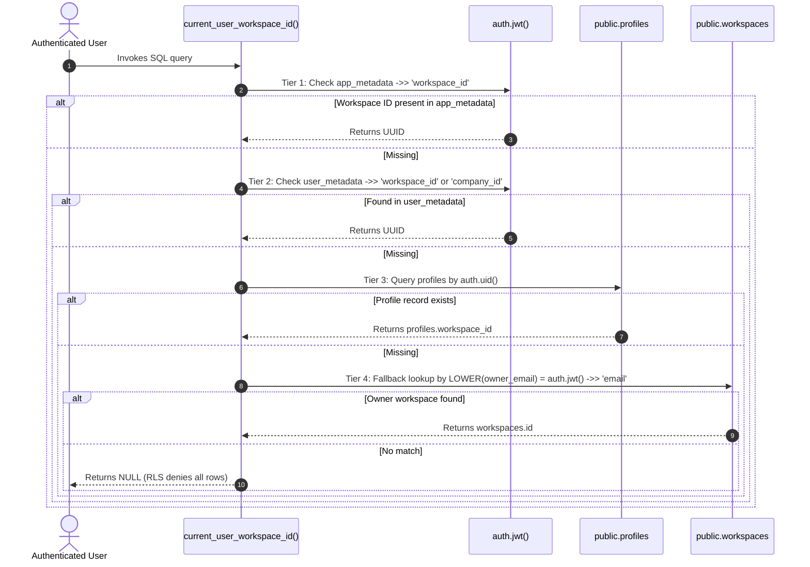
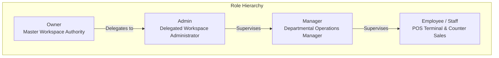
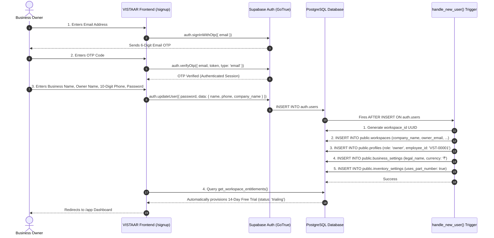
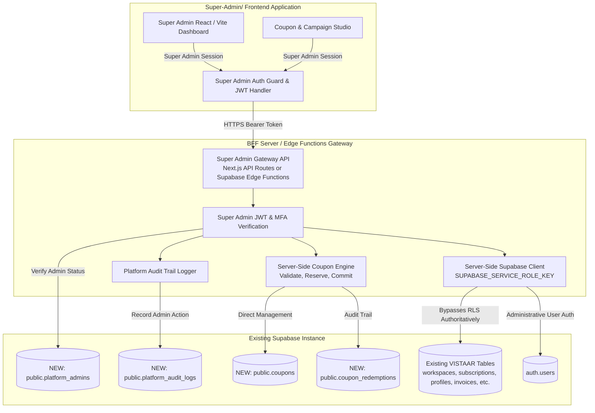
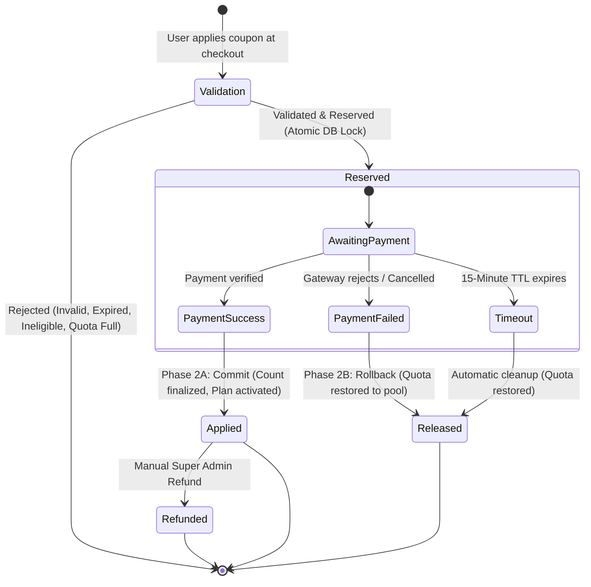

# VISTAAR Super Admin — Technical Architecture Inspection Report
## Including Core Coupon & Promotional Campaign Management Architecture

**Project Target:** VISTAAR Super Admin Control Plane (`Super-Admin/`)  
**Target Platform Inspected:** VISTAAR Business OS (`Vistaar/` / `vistaar-main/`)  
**Database Infrastructure:** Supabase PostgreSQL 15+ (Production Instance: `https://kluxsykimnjivkqxelba.supabase.co`)  
**Inspection Type:** Non-Destructive Deep Architecture Audit  
**Date of Inspection:** November 2026  
**Status:** Audit Complete — Ready for Architecture Review  

---

## Executive Summary

This architecture inspection report provides an exhaustive, authoritative blueprint of the existing **VISTAAR Business OS** codebase, database schema, multi-tenant isolation model, authentication mechanisms, subscription models, backend functions, and the **Coupon & Promotional Campaign Management Module**.

The objective of this inspection is to lay the complete architectural foundation for building **VISTAAR Super Admin**—a completely independent, secure platform administration control plane—**without modifying, renaming, duplicating, or endangering the existing production VISTAAR application or database tables**.

### Key Architectural Findings

1. **Mature Multi-Tenant Core:** The database employs a normalized, single-database shared-schema architecture partitioned across 76 evolutionary migrations. Tenant isolation is anchored on `workspace_id UUID` enforced via Row-Level Security (RLS) policies using the authoritative database function `public.current_user_workspace_id()`.
2. **Dual-Tier Multi-Branch Organization Hierarchy:** In migration `058`, an enterprise layer was introduced (`public.organizations` and `public.workspace_memberships`), allowing parent organizations to own multiple operating workspaces (branches) while preserving per-workspace transactional isolation.
3. **Absence of Platform Super Admin Role:** The existing database user roles (`public.user_role`) are strictly tenant-scoped: `'owner'`, `'admin'`, `'manager'`, `'employee'`, and `'staff'`. Even the `'owner'` role is confined strictly to their own business workspace. **There is currently zero concept, table, or role for platform-wide Super Administration.**
4. **Subscription Framework Already Implemented:** Migration `070` established canonical subscription plans (`subscription_plans`), workspace subscriptions (`workspace_subscriptions`), add-ons (`subscription_addons`), payment audit records (`payment_transactions`), and an authoritative entitlement RPC (`get_workspace_entitlements()`).
5. **Strict RLS Lock on Client Plan Elevation:** Under migration `070`, `workspace_subscriptions` has an RLS policy `FOR ALL USING (false)` for clients, meaning plan modifications can only be enacted via server-side service-role operations or security definer RPCs.
6. **No Pre-existing Coupon or Recurring Discount Infrastructure:** The existing billing schema only supports static canonical pricing. Neither coupons nor recurring discounts exist in the database or client checkout service.
7. **Additive Coupon Architecture Defined:** A complete, two-phase reservation and settlement coupon architecture (`public.coupons`, `public.coupon_redemptions`) can be safely introduced via an additive migration without breaking any existing table, query, or subscription flow.
8. **Integration Imperative:** The Super Admin application **must never** expose the Supabase `SUPABASE_SERVICE_ROLE_KEY` in frontend client code. It requires a dedicated, secure backend gateway (BFF or Edge Functions) with authenticated administrative claims to manage platform-wide business tenants, subscriptions, coupons, and system health.

---

## 1. Technology Stack & Application Architecture

### 1.1 Existing VISTAAR Client Architecture

VISTAAR Business OS is engineered as an offline-first, high-performance, multi-platform application supporting three distinct runtime environments from a unified TypeScript/React codebase:

```mermaid
graph TD
    subgraph Client Application Layer [Unified TypeScript / React 19 Frontend]
        Web[Web PWA / Browser]
        Desktop[Windows Desktop via Tauri v2.12]
        Mobile[Android / iOS via Capacitor v8.5]
    end

    subgraph Client Services & State [Core Frontend Services]
        Store[Reactive AppState Store\nsrc/services/store.ts]
        SafeStorage[Tenant-Scoped SafeStorage\nsrc/services/supabase/safeStorage.ts]
        AuthService[Supabase Auth Service\nsrc/services/supabaseAuth.ts]
        SubService[Subscription & Entitlements\nsrc/services/subscriptionService.ts]
        PlatformDetect[Platform Detection Engine\nsrc/platform/platformDetection.ts]
    end

    subgraph Backend Services [Supabase BaaS + Vercel Serverless]
        GoTrue[Supabase Auth / GoTrue]
        Postgres[(Supabase PostgreSQL 15+\n76 Migrations + RLS)]
        EdgeFunc[Supabase Edge Functions\ncreate-employee]
        VercelAPI[Vercel Serverless API\napi/create-employee\napi/repair-employee\napi/resolve-employee-id]
        StorageBuckets[Supabase Storage\navatars, business-assets,\nproduct-media, documents]
    end

    Client Application Layer --> Client Services & State
    Client Services & State -->|Anon / PKCE JWT| GoTrue
    Client Services & State -->|RLS-Scoped REST / RPC| Postgres
    Client Services & State -->|REST Uploads| StorageBuckets
    Client Services & State -->|Authorized HTTPS POST| EdgeFunc
    Client Services & State -->|Authorized HTTPS POST| VercelAPI
```

### 1.2 Core Dependencies & Frameworks

| Layer | Technology | Version | Purpose / Architectural Role |
| :--- | :--- | :--- | :--- |
| **Runtime / UI** | React | `^19.2.8` | Component rendering with React 19 hooks and transitions |
| **Language** | TypeScript | `~6.0.2` | Strict compile-time typing across all data layers |
| **Bundler** | Vite | `^8.2.0` | Ultra-fast build tool with manual chunk optimization |
| **CSS Engine** | Tailwind CSS | `^4.3.3` | Utility-first styling with `@tailwindcss/vite` |
| **Desktop Wrapper** | Tauri | `^2.12.1` | Native Windows executable with Rust OS integration |
| **Mobile Wrapper** | Capacitor | `^8.5.2` | Native Android APK & iOS IPA wrappers |
| **BaaS Client** | `@supabase/supabase-js` | `^2.112.4` | Client-side PostgreSQL interface and PKCE auth |
| **PDF Generation** | `jspdf` + `jspdf-autotable` | `^4.2.1` / `^5.0.8` | Client-side GST invoice and thermal receipt rendering |
| **DOM to Canvas** | `html2canvas-pro` | `^2.5.2` | High-fidelity print document snapshots |
| **Data Export** | `xlsx` | `^0.18.5` | Excel workbook generation for Daybook/Stock reports |
| **Charts** | `recharts` | `^3.10.1` | Financial analytics and sales trend visualization |
| **Icons** | `lucide-react` | `^1.33.0` | Standard iconography |

---

## 2. Supabase Configuration & Environment Variables

### 2.1 Project Identification

- **Supabase Project URL:** `https://kluxsykimnjivkqxelba.supabase.co`
- **Default Publishable Anon Key:** `sb_publishable_j5tuLPC3iQO4pQHU0BeyYQ_CH_7Ls6x` (or JWT anon key format)
- **Local Fallback File:** `vistaar-main/.env.local`

### 2.2 Environment Variable Mapping Matrix

| Variable Name | Exposure Scope | Required In | Security Level | Purpose |
| :--- | :--- | :--- | :--- | :--- |
| `VITE_SUPABASE_URL` | Client (Public) | VISTAAR & Super Admin | Public | Supabase API Gateway URL |
| `VITE_SUPABASE_PUBLISHABLE_KEY` | Client (Public) | VISTAAR & Super Admin | Public (RLS Enforced) | Supabase client anon key |
| `VITE_SUPABASE_ANON_KEY` | Client (Public) | VISTAAR (Fallback) | Public (RLS Enforced) | Alias for backward compatibility |
| `SUPABASE_SERVICE_ROLE_KEY` | **Backend Server Only** | Edge Functions / BFF / Vercel | **CRITICAL / CONFIDENTIAL** | Bypasses all RLS policies; administrative root |
| `SUPABASE_URL` | Backend Server | Vercel API / Server | Server | Node.js runtime fallback for `VITE_SUPABASE_URL` |
| `VITE_EWB_ENV` | Client (Public) | VISTAAR | Public | E-Way Bill mode (`SANDBOX` vs `PRODUCTION`) |
| `WHATSAPP_TOKEN` | Backend Server | Vite Scheduler / Vercel | Sensitive | WhatsApp Cloud API token for follow-up reminders |
| `WHATSAPP_PHONE_NUMBER_ID`| Backend Server | Vite Scheduler / Vercel | Sensitive | WhatsApp Business Phone ID |

### 2.3 Vite Build & Runtime Inlining Rules

- **Prefix Requirement:** Vite only exposes variables prefixed with `VITE_` via static string replacement (`import.meta.env.VITE_*`).
- **Service Role Key Security Mandate:** The `SUPABASE_SERVICE_ROLE_KEY` **must never** have a `VITE_` prefix and **must never** appear in any client-facing source code. If exposed in a client build bundle, anyone with browser DevTools can obtain unconditional, unlogged, read-write-delete control over the entire multi-tenant database.

---

## 3. Database Schema Overview & Entity Relationships

The VISTAAR database consists of **35+ core relational tables** spanning master data, inventory, transactions, accounting ledgers, multi-branch operations, subscriptions, and auditing.

### 3.1 Complete Table Inventory

```
+----------------------------------------------------------------------------------------------------+
|                                    VISTAAR DATABASE TABLES                                         |
+------------------------------+-------------------------------+-------------------------------------+
| CORE & MULTI-TENANCY         | INVENTORY & STOCK             | FINANCIALS & ACCOUNTING             |
| - workspaces                 | - products                    | - payments                          |
| - organizations              | - categories                  | - udhari_records                    |
| - workspace_memberships      | - suppliers                   | - udhari_payments                   |
| - profiles                   | - stock_receipts (FIFO)       | - expenses                          |
| - business_settings          | - stock_movements (Immutable) | - financial_accounts                |
| - inventory_settings         | - import_sessions             | - daybook_transactions              |
| - idempotency_keys           |                               | - cashbook_entries                  |
+------------------------------+-------------------------------+-------------------------------------+
| MULTI-BRANCH OPERATIONS      | SALES & BILLING               | HR & PAYROLL                        |
| - branches                   | - counter_sales               | - salary_structures                 |
| - user_branch_access         | - counter_sale_items          | - salary_payments                   |
| - branch_inventory           | - quotations                  | - salary_payment_items              |
| - stock_transfers            | - quotation_items             |                                     |
| - stock_transfer_items       | - invoices                    |                                     |
|                              | - invoice_items               |                                     |
+------------------------------+-------------------------------+-------------------------------------+
| SUBSCRIPTIONS & COMMERCIAL   | LOGISTICS & CATALOGUES        | AUDITING & SYSTEM HEALTH            |
| - subscription_plans         | - eway_bills                  | - security_audit_logs               |
| - workspace_subscriptions    | - eway_bill_items             | - inventory_audit_logs              |
| - subscription_addons        | - eway_bill_events            | - financial_audit_logs              |
| - payment_transactions       | - transporters                | - backups                           |
|                              | - vehicles                    | - follow_ups                        |
|                              | - business_locations          | - notifications                     |
|                              | - purchase_orders             | - feedbacks                         |
|                              | - purchase_order_items        | - offers                            |
|                              | - supplier_catalogues         | - id_mappings                       |
+------------------------------+-------------------------------+-------------------------------------+
```

### 3.2 Schema Specifications & Primary/Foreign Keys

#### A. Core Multi-Tenancy & Identity

| Table Name | Primary Key | Foreign Keys & References | Unique Constraints | Critical Columns |
| :--- | :--- | :--- | :--- | :--- |
| `public.workspaces` | `id` (UUID) | `organization_id` &rarr; `organizations(id)` | `UNIQUE(owner_email)` | `company_name`, `owner_name`, `owner_email`, `owner_phone`, `branch_name`, `branch_code`, `is_main_branch`, `is_active`, `branch_password_hash` |
| `public.organizations` | `id` (UUID) | `owner_user_id` &rarr; `auth.users(id)` | — | `name`, `owner_user_id`, `created_at`, `updated_at` |
| `public.profiles` | `id` (UUID) | `id` &rarr; `auth.users(id)`<br>`workspace_id` &rarr; `workspaces(id)` | `UNIQUE(workspace_id, employee_id)` | `employee_id`, `name`, `email`, `phone`, `role` (`user_role`), `status` (`employee_status`), `must_change_password`, `avatar_url` |
| `public.workspace_memberships`| `id` (UUID) | `workspace_id` &rarr; `workspaces(id)`<br>`user_id` &rarr; `auth.users(id)` | `UNIQUE(user_id, workspace_id)` | `role`, `status`, `created_at` |
| `public.business_settings` | `workspace_id` (UUID) | `workspace_id` &rarr; `workspaces(id)` | PK is FK | `legal_name`, `business_type`, `gstin`, `pan`, `address`, `city`, `state`, `pincode`, `bank_details` (JSONB), `invoice_prefix`, `brand_color`, `theme` |
| `public.inventory_settings` | `workspace_id` (UUID) | `workspace_id` &rarr; `workspaces(id)` | PK is FK | `uses_part_number`, `created_at` |

#### B. Master Catalog & Inventory Management

| Table Name | Primary Key | Foreign Keys & References | Unique Constraints | Critical Columns |
| :--- | :--- | :--- | :--- | :--- |
| `public.categories` | `id` (UUID) | `workspace_id` &rarr; `workspaces(id)` | `UNIQUE(workspace_id, name)` | `name`, `description` |
| `public.suppliers` | `id` (UUID) | `workspace_id` &rarr; `workspaces(id)` | — | `name`, `contact_person`, `phone`, `email`, `address` |
| `public.customers` | `id` (UUID) | `workspace_id` &rarr; `workspaces(id)` | — | `name`, `phone`, `whatsapp`, `email`, `gstin`, `customer_type`, `credit_limit`, `payment_terms` |
| `public.products` | `id` (UUID) | `workspace_id` &rarr; `workspaces(id)`<br>`category_id` &rarr; `categories(id)`<br>`supplier_id` &rarr; `suppliers(id)` | `UNIQUE(workspace_id, sku)` | `name`, `sku`, `part_number`, `buy_price`, `selling_price`, `minimum_stock`, `tax_percent`, `hsn_sac`, `active`, `current_stock` |
| `public.stock_receipts` | `id` (UUID) | `workspace_id` &rarr; `workspaces(id)`<br>`product_id` &rarr; `products(id)`<br>`supplier_id` &rarr; `suppliers(id)` | — | `receipt_number`, `received_date`, `quantity_received`, `quantity_remaining` (FIFO ledger), `buy_price` |
| `public.stock_movements` | `id` (UUID) | `workspace_id` &rarr; `workspaces(id)`<br>`product_id` &rarr; `products(id)`<br>`created_by` &rarr; `profiles(id)` | — | `type` (`stock_movement_type`), `quantity`, `movement_date`, `reference_id`, `reference_type` (IMMUTABLE table) |

#### C. Multi-Branch Operations

| Table Name | Primary Key | Foreign Keys & References | Unique Constraints | Critical Columns |
| :--- | :--- | :--- | :--- | :--- |
| `public.branches` | `id` (UUID) | `workspace_id` &rarr; `workspaces(id)` | `UNIQUE(workspace_id, branch_code)` | `branch_code`, `branch_name`, `address`, `phone`, `is_default`, `status`, `access_pin`, `branch_password_hash` |
| `public.user_branch_access` | `id` (UUID) | `workspace_id` &rarr; `workspaces(id)`<br>`user_id` &rarr; `auth.users(id)`<br>`branch_id` &rarr; `branches(id)` | `UNIQUE(user_id, branch_id)` | `role`, `granted_at` |
| `public.branch_inventory` | `id` (UUID) | `workspace_id` &rarr; `workspaces(id)`<br>`branch_id` &rarr; `branches(id)`<br>`product_id` &rarr; `products(id)` | `UNIQUE(workspace_id, branch_id, product_id)` | `current_stock`, `minimum_stock` |
| `public.stock_transfers` | `id` (UUID) | `workspace_id` &rarr; `workspaces(id)`<br>`from_branch_id` &rarr; `branches(id)`<br>`to_branch_id` &rarr; `branches(id)` | — | `transfer_number`, `status` (`DRAFT`, `DISPATCHED`, `RECEIVED`, `CANCELLED`), `dispatched_at`, `received_at` |
| `public.stock_transfer_items`| `id` (UUID) | `workspace_id` &rarr; `workspaces(id)`<br>`transfer_id` &rarr; `stock_transfers(id)`<br>`product_id` &rarr; `products(id)` | — | `quantity` |

#### D. Sales, Billing & Commercial

| Table Name | Primary Key | Foreign Keys & References | Unique Constraints | Critical Columns |
| :--- | :--- | :--- | :--- | :--- |
| `public.invoices` | `id` (UUID) | `workspace_id` &rarr; `workspaces(id)`<br>`customer_id` &rarr; `customers(id)`<br>`quotation_id` &rarr; `quotations(id)` | `UNIQUE(workspace_id, invoice_number)` | `invoice_number`, `date`, `due_date`, `subtotal`, `tax_total`, `grand_total`, `paid_amount`, `balance_amount`, `status` (`invoice_status`) |
| `public.invoice_items` | `id` (UUID) | `workspace_id` &rarr; `workspaces(id)`<br>`invoice_id` &rarr; `invoices(id)`<br>`product_id` &rarr; `products(id)` | — | `product_name`, `sku`, `quantity`, `buy_price`, `selling_price`, `discount_amount`, `tax_percent`, `tax_amount`, `total` |
| `public.counter_sales` | `id` (UUID) | `workspace_id` &rarr; `workspaces(id)`<br>`customer_id` &rarr; `customers(id)` | `UNIQUE(workspace_id, sale_number)` | `sale_number`, `customer_name`, `sale_date`, `subtotal`, `final_total`, `status` (`counter_sale_status`) |
| `public.counter_sale_items` | `id` (UUID) | `workspace_id` &rarr; `workspaces(id)`<br>`counter_sale_id` &rarr; `counter_sales(id)`<br>`product_id` &rarr; `products(id)` | — | `product_name_snapshot`, `quantity`, `rate`, `amount`, `buy_price_snapshot` |
| `public.quotations` | `id` (UUID) | `workspace_id` &rarr; `workspaces(id)`<br>`customer_id` &rarr; `customers(id)` | `UNIQUE(workspace_id, quotation_number)` | `quotation_number`, `status` (`quotation_status`), `valid_until`, `grand_total`, `converted_invoice_id` |
| `public.quotation_items` | `id` (UUID) | `workspace_id` &rarr; `workspaces(id)`<br>`quotation_id` &rarr; `quotations(id)`<br>`product_id` &rarr; `products(id)` | — | `product_name`, `sku`, `quantity`, `selling_price`, `total` |

#### E. Financial Ledger & Cash Management

| Table Name | Primary Key | Foreign Keys & References | Unique Constraints | Critical Columns |
| :--- | :--- | :--- | :--- | :--- |
| `public.payments` | `id` (UUID) | `workspace_id` &rarr; `workspaces(id)`<br>`customer_id` &rarr; `customers(id)`<br>`invoice_id` &rarr; `invoices(id)` | `UNIQUE(workspace_id, payment_number)` | `payment_number`, `amount`, `payment_date`, `method` (`payment_method`), `reference_no` |
| `public.udhari_records` | `id` (UUID) | `workspace_id` &rarr; `workspaces(id)`<br>`customer_id` &rarr; `customers(id)` | `UNIQUE(workspace_id, udhari_code)` | `udhari_code`, `original_amount`, `total_received`, `outstanding_amount`, `due_date`, `status` (`udhari_status`) |
| `public.udhari_payments` | `id` (UUID) | `workspace_id` &rarr; `workspaces(id)`<br>`udhari_id` &rarr; `udhari_records(id)` | `UNIQUE(workspace_id, payment_code)` | `payment_code`, `amount`, `payment_method`, `payment_date` |
| `public.expenses` | `id` (UUID) | `workspace_id` &rarr; `workspaces(id)` | — | `category` (`expense_category`), `expense_name`, `amount`, `expense_date`, `paid_to` |
| `public.financial_accounts` | `id` (UUID) | `workspace_id` &rarr; `workspaces(id)` | — | `account_name`, `account_type`, `account_number`, `current_balance`, `is_default`, `is_active` |
| `public.daybook_transactions`| `id` (UUID) | `workspace_id` &rarr; `workspaces(id)`<br>`account_id` &rarr; `financial_accounts(id)` | — | `transaction_date`, `voucher_type`, `voucher_number`, `inflow`, `outflow`, `amount`, `payment_mode` |
| `public.cashbook_entries` | `id` (UUID) | `workspace_id` &rarr; `workspaces(id)`<br>`account_id` &rarr; `financial_accounts(id)` | — | `entry_date`, `entry_type` (`INFLOW`/`OUTFLOW`), `category`, `amount`, `payment_mode`, `reference_type`, `reference_id` |

#### F. Subscriptions & Commercial Data (Migration 070)

| Table Name | Primary Key | Foreign Keys & References | Unique Constraints | Critical Columns |
| :--- | :--- | :--- | :--- | :--- |
| `public.subscription_plans` | `id` (TEXT) | — | PK is TEXT ID | `name`, `tagline`, `price_annual_inr`, `price_monthly_inr`, `allowed_platforms` (TEXT[]), `max_users`, `max_branches` |
| `public.workspace_subscriptions` | `id` (UUID) | `workspace_id` &rarr; `workspaces(id)`<br>`plan_id` &rarr; `subscription_plans(id)` | `UNIQUE(workspace_id)` | `status` (`trialing`, `active`, `payment_pending`, `past_due`, `cancelled`, `expired`), `trial_start`, `trial_end`, `current_period_start`, `current_period_end`, `billing_interval`, `cancel_at_period_end` |
| `public.subscription_addons` | `id` (UUID) | `workspace_id` &rarr; `workspaces(id)` | `UNIQUE(workspace_id, addon_key)` | `addon_key`, `status` (`active`, `cancelled`, `expired`), `valid_until` |
| `public.payment_transactions` | `id` (UUID) | `workspace_id` &rarr; `workspaces(id)`<br>`plan_id` &rarr; `subscription_plans(id)` | `UNIQUE(transaction_reference)` | `transaction_reference`, `provider` (`youpi_pg`), `amount_inr`, `currency`, `addon_key`, `status` (`initiated`, `pending`, `verified_success`, `failed`, `refunded`), `provider_payload`, `verified_at` |

---

## 4. Tenant Isolation Architecture

### 4.1 Single-Database Shared-Schema Multi-Tenancy

Every transactional table in the VISTAAR database contains a mandatory discriminator column: `workspace_id UUID NOT NULL REFERENCES public.workspaces(id) ON DELETE CASCADE`.

### 4.2 Row-Level Security (RLS) Mechanics

Every business table enforces RLS via standard policies:

```sql
-- Standard tenant isolation pattern applied to all domain tables
CREATE POLICY "Workspace isolation SELECT for products" ON public.products
    FOR SELECT USING (workspace_id = public.current_user_workspace_id());

CREATE POLICY "Workspace isolation INSERT for products" ON public.products
    FOR INSERT WITH CHECK (workspace_id = public.current_user_workspace_id());

CREATE POLICY "Workspace isolation UPDATE for products" ON public.products
    FOR UPDATE USING (workspace_id = public.current_user_workspace_id());

CREATE POLICY "Workspace isolation DELETE for products" ON public.products
    FOR DELETE USING (workspace_id = public.current_user_workspace_id());
```

### 4.3 Deep Dive: Authoritative Workspace Resolution (`current_user_workspace_id()`)

The authoritative PostgreSQL function `public.current_user_workspace_id()` resolves the calling user's tenant identity through a strict 5-tier fallback cascade (optimized in Migration `075`):



### 4.4 Enterprise Multi-Branch Organization Resolution (`user_has_workspace_access`)

Migration `058` enhanced isolation for multi-branch organizations with `public.user_has_workspace_access(p_workspace_id UUID)`:
1. Returns `TRUE` if user's direct profile has `workspace_id = p_workspace_id`.
2. Returns `TRUE` if user has an active record in `public.workspace_memberships` for `p_workspace_id`.
3. Returns `TRUE` if user is the `owner_user_id` of the parent `public.organizations` that owns `p_workspace_id`.
4. Returns `TRUE` if user holds `owner` or `admin` role in any workspace under the same organization.
5. Returns `FALSE` otherwise.

### 4.5 Client-Side Storage Isolation (`safeStorage.ts`)

In addition to database RLS, VISTAAR implements local storage tenant partitioning. In `src/services/supabase/safeStorage.ts`, all keys are prefixed with the current workspace ID:
- `safeGetTenantItem(key)` &rarr; reads `vst_{workspaceId}_{key}`
- `safeSaveTenantItem(key, data)` &rarr; writes `vst_{workspaceId}_{key}`

This prevents cross-tenant contamination when multiple users from different businesses access VISTAAR on the same physical desktop terminal or browser.

---

## 5. Authentication & Authorization Architecture

### 5.1 Identity & Authentication Provider

- **Engine:** Supabase Auth (GoTrue).
- **Authentication Modes:**
  1. **Standard Email & Password:** Used primarily by Workspace Owners.
  2. **Email Verification Code (OTP):** Used during new business onboarding (`auth.signInWithOtp` / `auth.verifyOtp`).
  3. **Custom Employee ID Login:** Staff enter their alphanumeric ID (e.g., `VST-EMP-001`). The backend resolves the ID to the employee's registered email via `/api/resolve-employee-id` or database RPC `get_email_by_employee_id`, then authenticates via password against Supabase Auth.

### 5.2 Role Definitions & Role-Permission Matrix

The PostgreSQL enum `public.user_role` defines five roles: `'owner'`, `'admin'`, `'manager'`, `'employee'`, and `'staff'`.



| Permission Category | Specific Permission | Owner | Admin | Manager | Employee / Staff |
| :--- | :--- | :---: | :---: | :---: | :---: |
| **Dashboard** | `dashboard.view` | :white_check_mark: | :white_check_mark: | :white_check_mark: | :white_check_mark: |
| **Inventory** | `inventory.view` / `receive_stock` | :white_check_mark: | :white_check_mark: | :white_check_mark: | :white_check_mark: |
| | `inventory.create_product` / `edit_metadata` | :white_check_mark: | :white_check_mark: | :white_check_mark: | :white_check_mark: |
| | `inventory.edit_quantity` / `adjust_stock` | :white_check_mark: | :x: | :x: | :x: |
| | `inventory.delete_product` / `delete_movement` | :white_check_mark: | :x: | :x: | :x: |
| **Sales & Billing**| `sales.create_invoice` / `create_counter_sale`| :white_check_mark: | :white_check_mark: | :white_check_mark: | :white_check_mark: |
| | `quotation.create` / `quotation.view` | :white_check_mark: | :white_check_mark: | :white_check_mark: | :white_check_mark: |
| | `customers.manage` / `suppliers.manage` | :white_check_mark: | :white_check_mark: | :white_check_mark: | :white_check_mark: |
| **Executive Finance**| `analytics.view` / `financial_statements.view`| :white_check_mark: | :x: | :x: | :x: |
| **Settings** | `business_info.view` / `business_info.edit` | :white_check_mark: | :x: | :x: | :x: |
| | `settings.bank.edit` / `branding.logo.edit` | :white_check_mark: | :white_check_mark: | :x: | :x: |
| **Staff & Payroll**| `employees.view` | :white_check_mark: | :white_check_mark: | :x: | :x: |
| | `employees.manage` / `create_login_account` | :white_check_mark: | :x: | :x: | :x: |
| | `payroll.view` / `payroll.manage_records` | :white_check_mark: | :white_check_mark: | :white_check_mark: | :white_check_mark: |
| **Multi-Branch** | `branches.view` | :white_check_mark: | :white_check_mark: | :white_check_mark: | :white_check_mark: |
| | `branches.manage` (Create branches) | :white_check_mark: | :white_check_mark: | :x: | :x: |
| | `branches.switch` | :white_check_mark: | :white_check_mark: | :white_check_mark: | :x: |

### 5.3 Database-Enforced RBAC Triggers

Security does not rely solely on frontend code. In Migration `046`, database triggers enforce permissions at the PostgreSQL engine level:
- **`enforce_product_stock_integrity()` Trigger:** Intercepts `BEFORE UPDATE` on `public.products`. If `current_stock` is modified by anyone other than the authenticated `owner` or outside a trusted server RPC (`vistaar.trusted_stock_call`), PostgreSQL raises `STOCK_MUTATION_DENIED` and aborts the transaction.
- **`owner_adjust_stock` RPC:** High-privilege security definer function allowing manual stock audits only after verifying `public.is_workspace_owner() = TRUE`.

---

## 6. Available Business & Subscription Data

### 6.1 Canonical Subscription Plans (`subscription_plans`)

Migration `070` defines the canonical subscription plans:

| Plan ID | Plan Display Name | Tagline | Annual Price (INR) | Monthly Price (INR) | Allowed Platforms | User Limit | Branch Limit |
| :--- | :--- | :--- | :---: | :---: | :--- | :---: | :---: |
| `free_trial` | 14-Day Free Trial | Full evaluation on all platforms | ₹0 | ₹0 | `['web', 'desktop', 'android']` | 2 | 1 |
| `starter` | Starter | Cloud web for single-terminal retail | ₹2,499 | ₹299 | `['web']` | 1 | 1 |
| `starter_mobile`| Starter + Mobile Add-on | Web counter + native Android APK | ₹4,498 | ₹498 | `['web', 'android']` | 2 | 1 |
| `business` | Business | Windows Desktop POS + multi-branch | ₹5,999 | ₹699 | `['web', 'desktop']` | 5 | 3 |
| `growth` | Growth | Enterprise all-platform system | ₹9,999 | ₹1,199 | `['web', 'desktop', 'android']` | Unlimited (0) | Unlimited (0) |

### 6.2 Subscription Lifecycle States (`workspace_subscriptions`)

- **`status` Enum Values:**
  - `trialing`: 14 days active evaluation from workspace creation.
  - `active`: Valid paid subscription period.
  - `payment_pending`: Checkout initiated, awaiting payment confirmation.
  - `past_due`: Grace period following failed recurring billing.
  - `cancelled`: Cancelled by user, active until period end.
  - `expired`: Trial or billing period terminated; platform locks into renewal-only mode.
- **Available Commercial Columns:**
  - `trial_start`, `trial_end`
  - `current_period_start`, `current_period_end`
  - `billing_interval` (`'annual'` | `'monthly'` | `'trial'`)
  - `cancel_at_period_end` (`BOOLEAN`)

### 6.3 Add-Ons & Platform Matrix (`subscription_addons`)

- **Add-on Key:** `mobile_pos_addon` (enables Android APK access when attached to `starter` plan).
- **Columns:** `workspace_id`, `addon_key`, `status` (`'active'`, `'cancelled'`, `'expired'`), `valid_until`.

### 6.4 Authoritative Entitlement RPC (`get_workspace_entitlements`)

An authoritative PostgreSQL RPC `public.get_workspace_entitlements(target_workspace_id UUID)` evaluates:
1. Workspace subscription status and expiration timestamps.
2. Trial remaining days (`GREATEST(0, EXTRACT(DAY FROM (trial_end - NOW())))`).
3. Active add-ons for the workspace.
4. Returns computed JSON:
   ```json
   {
     "workspace_id": "...",
     "plan_id": "business",
     "plan_name": "Business",
     "status": "active",
     "is_valid": true,
     "trial_remaining_days": 0,
     "trial_end": "...",
     "current_period_end": "...",
     "billing_interval": "annual",
     "cancel_at_period_end": false,
     "allowed_platforms": ["web", "desktop"],
     "active_addons": [],
     "max_users": 5,
     "max_branches": 3
   }
   ```

### 6.5 Payment Transactions Table (`payment_transactions`)

Audit log for all customer billing events:
- `transaction_reference`: Unique merchant transaction string (`VST-...`).
- `provider`: Gateway provider (`'youpi_pg'`).
- `amount_inr`, `currency`: Transaction value (strictly non-test rates).
- `plan_id`, `addon_key`: Commercial item purchased.
- `status`: `'initiated'`, `'pending'`, `'verified_success'`, `'failed'`, `'refunded'`.
- `provider_payload`: JSONB storage for gateway payloads, webhooks, and tokens.
- `verified_at`: Timestamp of server-side cryptographic verification.

---

## 7. Existing Backend APIs, Edge Functions & Server Logic

### 7.1 Supabase Edge Functions (`supabase/functions/`)

- **`create-employee` (`supabase/functions/create-employee/index.ts`):**
  - **Runtime:** Supabase Edge Runtime (Deno).
  - **Auth Enforcement:** Inspects incoming `Authorization` Bearer token, validates caller profile `role = 'owner'` and `status = 'Active'`.
  - **Execution:** Uses `SUPABASE_SERVICE_ROLE_KEY` to invoke `supabaseAdmin.auth.admin.createUser`, creates a verified Supabase Auth user, assigns a generated 14-character password satisfying security policies, and inserts a linked `public.profiles` row.

### 7.2 Vercel Serverless Functions (`api/`)

- **`/api/create-employee.ts`:** Node.js Vercel serverless function mirroring employee provisioning with fallback to caller-scoped RPC `create_employee_account`.
- **`/api/repair-employee.ts`:** Administrative repair function to re-link orphaned `profiles` records with `auth.users`.
- **`/api/resolve-employee-id.ts`:** Public/service endpoint that maps human-readable Employee IDs (e.g., `VST-EMP-001`) to user emails during login flow.

### 7.3 Core Database Stored Procedures & RPCs

| RPC Name | Security Definer | Purpose & Impact |
| :--- | :---: | :--- |
| `finalize_invoice_transaction(JSONB)` | Yes | **Atomic Invoice Settlement:** Deducts branch stock, creates invoice & line items, records payments, creates Daybook & Cashbook journal vouchers, logs idempotency key. |
| `finalize_counter_sale(JSONB)` | Yes | **Atomic POS Counter Sale:** Decrements stock receipt batches (FIFO), generates POS invoice, records Daybook & Cashbook inflows. |
| `owner_adjust_stock(...)` | Yes | Owner-only inventory adjustment with comprehensive audit logging in `inventory_audit_logs`. |
| `get_workspace_entitlements(UUID)` | Yes | Evaluates subscription status, expiry dates, add-ons, and allowed device platforms. |
| `get_organization_analytics(UUID)` | Yes | Computes consolidated cross-branch sales, top products, and revenue for multi-branch organizations. |
| `create_employee_account(...)` | Yes | Database-level employee provisioning function. |
| `generate_next_employee_id(UUID)` | Yes | Generates next sequential employee code (`VST-EMP-001`, `VST-EMP-002`). |

---

## 8. Existing Business Registration & Onboarding Flow



---

## 9. Missing Components Required for Platform Administration

The existing architecture was designed entirely for **tenant-level** operations. A platform administrator has **no infrastructure or access pathways** in the current schema. The following components are missing:

```
+-------------------------------------------------------------------------------------------------------+
|                               MISSING PLATFORM ADMINISTRATION INFRASTRUCTURE                          |
+------------------------------------+------------------------------------+-----------------------------+
| 1. IDENTITY & RBAC                 | 2. CROSS-TENANT DATA ACCESS        | 3. TENANT LIFECYCLE CONTROL |
| - No 'super_admin' in user_role    | - RLS blocks cross-tenant queries  | - No tenant suspension RPC  |
| - No platform_admins table         | - No cross-tenant metrics RPC      | - No tenant deletion/purge  |
| - No Super Admin MFA enforcement   | - No global MRR/ARR aggregations   | - No data export for audit  |
+------------------------------------+------------------------------------+-----------------------------+
| 4. SUBSCRIPTION GOVERNANCE         | 5. GLOBAL USER DIRECTORY           | 6. SYSTEM HEALTH & AUDIT    |
| - No manual plan override RPC      | - No cross-workspace user search   | - No global error telemetry |
| - No manual trial extension RPC    | - No platform password reset tool  | - No DB storage/table size  |
| - No coupon/discount code manager  | - No orphan profile cleanup tool   | - No backup verification UI |
+------------------------------------+------------------------------------+-----------------------------+
```

---

## 10. Recommended Secure Integration Architecture

### 10.1 Architecture Comparison

| Architecture Approach | Feasibility | Security Score | Evaluation & Trade-offs |
| :--- | :---: | :---: | :--- |
| **Option 1: Direct Service Role Key in Frontend** | :x: **REJECTED** | **0 / 10** | **Catastrophic Vulnerability:** Exposes the master database key to any user inspecting browser network traffic. Bypasses all security. |
| **Option 2: Elevate RLS via Client Claims** | :warning: **Partial** | **5 / 10** | Requires altering 35+ existing RLS policies to check for `is_super_admin` claim. High risk of introducing bugs or data leaks into existing production tenant policies. |
| **Option 3: Dedicated Super Admin BFF Gateway** | :white_check_mark: **RECOMMENDED** | **9.5 / 10** | Independent Next.js / Node.js Backend-For-Frontend (or Supabase Edge Functions) holding `SUPABASE_SERVICE_ROLE_KEY` server-side. Frontend authenticates via Super Admin JWT. Zero modification of existing VISTAAR tables. |

### 10.2 Recommended Target Architecture (Super Admin BFF Control Plane)



### 10.3 Required New Additive Database Entities (Zero Modification of Existing Schema)

To support Super Admin without altering any existing VISTAAR production tables, create two **isolated, additive tables**:

```sql
-- 1. Dedicated Platform Administrators Table (Zero impact on existing public.profiles)
CREATE TABLE IF NOT EXISTS public.platform_admins (
    id UUID PRIMARY KEY REFERENCES auth.users(id) ON DELETE CASCADE,
    email TEXT NOT NULL UNIQUE,
    full_name TEXT NOT NULL,
    role TEXT NOT NULL DEFAULT 'super_admin' CHECK (role IN ('super_admin', 'billing_admin', 'support_agent')),
    is_active BOOLEAN NOT NULL DEFAULT TRUE,
    last_login_at TIMESTAMPTZ,
    created_at TIMESTAMPTZ NOT NULL DEFAULT NOW(),
    updated_at TIMESTAMPTZ NOT NULL DEFAULT NOW()
);

-- Enable RLS: Locked down completely to prevent public or tenant access
ALTER TABLE public.platform_admins ENABLE ROW LEVEL SECURITY;
CREATE POLICY "Strict platform admin isolation" ON public.platform_admins
    FOR ALL USING (FALSE); -- Only accessible via service_role backend

-- 2. Dedicated Platform Audit Logs Table (Tracks all Super Admin administrative actions)
CREATE TABLE IF NOT EXISTS public.platform_audit_logs (
    id UUID PRIMARY KEY DEFAULT gen_random_uuid(),
    admin_id UUID REFERENCES public.platform_admins(id) ON DELETE SET NULL,
    admin_email TEXT NOT NULL,
    action TEXT NOT NULL, -- e.g., 'SUSPEND_WORKSPACE', 'OVERRIDE_SUBSCRIPTION', 'EXTEND_TRIAL'
    target_workspace_id UUID REFERENCES public.workspaces(id) ON DELETE SET NULL,
    target_user_id UUID,
    ip_address TEXT,
    user_agent TEXT,
    details JSONB NOT NULL DEFAULT '{}'::jsonb,
    created_at TIMESTAMPTZ NOT NULL DEFAULT NOW()
);

ALTER TABLE public.platform_audit_logs ENABLE ROW LEVEL SECURITY;
CREATE POLICY "Strict platform audit isolation" ON public.platform_audit_logs
    FOR ALL USING (FALSE); -- Only accessible via service_role backend
```

---

## 11. Coupon & Promotional Campaign Management Architecture

Coupon and Promotional Campaign Management is a core functional module of **VISTAAR Super Admin**. This section delivers the complete architectural design, lifecycle state machine, validation rules, financial integrity mechanisms, and database specifications.

### 11.1 Inspection of Existing Subscription, Pricing & Billing Infrastructure

A forensic review of the existing subscription engine (`070_subscription_plans_and_entitlements.sql` and `src/services/subscriptionPaymentService.ts`) reveals the following operational realities:

1. **Fixed Pricing Matrix:** Base prices are hardcoded in `subscription_plans` and `src/config/plans.ts` (e.g., Starter: ₹2,499/yr, Business: ₹5,999/yr, Growth: ₹9,999/yr).
2. **Client-Side Pricing Formulation:** Currently, `subscriptionPaymentService.initiatePlanCheckout` computes checkout amounts by summing canonical plan rates and add-on rates, then passing `amountInr` into `payment_transactions`.
3. **No Discount Columns in Schema:** Neither `workspace_subscriptions` nor `payment_transactions` has fields for storing applied discounts, promo codes, original gross amounts, or coupon identifiers.
4. **Renewal Handling:** VISTAAR does not currently execute automated card auto-debit renewals. Subscriptions expire when `NOW() > current_period_end`. Renewals are initiated on-demand by the workspace owner through checkout.
5. **Does the Existing Architecture Support Recurring Discounts?**
   - **NO.** The existing schema has zero concept of recurring discounts, coupon retention, or discounted renewal periods.
   - **Solution:** We introduce additive, non-breaking columns on `workspace_subscriptions` and `payment_transactions` to track active recurring discount rules without modifying existing table logic.

### 11.2 Core Capabilities & Specification Matrix

```
+---------------------------------------------------------------------------------------------------------+
|                                    COUPON MANAGEMENT SPECIFICATION                                      |
+------------------------------------+------------------------------------+-------------------------------+
| 1. CREATION & CONFIGURATION        | 2. ELIGIBILITY ENGINE              | 3. USAGE & RESTRICTION RULES  |
| - Custom alphanumeric codes        | - Plan-specific (or all)           | - Global max redemptions cap  |
| - Percentage discount (10%-100%)   | - Monthly vs Annual filter         | - Per-workspace limit (default 1)
| - Fixed discount (₹100, ₹1000)     | - New vs Existing customers only   | - Start date & Expiration date|
| - Max percentage discount cap (₹)  | - First subscription vs Renewals   | - Stacking policy (Forbidden) |
| - Flash sales / Limited-time offers| - Minimum order purchase threshold | - Instant kill-switch toggle  |
+------------------------------------+------------------------------------+-------------------------------+
| 4. RECURRING DISCOUNT RULES        | 5. FINANCIAL INTEGRITY             | 6. AUDIT & ANALYTICS          |
| - One-time discount ('once')       | - 100% Server-side calculation     | - Full redemption history log |
| - Repeating ('repeating', N months)| - Two-phase reserve & commit lock  | - Total discount granted (₹)  |
| - Lifetime discount ('forever')    | - Discount capped at invoice sum   | - Campaign revenue (GMV ₹)    |
| - Preserved on subscription record | - Distinct failed vs verified tx   | - Real-time conversion metrics|
+------------------------------------+------------------------------------+-------------------------------+
```

### 11.3 Two-Phase Reservation & Settlement State Machine

To prevent coupon code hoarding, race conditions during viral promotions, and false redemption counts on abandoned payments, redemptions use a **Two-Phase Commit Protocol**:



#### Detailed Phase Breakdown

1. **Phase 1: Validation & Reservation (`reserved`):**
   - The user inputs the coupon code during checkout.
   - The client invokes the secure endpoint (BFF API or database RPC `validate_and_reserve_coupon`).
   - The engine validates all constraints inside an atomic transaction.
   - If valid, a record in `public.coupon_redemptions` is inserted with status `'reserved'` and a 15-minute expiration timestamp (`reserved_until`).
   - The checkout payment order is created with the authoritatively calculated `discount_amount_inr` and `final_payable_inr`.
2. **Phase 2A: Verification & Commitment (`applied`):**
   - Upon payment verification (webhook or authoritative signature check), `commit_coupon_redemption` is invoked.
   - The redemption status updates from `'reserved'` to `'applied'`, linking the `transaction_reference`.
   - The global redemption count increments permanently.
   - If the coupon is marked as `'repeating'` or `'forever'`, the recurring discount metadata is written to `workspace_subscriptions`.
3. **Phase 2B: Release & Expiration (`failed` / `released`):**
   - If the user abandons payment or the transaction fails, the reservation is released.
   - The reserved slot is immediately returned to the coupon's available quota pool.

### 11.4 Security & Financial Integrity Enforcements

1. **Zero Client Trust:** The frontend client **never** transmits discounted amounts. The client transmits only `coupon_code`, `plan_id`, and `billing_interval`. The backend computes the discount against canonical database prices.
2. **Race Condition Prevention:** Global and per-workspace redemption limits are checked using `SELECT ... FOR UPDATE` row locks inside the reservation RPC. Two users attempting to claim the final available coupon redemption simultaneously cannot both succeed.
3. **Discount Floor & Cap Enforcement:**
   - A discount can never exceed the eligible plan purchase amount.
   - Formula: `final_payable = GREATEST(0, original_price - discount_amount)`.
   - Percentage discounts can specify a `max_discount_amount` cap (e.g., 50% discount capped at a maximum of ₹1,500).
4. **Anti-Stacking Enforcement:**
   - Coupons have an `allow_stacking BOOLEAN DEFAULT FALSE` property.
   - By default, only one coupon may be applied per checkout session. Coupons cannot be stacked with promotional trial extensions or secondary discount vouchers.

### 11.5 Additive Database Architecture (Migration 078)

The following migration script creates the complete Coupon and Promotional Campaign schema cleanly and additively:

```sql
-- =============================================================================
-- VISTAAR BUSINESS OS — MIGRATION 078
-- Module: Coupon & Promotional Campaign Management System
-- Description: Creates public.coupons, public.coupon_redemptions, adds non-breaking
--              discount fields to workspace_subscriptions and payment_transactions,
--              and introduces authoritative transactional RPCs.
-- =============================================================================

BEGIN;

-- -----------------------------------------------------------------------------
-- 1. CANONICAL COUPONS TABLE (public.coupons)
-- -----------------------------------------------------------------------------
CREATE TABLE IF NOT EXISTS public.coupons (
    id UUID PRIMARY KEY DEFAULT gen_random_uuid(),
    code VARCHAR(50) NOT NULL UNIQUE,
    description TEXT,
    discount_type VARCHAR(20) NOT NULL CHECK (discount_type IN ('percentage', 'fixed')),
    discount_value NUMERIC(10, 2) NOT NULL CHECK (discount_value > 0),
    max_discount_amount NUMERIC(10, 2) DEFAULT NULL, -- Cap for percentage discounts
    applicable_plans TEXT[] NOT NULL DEFAULT ARRAY['all'], -- e.g. ARRAY['starter', 'business', 'growth']
    applicable_intervals TEXT[] NOT NULL DEFAULT ARRAY['annual', 'monthly'],
    customer_eligibility VARCHAR(30) NOT NULL DEFAULT 'all' CHECK (customer_eligibility IN ('all', 'new_customers_only', 'existing_customers_only')),
    first_subscription_only BOOLEAN NOT NULL DEFAULT FALSE,
    min_purchase_amount NUMERIC(10, 2) NOT NULL DEFAULT 0,
    discount_duration VARCHAR(20) NOT NULL DEFAULT 'once' CHECK (discount_duration IN ('once', 'repeating', 'forever')),
    duration_in_months INTEGER DEFAULT NULL, -- Used when discount_duration = 'repeating'
    max_total_redemptions INTEGER DEFAULT NULL, -- NULL = unlimited
    max_redemptions_per_workspace INTEGER NOT NULL DEFAULT 1,
    allow_stacking BOOLEAN NOT NULL DEFAULT FALSE,
    valid_from TIMESTAMPTZ NOT NULL DEFAULT NOW(),
    valid_until TIMESTAMPTZ DEFAULT NULL, -- NULL = never expires
    is_active BOOLEAN NOT NULL DEFAULT TRUE,
    created_by UUID REFERENCES auth.users(id) ON DELETE SET NULL,
    created_at TIMESTAMPTZ NOT NULL DEFAULT NOW(),
    updated_at TIMESTAMPTZ NOT NULL DEFAULT NOW()
);

-- Case-insensitive search index for rapid code verification
CREATE UNIQUE INDEX IF NOT EXISTS idx_coupons_code_upper ON public.coupons (UPPER(code));
CREATE INDEX IF NOT EXISTS idx_coupons_status ON public.coupons (is_active, valid_from, valid_until);

-- -----------------------------------------------------------------------------
-- 2. COUPON REDEMPTIONS & AUDIT TABLE (public.coupon_redemptions)
-- -----------------------------------------------------------------------------
CREATE TABLE IF NOT EXISTS public.coupon_redemptions (
    id UUID PRIMARY KEY DEFAULT gen_random_uuid(),
    coupon_id UUID NOT NULL REFERENCES public.coupons(id) ON DELETE RESTRICT,
    coupon_code VARCHAR(50) NOT NULL,
    workspace_id UUID NOT NULL REFERENCES public.workspaces(id) ON DELETE CASCADE,
    user_id UUID REFERENCES auth.users(id) ON DELETE SET NULL,
    plan_id TEXT NOT NULL REFERENCES public.subscription_plans(id),
    billing_interval VARCHAR(20) NOT NULL CHECK (billing_interval IN ('annual', 'monthly')),
    original_amount_inr NUMERIC(10, 2) NOT NULL,
    discount_amount_inr NUMERIC(10, 2) NOT NULL,
    final_payable_inr NUMERIC(10, 2) NOT NULL,
    transaction_reference TEXT DEFAULT NULL,
    status VARCHAR(30) NOT NULL DEFAULT 'reserved' CHECK (status IN ('reserved', 'applied', 'failed', 'refunded')),
    reserved_at TIMESTAMPTZ NOT NULL DEFAULT NOW(),
    reserved_until TIMESTAMPTZ NOT NULL DEFAULT (NOW() + INTERVAL '15 minutes'),
    applied_at TIMESTAMPTZ DEFAULT NULL,
    failure_reason TEXT DEFAULT NULL,
    created_at TIMESTAMPTZ NOT NULL DEFAULT NOW(),
    updated_at TIMESTAMPTZ NOT NULL DEFAULT NOW()
);

CREATE INDEX IF NOT EXISTS idx_coupon_redemptions_coupon ON public.coupon_redemptions(coupon_id, status);
CREATE INDEX IF NOT EXISTS idx_coupon_redemptions_ws ON public.coupon_redemptions(workspace_id, status);
CREATE INDEX IF NOT EXISTS idx_coupon_redemptions_ref ON public.coupon_redemptions(transaction_reference);

-- -----------------------------------------------------------------------------
-- 3. NON-BREAKING ADDITIVE COLUMNS ON EXISTING TABLES
-- -----------------------------------------------------------------------------
-- Extend workspace_subscriptions to support recurring discounts seamlessly
ALTER TABLE public.workspace_subscriptions
    ADD COLUMN IF NOT EXISTS active_coupon_id UUID REFERENCES public.coupons(id) ON DELETE SET NULL,
    ADD COLUMN IF NOT EXISTS recurring_discount_type VARCHAR(20) DEFAULT NULL,
    ADD COLUMN IF NOT EXISTS recurring_discount_value NUMERIC(10, 2) DEFAULT NULL,
    ADD COLUMN IF NOT EXISTS recurring_discount_until TIMESTAMPTZ DEFAULT NULL;

-- Extend payment_transactions for audit transparency
ALTER TABLE public.payment_transactions
    ADD COLUMN IF NOT EXISTS coupon_code VARCHAR(50) DEFAULT NULL,
    ADD COLUMN IF NOT EXISTS original_amount_inr NUMERIC(10, 2) DEFAULT NULL,
    ADD COLUMN IF NOT EXISTS discount_amount_inr NUMERIC(10, 2) DEFAULT 0;

-- -----------------------------------------------------------------------------
-- 4. ROW-LEVEL SECURITY POLICIES
-- -----------------------------------------------------------------------------
ALTER TABLE public.coupons ENABLE ROW LEVEL SECURITY;
ALTER TABLE public.coupon_redemptions ENABLE ROW LEVEL SECURITY;

-- Coupons: Public read for active valid coupons during checkout
CREATE POLICY "Public can view active coupons" ON public.coupons
    FOR SELECT USING (is_active = TRUE AND NOW() >= valid_from AND (valid_until IS NULL OR NOW() <= valid_until));

-- Redemptions: Workspace members can view their own redemptions
CREATE POLICY "Workspace members can view own redemptions" ON public.coupon_redemptions
    FOR SELECT USING (
        workspace_id = public.current_user_workspace_id()
    );

-- Mutations strictly forbidden from client REST (Restricted to Service Role / Security Definer RPCs)
CREATE POLICY "Prevent direct client mutation of coupons" ON public.coupons
    FOR ALL USING (FALSE);

CREATE POLICY "Prevent direct client mutation of redemptions" ON public.coupon_redemptions
    FOR ALL USING (FALSE);

-- -----------------------------------------------------------------------------
-- 5. AUTHORITATIVE RPC: validate_and_reserve_coupon
-- -----------------------------------------------------------------------------
CREATE OR REPLACE FUNCTION public.validate_and_reserve_coupon(
    p_code TEXT,
    p_workspace_id UUID,
    p_plan_id TEXT,
    p_billing_interval TEXT,
    p_user_id UUID DEFAULT NULL
)
RETURNS JSONB
LANGUAGE plpgsql
SECURITY DEFINER
SET search_path = public, pg_temp
AS $$
DECLARE
    v_coupon RECORD;
    v_plan RECORD;
    v_base_price NUMERIC(10, 2);
    v_discount NUMERIC(10, 2) := 0;
    v_final NUMERIC(10, 2);
    v_applied_total_count INTEGER;
    v_applied_ws_count INTEGER;
    v_active_ws_sub RECORD;
    v_has_past_payments BOOLEAN;
    v_redemption_id UUID;
    v_now TIMESTAMPTZ := NOW();
BEGIN
    -- 1. Fetch Plan details
    SELECT * INTO v_plan FROM public.subscription_plans WHERE id = p_plan_id;
    IF NOT FOUND THEN
        RETURN jsonb_build_object('success', false, 'error', 'Invalid subscription plan specified.');
    END IF;

    -- Compute base price
    IF p_billing_interval = 'monthly' THEN
        v_base_price := v_plan.price_monthly_inr;
    ELSE
        v_base_price := v_plan.price_annual_inr;
    END IF;

    IF v_base_price <= 0 THEN
        RETURN jsonb_build_object('success', false, 'error', 'Coupons cannot be applied to free tiers.');
    END IF;

    -- 2. Fetch and lock Coupon row
    SELECT * INTO v_coupon
    FROM public.coupons
    WHERE UPPER(code) = UPPER(TRIM(p_code))
    FOR UPDATE;

    IF NOT FOUND THEN
        RETURN jsonb_build_object('success', false, 'error', 'Coupon code not found.');
    END IF;

    -- 3. Check active state and validity dates
    IF NOT v_coupon.is_active THEN
        RETURN jsonb_build_object('success', false, 'error', 'This coupon is no longer active.');
    END IF;

    IF v_now < v_coupon.valid_from THEN
        RETURN jsonb_build_object('success', false, 'error', 'This promotional campaign has not started yet.');
    END IF;

    IF v_coupon.valid_until IS NOT NULL AND v_now > v_coupon.valid_until THEN
        RETURN jsonb_build_object('success', false, 'error', 'This coupon code has expired.');
    END IF;

    -- 4. Check Plan Compatibility
    IF NOT ('all' = ANY(v_coupon.applicable_plans) OR p_plan_id = ANY(v_coupon.applicable_plans)) THEN
        RETURN jsonb_build_object('success', false, 'error', 'This coupon is not applicable to the selected plan.');
    END IF;

    -- 5. Check Billing Interval Compatibility
    IF NOT ('all' = ANY(v_coupon.applicable_intervals) OR p_billing_interval = ANY(v_coupon.applicable_intervals)) THEN
        RETURN jsonb_build_object('success', false, 'error', 'This coupon is not valid for ' || p_billing_interval || ' billing.');
    END IF;

    -- 6. Check Minimum Order Amount
    IF v_base_price < v_coupon.min_purchase_amount THEN
        RETURN jsonb_build_object('success', false, 'error', 'Minimum purchase amount of ₹' || v_coupon.min_purchase_amount || ' required.');
    END IF;

    -- 7. Check Customer Eligibility
    IF v_coupon.customer_eligibility = 'new_customers_only' OR v_coupon.first_subscription_only THEN
        SELECT EXISTS(
            SELECT 1 FROM public.payment_transactions 
            WHERE workspace_id = p_workspace_id AND status = 'verified_success'
        ) INTO v_has_past_payments;

        IF v_has_past_payments THEN
            RETURN jsonb_build_object('success', false, 'error', 'This coupon is strictly reserved for new business subscriptions.');
        END IF;
    END IF;

    -- 8. Check Global Redemption Quota (Applied + Active Reservations)
    IF v_coupon.max_total_redemptions IS NOT NULL THEN
        SELECT COUNT(*) INTO v_applied_total_count
        FROM public.coupon_redemptions
        WHERE coupon_id = v_coupon.id 
          AND (status = 'applied' OR (status = 'reserved' AND reserved_until > v_now));

        IF v_applied_total_count >= v_coupon.max_total_redemptions THEN
            RETURN jsonb_build_object('success', false, 'error', 'This promotional offer has reached its maximum redemption limit.');
        END IF;
    END IF;

    -- 9. Check Per-Workspace Limit
    SELECT COUNT(*) INTO v_applied_ws_count
    FROM public.coupon_redemptions
    WHERE coupon_id = v_coupon.id 
      AND workspace_id = p_workspace_id 
      AND (status = 'applied' OR (status = 'reserved' AND reserved_until > v_now));

    IF v_applied_ws_count >= v_coupon.max_redemptions_per_workspace THEN
        RETURN jsonb_build_object('success', false, 'error', 'Your business has already redeemed this coupon.');
    END IF;

    -- 10. Calculate Discount Amount
    IF v_coupon.discount_type = 'percentage' THEN
        v_discount := ROUND((v_base_price * (v_coupon.discount_value / 100.0)), 2);
        IF v_coupon.max_discount_amount IS NOT NULL AND v_discount > v_coupon.max_discount_amount THEN
            v_discount := v_coupon.max_discount_amount;
        END IF;
    ELSE
        -- Fixed discount
        v_discount := LEAST(v_base_price, v_coupon.discount_value);
    END IF;

    v_final := GREATEST(0.00, v_base_price - v_discount);

    -- 11. Create Phase 1 Reservation Record
    INSERT INTO public.coupon_redemptions (
        coupon_id,
        coupon_code,
        workspace_id,
        user_id,
        plan_id,
        billing_interval,
        original_amount_inr,
        discount_amount_inr,
        final_payable_inr,
        status,
        reserved_at,
        reserved_until
    ) VALUES (
        v_coupon.id,
        v_coupon.code,
        p_workspace_id,
        p_user_id,
        p_plan_id,
        p_billing_interval,
        v_base_price,
        v_discount,
        v_final,
        'reserved',
        v_now,
        v_now + INTERVAL '15 minutes'
    ) RETURNING id INTO v_redemption_id;

    RETURN jsonb_build_object(
        'success', true,
        'redemption_id', v_redemption_id,
        'coupon_code', v_coupon.code,
        'discount_type', v_coupon.discount_type,
        'discount_value', v_coupon.discount_value,
        'original_amount_inr', v_base_price,
        'discount_amount_inr', v_discount,
        'final_payable_inr', v_final,
        'reserved_until', v_now + INTERVAL '15 minutes'
    );
END;
$$;

-- -----------------------------------------------------------------------------
-- 6. AUTHORITATIVE RPC: commit_coupon_redemption
-- -----------------------------------------------------------------------------
CREATE OR REPLACE FUNCTION public.commit_coupon_redemption(
    p_redemption_id UUID,
    p_transaction_reference TEXT
)
RETURNS JSONB
LANGUAGE plpgsql
SECURITY DEFINER
SET search_path = public, pg_temp
AS $$
DECLARE
    v_red RECORD;
    v_coupon RECORD;
    v_period_end TIMESTAMPTZ;
    v_now TIMESTAMPTZ := NOW();
BEGIN
    SELECT * INTO v_red
    FROM public.coupon_redemptions
    WHERE id = p_redemption_id
    FOR UPDATE;

    IF NOT FOUND THEN
        RETURN jsonb_build_object('success', false, 'error', 'Redemption reservation record not found.');
    END IF;

    IF v_red.status = 'applied' THEN
        RETURN jsonb_build_object('success', true, 'message', 'Coupon redemption was already committed.');
    END IF;

    -- Fetch coupon details
    SELECT * INTO v_coupon FROM public.coupons WHERE id = v_red.coupon_id;

    -- Update Redemption Status to 'applied'
    UPDATE public.coupon_redemptions
    SET status = 'applied',
        transaction_reference = p_transaction_reference,
        applied_at = v_now,
        updated_at = v_now
    WHERE id = p_redemption_id;

    -- Calculate Subscription Period End
    IF v_red.billing_interval = 'monthly' THEN
        v_period_end := v_now + INTERVAL '30 days';
    ELSE
        v_period_end := v_now + INTERVAL '365 days';
    END IF;

    -- Activate Workspace Subscription
    UPDATE public.workspace_subscriptions
    SET plan_id = v_red.plan_id,
        status = 'active',
        current_period_start = v_now,
        current_period_end = v_period_end,
        billing_interval = v_red.billing_interval,
        -- Record recurring discount if coupon duration is repeating or forever
        active_coupon_id = CASE WHEN v_coupon.discount_duration IN ('repeating', 'forever') THEN v_coupon.id ELSE NULL END,
        recurring_discount_type = CASE WHEN v_coupon.discount_duration IN ('repeating', 'forever') THEN v_coupon.discount_type ELSE NULL END,
        recurring_discount_value = CASE WHEN v_coupon.discount_duration IN ('repeating', 'forever') THEN v_coupon.discount_value ELSE NULL END,
        recurring_discount_until = CASE 
            WHEN v_coupon.discount_duration = 'repeating' AND v_coupon.duration_in_months IS NOT NULL 
                THEN v_now + (v_coupon.duration_in_months || ' months')::INTERVAL 
            ELSE NULL 
        END,
        updated_at = v_now
    WHERE workspace_id = v_red.workspace_id;

    -- Update payment transaction with discount audit details
    UPDATE public.payment_transactions
    SET coupon_code = v_red.coupon_code,
        original_amount_inr = v_red.original_amount_inr,
        discount_amount_inr = v_red.discount_amount_inr
    WHERE transaction_reference = p_transaction_reference;

    RETURN jsonb_build_object(
        'success', true,
        'message', 'Coupon redeemed and subscription successfully activated.',
        'workspace_id', v_red.workspace_id,
        'plan_id', v_red.plan_id,
        'current_period_end', v_period_end
    );
END;
$$;

-- -----------------------------------------------------------------------------
-- 7. SUPER ADMIN ANALYTICS RPC: get_coupon_dashboard_metrics
-- -----------------------------------------------------------------------------
CREATE OR REPLACE FUNCTION public.get_coupon_dashboard_metrics()
RETURNS JSONB
LANGUAGE plpgsql
SECURITY DEFINER
SET search_path = public, pg_temp
AS $$
DECLARE
    v_total_created INT := 0;
    v_active_count INT := 0;
    v_expired_count INT := 0;
    v_total_redemptions INT := 0;
    v_total_discount_granted NUMERIC(12, 2) := 0;
    v_revenue_generated NUMERIC(12, 2) := 0;
    v_now TIMESTAMPTZ := NOW();
BEGIN
    SELECT 
        COUNT(*),
        COUNT(*) FILTER (WHERE is_active = TRUE AND v_now >= valid_from AND (valid_until IS NULL OR v_now <= valid_until)),
        COUNT(*) FILTER (WHERE valid_until IS NOT NULL AND v_now > valid_until)
    INTO v_total_created, v_active_count, v_expired_count
    FROM public.coupons;

    SELECT 
        COUNT(*),
        COALESCE(SUM(discount_amount_inr), 0),
        COALESCE(SUM(final_payable_inr), 0)
    INTO v_total_redemptions, v_total_discount_granted, v_revenue_generated
    FROM public.coupon_redemptions
    WHERE status = 'applied';

    RETURN jsonb_build_object(
        'total_coupons_created', v_total_created,
        'active_coupons', v_active_count,
        'expired_coupons', v_expired_count,
        'total_redemptions', v_total_redemptions,
        'total_discount_granted_inr', v_total_discount_granted,
        'revenue_generated_inr', v_revenue_generated,
        'conversion_rate_percent', CASE 
            WHEN (SELECT COUNT(*) FROM public.coupon_redemptions) > 0 
                THEN ROUND((v_total_redemptions::NUMERIC / (SELECT COUNT(*) FROM public.coupon_redemptions)::NUMERIC) * 100.0, 1) 
            ELSE 0.0 
        END
    );
END;
$$;

COMMIT;
```

### 11.6 Super Admin Coupon Dashboard & Redemption History Specifications

#### A. Coupon Management Dashboard KPI Metrics

The Super Admin Coupon Dashboard UI will feature six real-time performance indicators:
1. **Total Coupons Created:** All historical campaigns (`v_total_created`).
2. **Active Campaigns:** Running campaigns available for redemption (`is_active = TRUE` and within validity window).
3. **Expired Campaigns:** Past campaigns whose `valid_until` timestamp has elapsed.
4. **Total Verified Redemptions:** Completed subscription checkouts with status `'applied'`.
5. **Total Promotional Discount Granted:** Total cumulative INR saved by businesses via promotional codes.
6. **Campaign Revenue Attributed (GMV):** Net subscription revenue collected from checkouts that utilized coupons (`SUM(final_payable_inr)`).
7. **Checkout Conversion Rate:** $\frac{\text{Committed Redemptions}}{\text{Total Reservations}} \times 100\%$.

#### B. Super Admin Redemption History Table Specification

Super Admin will have a searchable, filterable data table tracking every coupon interaction:

| Field Name | Data Source | UI Presentation | Filterable / Searchable |
| :--- | :--- | :--- | :---: |
| **Coupon Code** | `coupon_redemptions.coupon_code` | Monospace badge with copy button | :white_check_mark: |
| **Business / Workspace** | `workspaces.company_name` (`workspace_id`) | Company name + Link to Tenant Profile | :white_check_mark: |
| **Customer / Owner** | `workspaces.owner_name` / `owner_email` | Owner name with mailto tooltip | :white_check_mark: |
| **Subscription Plan** | `subscription_plans.name` + `billing_interval` | Plan badge (e.g. `Business (Annual)`) | :white_check_mark: |
| **Original Price** | `coupon_redemptions.original_amount_inr` | Currency format (`₹5,999.00`) | :x: |
| **Discount Granted** | `coupon_redemptions.discount_amount_inr` | Highlighted green badge (`-₹1,199.80`) | :x: |
| **Final Paid** | `coupon_redemptions.final_payable_inr` | Bold currency format (`₹4,799.20`) | :x: |
| **Transaction Reference** | `coupon_redemptions.transaction_reference` | Monospace code linked to Gateway Log | :white_check_mark: |
| **Redemption Status** | `coupon_redemptions.status` | Tag (`applied`, `reserved`, `failed`) | :white_check_mark: |
| **Timestamp** | `coupon_redemptions.created_at` | IST Date & Time (`01 Nov 2026, 08:30 AM`) | :white_check_mark: |

---

## 12. Potential Security Risks & Implementation Dependencies

### 12.1 Security Risk Matrix & Mitigation Blueprint

| Identified Risk | Severity | Root Cause | Mandatory Mitigation |
| :--- | :---: | :--- | :--- |
| **Service Role Credential Exposure** | **CRITICAL** | Developer bundles `SUPABASE_SERVICE_ROLE_KEY` into frontend environment or client bundle. | **Zero Service Key in Client:** The key must reside strictly on the server/edge backend. Super Admin frontend communicates via authenticated BFF API. |
| **Coupon Value Client Tampering** | **CRITICAL** | Client submits discounted prices directly to payment gateway. | **Server-Side Authoritative Quoting:** Pricing and discounts are computed 100% server-side via `validate_and_reserve_coupon`. |
| **Coupon Exhaustion Race Condition** | **HIGH** | High-traffic flash promotion causes total redemptions to exceed max cap. | Atomic database row locking (`SELECT ... FOR UPDATE`) inside the reservation RPC. |
| **Accidental Schema Regression** | **HIGH** | Modifying existing table definitions or dropping migration constraints. | **Additive Only:** Never modify existing tables, triggers, or policies. Only create new standalone tables (`platform_admins`, `coupons`, etc.) or add non-breaking columns (`ADD COLUMN IF NOT EXISTS`). |
| **Cross-Tenant Data Tampering** | **HIGH** | Super Admin backend route lacks workspace validation, updating wrong tenant. | All BFF mutation endpoints require explicit `target_workspace_id` parameters and log to `platform_audit_logs`. |
| **Privilege Escalation via VISTAAR Client** | **HIGH** | A standard workspace owner exploits Super Admin endpoints. | BFF middleware must verify the caller's `auth.uid()` against `public.platform_admins` where `is_active = TRUE`. |
| **Coupon Hoarding / Reservation Lockup**| **MEDIUM** | Bad actors initiate checkouts to lock up reservation slots without paying. | Strict 15-minute Time-To-Live (TTL) on reservations with automatic quota release. |

### 12.2 Implementation Dependencies for Phase 1

1. **Authentication Boundary:**
   - Platform admin accounts must be provisioned either directly via database seed or via the Supabase Auth Admin API.
   - Separate login portal for Super Admin (do not reuse the standard VISTAAR `/login` route).
2. **Serverless / BFF Infrastructure:**
   - Set up API routes (Next.js or Supabase Edge Functions) equipped with `SUPABASE_SERVICE_ROLE_KEY`.
3. **Database Migration Pipeline:**
   - Execute Migration `077_super_admin_infrastructure.sql` (creating `platform_admins` and `platform_audit_logs`).
   - Execute Migration `078_coupon_and_promotional_campaign_system.sql` (creating `coupons`, `coupon_redemptions`, and atomic RPCs).

---

## Conclusion & Next Steps

This inspection confirms that:
1. The existing VISTAAR database and application are robust, stable, and strictly isolated at the tenant level.
2. The subscription engine and multi-branch infrastructure are already modeled and ready for administrative consumption.
3. The Coupon and Promotional Campaign module can be integrated with **zero disruption to existing operations** using a clean, additive two-phase commit architecture.
4. Building Super Admin requires an **additive, isolated control plane** powered by a secure server-side gateway.

**The architecture inspection and coupon planning task are complete. Do not proceed to application implementation until this report is formally reviewed.**
