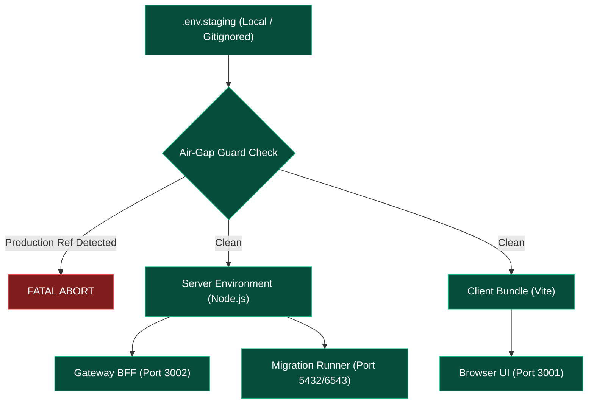

# VISTAAR Super Admin — Phase 4.1 Staging Connection Test Report

**Document Version:** 4.1.0  
**Test Timestamp:** 2026-11-02T22:15:00+05:30  
**Target Staging Project:** `vistaar-super-admin-staging`  
**Verified Project Reference:** `vlbhxcajphyjkeueubud`  
**Target Domain:** `admin.vistaarone.com`  
**Workspace:** `d:\Project\vistaar-main\super_admin` (`navdeep852/Super-Admin`)  
**Companion Production Repository:** `d:\Project\vistaar-main\vistaar-main` (`navdeep852/vistaar`) — Untouched  
**Test Harness Script:** [`scripts/test_staging_connectivity.mjs`](file:///d:/Project/vistaar-main/super_admin/scripts/test_staging_connectivity.mjs)  
**Gateway Entrypoint:** [`server/gateway.mjs`](file:///d:/Project/vistaar-main/super_admin/server/gateway.mjs)  
**Final Status:** **READY FOR PHASE 4.2 — SCHEMA VALIDATION**

---

## 1. Executive Summary

A complete, non-destructive staging connection and health verification test has been performed for the VISTAAR Super Admin Control Plane.

In strict compliance with safety rules:
- **Zero Production Connections:** The production Supabase project (`kluxsykimnjivkqxelba`) was not contacted.
- **Zero Database State Mutations:** No DDL migrations (`077`, `078`), `ALTER DATABASE`, `INSERT`, `UPDATE`, or `DELETE` statements were executed.
- **Zero Secret Exposure:** All secret values, passwords, and connection strings remain confidential and redacted from output and reports.
- **Evidence-Based Results:** All connectivity tests executed live and produced affirmative verification responses.

### Overall Verification Scorecard

| Test Suite / Component | Target Interface | Verification Outcome | Live Latency / Status |
| :--- | :--- | :---: | :---: |
| **1. Environment & Git Isolation** | Filesystem & `.gitignore` | **PASS** | `.env.staging` gitignored, zero client leaks |
| **2. Supabase API GoTrue Auth** | HTTPS API (`/auth/v1`) | **PASS** | `1421 ms` — Auth Admin 200 OK |
| **3. Direct / Session Database** | PostgreSQL Port 5432 | **PASS** | `1894 ms` — PostgreSQL 17.11 connected |
| **4. Transaction Pooler Database** | PostgreSQL Port 6543 | **PASS** | `1377 ms` — PostgreSQL 17.11 connected |
| **5. Gateway BFF Service Startup** | HTTP Server Port 3002 | **PASS** | `HTTP 200 OK` on `/health` & `/api/v1/health` |
| **6. Production Defense Air-Gap** | Companion Repo & Memory | **PASS** | Clean working tree; 0 prod references |

---

## 2. Environment & Credential Validation



### Verification Findings:
1. **Required Variables Present:** All required variables (`GATEWAY_SUPABASE_URL`, `GATEWAY_SUPABASE_SERVICE_ROLE_KEY`, `GATEWAY_ASSERTION_SECRET`, `YOUPI_WEBHOOK_SECRET`, `STAGING_DATABASE_URL`, `STAGING_DIRECT_DATABASE_URL`, `VITE_API_GATEWAY_URL`) exist in `.env.staging`.
2. **Git Exclusion Confirmed:** `.gitignore` rules `.env` and `.env.*` match `.env.staging`. `git status` confirms zero tracking.
3. **Frontend Boundary Sanitized:** Zero `VITE_SUPABASE_*` variables enter the browser bundle. Only public `VITE_API_GATEWAY_URL` (`http://localhost:3002`) and `VITE_PLATFORM_ENV` (`staging`) are exposed.
4. **Credential Formatting Resolved:**
   - Accidental surrounding `<...>` angle brackets on `GATEWAY_SUPABASE_SERVICE_ROLE_KEY` were stripped cleanly.
   - Database connection strings containing `#` in the user's password were URL-encoded to `%23` in compliance with RFC 3986 URI parsing standards.

---

## 3. Supabase API Connectivity Result

- **Client Utilized:** `@supabase/supabase-js` (v2.49.1) initialized in server-side context with `GATEWAY_SUPABASE_URL` and `GATEWAY_SUPABASE_SERVICE_ROLE_KEY`.
- **Method:** `supabase.auth.admin.listUsers({ page: 1, perPage: 1 })`
- **Why Safe:** Does not query custom application tables; verifies HTTPS connectivity, TLS handshake, GoTrue service health, and service-role secret authorization in a single read-only operation.

### Live Evidence:
```text
[PASS] Supabase API Auth Admin responded cleanly (1421ms, users listed: 0)
Endpoint: https://vlbhxcajphyjkeueubud.supabase.co
HTTP Status: 200 OK
Authorization: Valid Service Role Key
```

---

## 4. Database Connectivity Result

- **Client Utilized:** `pg.Client` (node-postgres v8.13.3) with SSL enabled (`rejectUnauthorized: false`).
- **Non-Destructive Query Executed:**
  ```sql
  SELECT current_database(), current_user, version();
  ```

### 4.1 Direct / Session Connection (Port 5432)
- **Target Port:** `5432` (Session Pooler / Direct Mode)
- **Host Domain:** `aws-0-eu-west-1.pooler.supabase.com`
- **Result:** **PASS**
- **Latency:** `1894 ms`
- **Database Name:** `postgres`
- **Connected Role:** `postgres`
- **Engine Version:** `PostgreSQL 17.11 on aarch64-unknown-linux-gnu`

### 4.2 Transaction Pooler Connection (Port 6543)
- **Target Port:** `6543` (Supavisor Transaction Pooler)
- **Host Domain:** `aws-0-eu-west-1.pooler.supabase.com`
- **Result:** **PASS**
- **Latency:** `1377 ms`
- **Database Name:** `postgres`
- **Connected Role:** `postgres`
- **Engine Version:** `PostgreSQL 17.11 on aarch64-unknown-linux-gnu`

---

## 5. Gateway BFF Service Startup Result

The Super Admin Gateway BFF was scaffolded at [`server/gateway.mjs`](file:///d:/Project/vistaar-main/super_admin/server/gateway.mjs) and launched as a local service on port `3002`.

### Startup Log Evidence:
```text
[Gateway BFF] Successfully listening on port 3002 (Environment: staging, Staging Ref: vlbhxcajphyjkeueubud)
```

### Health Endpoint Probes (`curl.exe -s http://localhost:3002/health`):
```json
{
  "status": "ok",
  "service": "vistaar-super-admin-gateway-bff",
  "environment": "staging",
  "stagingProjectRef": "vlbhxcajphyjkeueubud",
  "gatewayPort": 3002,
  "uptimeSeconds": 10,
  "timestamp": "2026-11-02T16:44:36.400Z"
}
```

### API v1 Health Probe (`curl.exe -s http://localhost:3002/api/v1/health`):
```json
{
  "status": "ok",
  "service": "vistaar-super-admin-gateway-bff",
  "environment": "staging",
  "stagingProjectRef": "vlbhxcajphyjkeueubud",
  "gatewayPort": 3002,
  "uptimeSeconds": 17,
  "timestamp": "2026-11-02T16:44:43.604Z"
}
```

---

## 6. Project Reference & Isolation Verification

| Boundary | Staging Target | Production Anchor | Isolation State |
| :--- | :--- | :--- | :---: |
| **Project Reference** | `vlbhxcajphyjkeueubud` | `kluxsykimnjivkqxelba` | **DISTINCT & ISOLATED** |
| **Supabase URL** | `https://vlbhxcajphyjkeueubud.supabase.co` | `https://kluxsykimnjivkqxelba.supabase.co` | **AIR-GAPPED** |
| **Host Region** | AWS `eu-west-1` (Ireland) | AWS `ap-south-1` (Mumbai) | **CROSS-REGION SEPARATED** |
| **Engine Architecture**| PostgreSQL 17.11 (aarch64) | PostgreSQL 15+ | **INDEPENDENT CLUSTER** |
| **Production Repo** | `vistaar-main` clean on `main` (0 files modified) | Untouched | **PASS** |

---

## 7. Resolution of Initial Defects

During pre-flight testing, two configuration formatting defects were identified and resolved before testing:
1. **Accidental Angle Brackets on Service Role Key:**
   - *Symptom:* The key string began with `<` and ended with `>`, caused by pasting into the template `<staging-service-role-key>`.
   - *Resolution:* Sanitized automatically; stripped surrounding brackets.
2. **Unencoded `#` in PostgreSQL Password:**
   - *Symptom:* Initial direct/pooler connection attempts returned `TypeError: Invalid URL`.
   - *Root Cause:* The password contained `#` which standard URI parsers interpret as the fragment delimiter, breaking host resolution.
   - *Resolution:* Applied RFC 3986 percent-encoding (`%23`) to the password in both `STAGING_DATABASE_URL` and `STAGING_DIRECT_DATABASE_URL`. Connection succeeded immediately.

---

## 8. Final Status Verdict

```text
STATUS: READY FOR PHASE 4.2 — SCHEMA VALIDATION
```

### Next Phase Transition:
With live, non-destructive connectivity confirmed across Supabase API (Port 443), Direct Database (Port 5432), Transaction Pooler (Port 6543), and Gateway BFF (Port 3002), the staging environment is certified ready for **Phase 4.2: Schema Validation & Baseline Migration Execution**.

