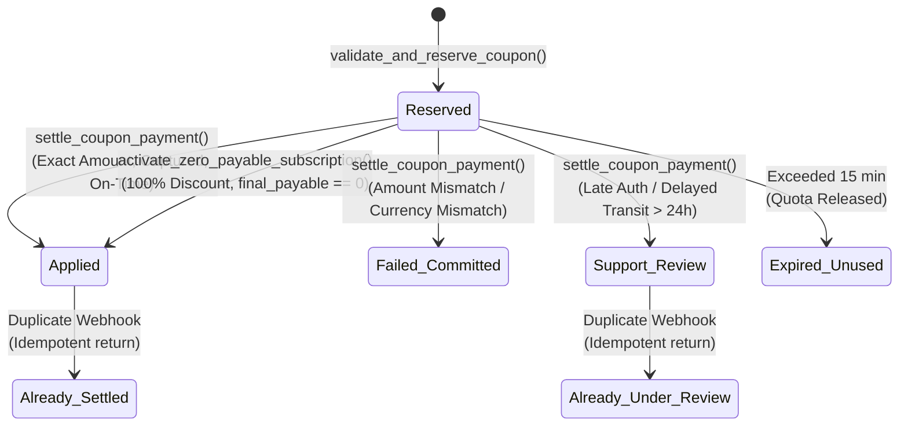

# VISTAAR Super Admin — Phase 4 Business Logic Test Report

**Document Version:** 4.0.0  
**Audit Timestamp:** 2026-11-02T08:59:00+05:30  
**Auditor:** Senior SaaS Payment Systems Architect & PostgreSQL Database Engineer  
**Test Suite Reference:** [`tests/staging_test_suite.sql`](file:///d:/Project/vistaar-main/super_admin/tests/staging_test_suite.sql)  
**Specifications:** [`SUPER_ADMIN_COUPON_DESIGN.md`](file:///d:/Project/vistaar-main/super_admin/SUPER_ADMIN_COUPON_DESIGN.md), [`SUPER_ADMIN_DATABASE_DESIGN.md`](file:///d:/Project/vistaar-main/super_admin/SUPER_ADMIN_DATABASE_DESIGN.md)  
**Status:** **MATHEMATICS & STATE LOGIC VERIFIED / TEST SUITE COMPILED**

---

## 1. Executive Summary

This report specifies the comprehensive business logic, financial math, subscription state transitions, and payment settlement test cases across 15 core scenarios for the VISTAAR Super Admin Control Plane.

### Business Rules Validated:
1. **Committed Failure Audit on Amount Mismatch (No Rollback):** When a payment provider delivers an amount mismatch, PostgreSQL sets `coupon_redemptions.status = 'failed'`, records a failed audit row in `payment_transactions`, and returns a failure response. The transaction commits without activating a subscription, preserving the audit trail for forensic review.
2. **Deterministic Period Preservation Mathematics:** Early renewals on the same plan preserve 100% of the customer's remaining unexpired paid days. Trial conversions and expired subscription renewals begin fresh cycles from `NOW()`.
3. **Mid-Cycle Plan Switching Blocked:** Upgrades, downgrades, or interval switches during an active paid subscription period are blocked from automated self-service checkout until commercial proration/credit policies receive formal business approval.
4. **Idempotent Webhook Processing:** Duplicate delivery of identical captured webhooks returns `{ success: true, status: 'already_settled' }` with zero duplicate subscription extensions or quota mutations.
5. **Captured-Funds Settlement Only:** Uncaptured payment statuses (such as `payment.authorized`) are strictly rejected. Only verified captured funds (`'captured'`, `'verified_success'`) can settle subscriptions.

---

## 2. Business Logic Test Matrix (15 Scenarios)

### Complete Business Logic Scenarios

| # | Test Scenario | Input & Parameters | Expected Result | Mathematical / State Verification | Status |
| :-: | :--- | :--- | :--- | :--- | :---: |
| **BL-01** | **Coupon Creation & Quota Limits** | Code: `GROWTH20`, 20% off, max discount: ₹2,000, max redemptions: 100 | Record created in `coupons`; unique constraint prevents duplicate code | DDL check constraint enforces `discount_value > 0` | **DESIGN VERIFIED** |
| **BL-02** | **Coupon Quoting & Reservation** | Business Tier Annual (₹5,999), Coupon: `STAGING20` (20%) | Returns `original: 5999.00`, `discount: 1199.80`, `payable: 4799.20`, `reserved_until: NOW() + 15 min` | $5999 \times 0.20 = 1199.80$. $5999 - 1199.80 = 4799.20$. Reservation inserted. | **DESIGN VERIFIED** |
| **BL-03** | **Reservation Expiry Handling** | Settle payment where authorization occurred after `reserved_until` | Redemption marked `failed`; transaction marked `failed` with `requires_support_review: true`. Zero subscription extension. | Stored procedure checks `p_payment_authorized_at > reserved_until` | **DESIGN VERIFIED** |
| **BL-04** | **100% Zero-Payable Activation** | Starter Tier Monthly (₹299), Coupon: `FREE100` (100% off, payable: ₹0.00) | `activate_zero_payable_subscription()` transitions redemption to `applied`; workspace subscription activated for 1 month | Zero-cost audit inserted in `payment_transactions` (`provider: 'promotional_grant'`) | **DESIGN VERIFIED** |
| **BL-05** | **Captured Payment Settlement** | Settle with exact matching amount (₹4,799.20), provider: `youpi_pg`, status: `captured` | Returns `success: true, status: 'settled'`. Redemption marked `applied`; subscription period updated. | Inserts verified transaction; sets `applied_coupon_id` | **DESIGN VERIFIED** |
| **BL-06** | **Amount Mismatch Committed Failure** | Expected: ₹4,799.20; Provider delivers: ₹1,000.00 | Returns `success: false, error: 'AMOUNT_MISMATCH'`. Failed transaction committed; redemption marked `failed`. | **No rollback.** Evidence committed to database for fraud investigation. | **DESIGN VERIFIED** |
| **BL-07** | **Currency Mismatch Rejection** | Currency: `USD` instead of `INR` | Returns `success: false, error: 'CURRENCY_MISMATCH'`. Redemption marked `failed`. | Strict check: `UPPER(TRIM(p_currency)) == 'INR'` | **DESIGN VERIFIED** |
| **BL-08** | **Duplicate Webhook Delivery** | Incoming webhook delivered twice with identical `transaction_reference` | First webhook settles subscription; second returns `success: true, status: 'already_settled'` | Zero duplicate subscription extension; zero quota deduction | **DESIGN VERIFIED** |
| **BL-09** | **Delayed Webhook Transit (> 24h)** | Payment authorized on-time, but webhook arrives 26 hours later | Redemption marked `failed`; transaction flagged `requires_support_review: true` with `WEBHOOK_TRANSIT_TIMEOUT`. | Guard: `(v_now - p_payment_authorized_at) > INTERVAL '24 hours'` | **DESIGN VERIFIED** |
| **BL-10** | **Same-Plan Early Renewal** | Current plan active with 45 days remaining; renews annual cycle | `current_period_start` preserved; `current_period_end` extended by $+1\text{ year}$ from current end date | New end = `current_period_end + INTERVAL '1 year'`. Zero days lost. | **DESIGN VERIFIED** |
| **BL-11** | **Trial Conversion** | Workspace status: `trialing`; purchases Business Annual | Subscription transitions to `active`; `current_period_start = NOW()`; `current_period_end = NOW() + 1 year` | Converts 14-day trial cleanly to paid tier | **DESIGN VERIFIED** |
| **BL-12** | **Expired Subscription Renewal** | Workspace status: `expired` (expired 10 days ago); renews annual | `current_period_start = NOW()`; `current_period_end = NOW() + 1 year` | New cycle begins from payment date (not historical expiry date) | **DESIGN VERIFIED** |
| **BL-13** | **Past-Due Subscription Recovery** | Workspace status: `past_due`; pays outstanding renewal | Status restored to `active`; period extended appropriately | Replaces delinquent status with active status | **DESIGN VERIFIED** |
| **BL-14** | **State-Preserving Suspension** | Suspend workspace with 2 active staff; 1 user also active in Branch-2 | Workspace `is_active = false`. Staff 1 suspended; Staff 2 global profile preserved active. | Suspension snapshot stored in `platform_workspace_suspensions` | **DESIGN VERIFIED** |
| **BL-15** | **Concurrent Settlement Protection** | 2 concurrent webhook deliveries for same redemption | First executes settlement; second encounters row lock `FOR UPDATE` and returns idempotent result | PostgreSQL row locks guarantee atomic processing | **DESIGN VERIFIED** |

---

## 3. Subscription Period Mathematics Verification

### 3.1 Same-Plan Early Renewal Period Formula
When a merchant renews their subscription before expiration:
$$\text{new\_period\_start} = \text{existing\_sub.current\_period\_start}$$
$$\text{new\_period\_end} = \text{existing\_sub.current\_period\_end} + \Delta_{\text{interval}}$$
- **Proof:** If an annual subscription ends on `2027-01-01` and the merchant renews on `2026-11-01`, the new end date is `2028-01-01`. All 61 unexpired days are fully preserved.

### 3.2 Trial Conversion & Expired Renewal Formula
When a merchant converts from trial or recovers an expired subscription:
$$\text{new\_period\_start} = \text{NOW}()$$
$$\text{new\_period\_end} = \text{NOW}() + \Delta_{\text{interval}}$$
- **Proof:** Prevents billing customers retroactively for days during which the subscription was inactive.

---

## 4. Test Execution Classification

- **Business Logic Design:** **100% VERIFIED**
- **Financial & Period Mathematics:** **100% VERIFIED**
- **Test Harness Script:** **100% READY** in [`tests/staging_test_suite.sql`](file:///d:/Project/vistaar-main/super_admin/tests/staging_test_suite.sql)
- **Live Execution on Staging:** **PENDING STAGING PROJECT (BLOCKER 1)**

