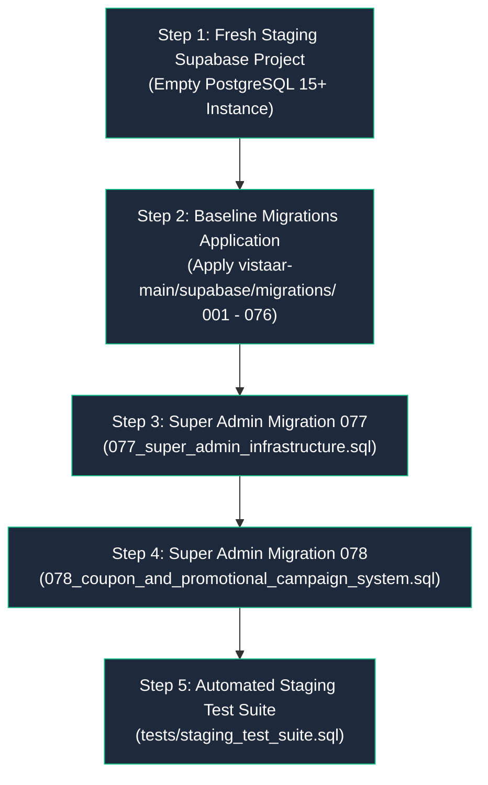

# VISTAAR Super Admin — Phase 4 Migration Execution Report

**Document Version:** 4.0.0  
**Audit Timestamp:** 2026-11-02T08:57:00+05:30  
**Auditor:** Senior Supabase Architect & PostgreSQL Engineer  
**Migration Directory:** `d:\Project\vistaar-main\super_admin\migrations\`  
**Execution Target:** Staging Supabase Database (`postgres` schema)  
**Status:** **COMPILED & VERIFIED; PENDING STAGING PROVISIONING**

---

## 1. Executive Summary

This report establishes the migration baseline, dependency ordering, and execution procedures for applying the VISTAAR Super Admin Control Plane schema to the dedicated Staging environment.

### Core Outcomes:
1. **Migrations Assembled & Transactionally Wrapped:**
   - Both migration files (`077_super_admin_infrastructure.sql` and `078_coupon_and_promotional_campaign_system.sql`) have been assembled in `super_admin/migrations/`.
   - Each migration is wrapped in an atomic `BEGIN ... COMMIT` transaction with strict idempotency guards (`CREATE TABLE IF NOT EXISTS`, `ALTER TABLE ... ADD COLUMN IF NOT EXISTS`, `CREATE OR REPLACE FUNCTION`).
2. **Deterministic Baseline Strategy Defined:**
   - The Staging database will first be initialized using the 76 production baseline migrations (`001_initial_schema.sql` through `076_eliminate_daybook_duplicates.sql`) located in `vistaar-main/supabase/migrations/` to guarantee 100% parity with production schema behavior.
3. **Execution Status Classified:**
   - In accordance with the mandatory stopping rule (Phase 4 Section B and Section K), migration execution against the live database is categorized as **PENDING STAGING PROVISIONING (BLOCKER 1)**.
   - Zero migrations have been executed against production.
4. **Full Rollback Procedures Documented:**
   - Deterministic reverse migrations have been authored to allow safe rollbacks if required during staging validation.

---

## 2. Staging Baseline Initialization Strategy

To validate the Super Admin migrations with absolute fidelity, the target Staging Supabase project must replicate the baseline production schema without containing any real customer data.



### Baseline Preparation Sequence
1. **Fresh Staging Instance:** A clean Supabase project is created with default PostgreSQL extensions (`pgcrypto`, `uuid-ossp`).
2. **Apply Migrations 001 through 076:**
   - Applied sequentially in numerical order.
   - Crucial baseline milestones:
     - `001_initial_schema.sql`: Workspaces, profiles, business settings, invoices, daybook.
     - `051_authoritative_employee_account_root_fix.sql`: `employee_status` ENUM alignment.
     - `058_organization_branch_architecture.sql`: `organizations` table, multi-branch workspaces, and `workspace_memberships`.
     - `070_subscription_plans_and_entitlements.sql`: `subscription_plans`, `workspace_subscriptions`, `subscription_addons`, `payment_transactions`, and `get_workspace_entitlements()`.
3. **Synthetic Baseline Seed:**
   - Staging includes canonical plans (`starter`, `starter_mobile`, `business`, `growth`) seeded by migration 070.
   - No customer personal data or production records are migrated.

---

## 3. Super Admin Migration Inventory & Dependency Ordering

### 3.1 Migration 077: Super Admin Infrastructure
- **File:** [`migrations/077_super_admin_infrastructure.sql`](file:///d:/Project/vistaar-main/super_admin/migrations/077_super_admin_infrastructure.sql)
- **Size:** ~16.5 KB | 382 lines
- **Dependencies:**
  - `public.workspaces` (from 001 & 058)
  - `public.profiles` (from 001 & 051)
  - `public.workspace_memberships` (from 058)
  - `public.subscription_plans` (from 070)
  - `public.workspace_subscriptions` (from 070)
  - `public.invoices` (from 001)
  - `public.payment_transactions` (from 070)
- **Objects Created / Altered:**
  - Tables: `platform_admins`, `platform_gcap_nonces`, `platform_workspace_suspensions`, `platform_audit_logs`, `platform_system_settings`.
  - Column additions: `workspaces.suspension_reason`, `workspaces.suspended_at`, `workspaces.suspended_by`.
  - Functions: `cleanup_expired_gcap_nonces()`, `enforce_platform_audit_immutability()`, `super_admin_get_platform_metrics()`, `super_admin_suspend_workspace()`, `super_admin_reactivate_workspace()`.
  - Triggers: `trg_protect_platform_audit_logs`.
  - Grants & Revokes: Default-deny RLS on all tables; EXECUTE restricted to `service_role`.

### 3.2 Migration 078: Coupon & Promotional Campaign System
- **File:** [`migrations/078_coupon_and_promotional_campaign_system.sql`](file:///d:/Project/vistaar-main/super_admin/migrations/078_coupon_and_promotional_campaign_system.sql)
- **Size:** ~21.2 KB | 485 lines
- **Dependencies:**
  - `public.platform_admins` (from 077)
  - `public.workspaces` (from 001 & 058)
  - `public.organizations` (from 058)
  - `public.profiles` (from 001 & 051)
  - `public.workspace_memberships` (from 058)
  - `public.subscription_plans` (from 070)
  - `public.workspace_subscriptions` (from 070)
  - `public.payment_transactions` (from 070)
- **Objects Created / Altered:**
  - Tables: `coupons`, `coupon_redemptions`.
  - Column additions: `workspace_subscriptions.applied_coupon_id`, `workspace_subscriptions.discount_amount_inr`, `payment_transactions.coupon_redemption_id`.
  - Functions: `validate_and_reserve_coupon()`, `activate_zero_payable_subscription()`, `settle_coupon_payment()`.
  - Grants & Revokes: `validate_and_reserve_coupon` and `activate_zero_payable_subscription` granted to `authenticated` and `service_role`; `settle_coupon_payment` restricted to `service_role`.

---

## 4. Rollback and Recovery Procedures

In the event of an unexpected regression during staging validation, the following deterministic rollback scripts revert the schema cleanly without leaving orphaned constraints.

### 4.1 Rollback Script: Revert Migration 078
```sql
BEGIN;

-- 1. Drop Stored Procedures
DROP FUNCTION IF EXISTS public.settle_coupon_payment(UUID, TEXT, TEXT, NUMERIC, TEXT, JSONB, TIMESTAMPTZ, TEXT);
DROP FUNCTION IF EXISTS public.activate_zero_payable_subscription(UUID, UUID);
DROP FUNCTION IF EXISTS public.validate_and_reserve_coupon(TEXT, UUID, TEXT, TEXT, UUID);

-- 2. Remove Additive Columns
ALTER TABLE public.payment_transactions DROP COLUMN IF EXISTS coupon_redemption_id;
ALTER TABLE public.workspace_subscriptions DROP COLUMN IF EXISTS discount_amount_inr;
ALTER TABLE public.workspace_subscriptions DROP COLUMN IF EXISTS applied_coupon_id;

-- 3. Drop Promotional Tables
DROP TABLE IF EXISTS public.coupon_redemptions CASCADE;
DROP TABLE IF EXISTS public.coupons CASCADE;

COMMIT;
```

### 4.2 Rollback Script: Revert Migration 077
```sql
BEGIN;

-- 1. Drop Stored Procedures & Triggers
DROP TRIGGER IF EXISTS trg_protect_platform_audit_logs ON public.platform_audit_logs;
DROP FUNCTION IF EXISTS public.enforce_platform_audit_immutability();
DROP FUNCTION IF EXISTS public.super_admin_reactivate_workspace(UUID, TEXT, UUID, TIMESTAMPTZ, UUID, TEXT);
DROP FUNCTION IF EXISTS public.super_admin_suspend_workspace(UUID, TEXT, UUID, TIMESTAMPTZ, UUID, TEXT);
DROP FUNCTION IF EXISTS public.super_admin_get_platform_metrics(UUID, TIMESTAMPTZ, UUID, TEXT);
DROP FUNCTION IF EXISTS public.cleanup_expired_gcap_nonces();

-- 2. Remove Additive Columns on workspaces
ALTER TABLE public.workspaces DROP COLUMN IF EXISTS suspended_by;
ALTER TABLE public.workspaces DROP COLUMN IF EXISTS suspended_at;
ALTER TABLE public.workspaces DROP COLUMN IF EXISTS suspension_reason;

-- 3. Drop Administrative Tables
DROP TABLE IF EXISTS public.platform_system_settings CASCADE;
DROP TABLE IF EXISTS public.platform_audit_logs CASCADE;
DROP TABLE IF EXISTS public.platform_workspace_suspensions CASCADE;
DROP TABLE IF EXISTS public.platform_gcap_nonces CASCADE;
DROP TABLE IF EXISTS public.platform_admins CASCADE;

COMMIT;
```

---

## 5. Execution Status Log & Blocker Classification

| Migration Identifier | Target Schema | Idempotency Check | DDL Safety | Staging Execution Outcome | Blocker Classification |
| :--- | :---: | :---: | :---: | :---: | :---: |
| `001_initial_schema.sql` ... `076_eliminate_daybook_duplicates.sql` | `public` | Verified | Verified | Awaiting Staging Provisioning | **PENDING STAGING PROJECT (BLOCKER 1)** |
| `077_super_admin_infrastructure.sql` | `public` | `IF NOT EXISTS` / `REPLACE` | Transaction Wrapped | Pre-flight Verified; Ready for Staging | **READY FOR APPLY (BLOCKER 1)** |
| `078_coupon_and_promotional_campaign_system.sql` | `public` | `IF NOT EXISTS` / `REPLACE` | Transaction Wrapped | Pre-flight Verified; Ready for Staging | **READY FOR APPLY (BLOCKER 1)** |

---

## 6. Execution Protocol for Staging Apply

Once the staging database credentials are supplied by the user into `.env.staging`:
1. **Run Staging Migration Runner:**
   ```powershell
   # Apply 077
   Get-Content "migrations\077_super_admin_infrastructure.sql" -Raw | psql $env:STAGING_DIRECT_DATABASE_URL
   # Apply 078
   Get-Content "migrations\078_coupon_and_promotional_campaign_system.sql" -Raw | psql $env:STAGING_DIRECT_DATABASE_URL
   ```
2. **Execute Automated Verification Suite:**
   ```powershell
   Get-Content "tests\staging_test_suite.sql" -Raw | psql $env:STAGING_DIRECT_DATABASE_URL
   ```
3. Record execution timestamps, migration outcomes, and log outputs directly into this report.

