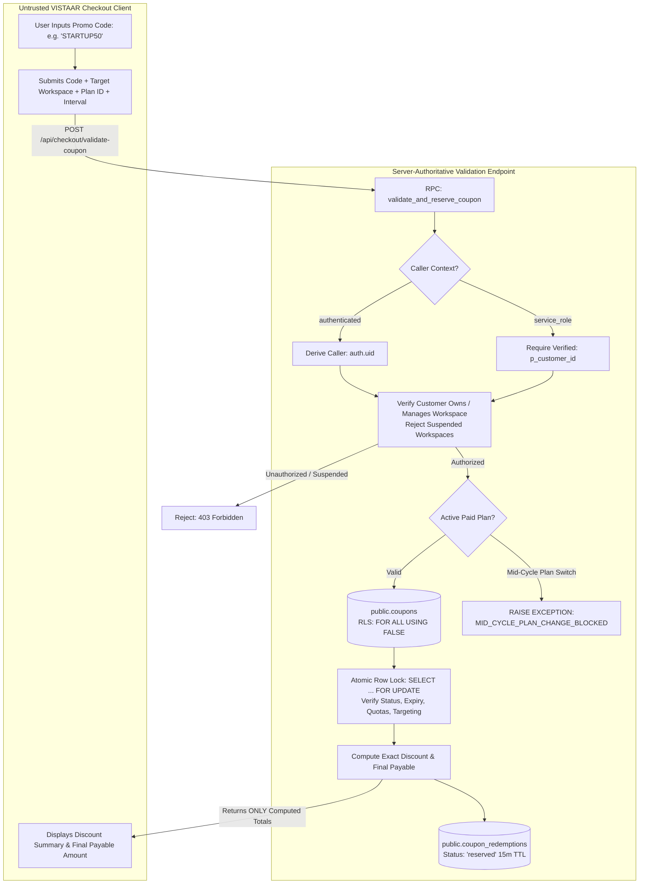
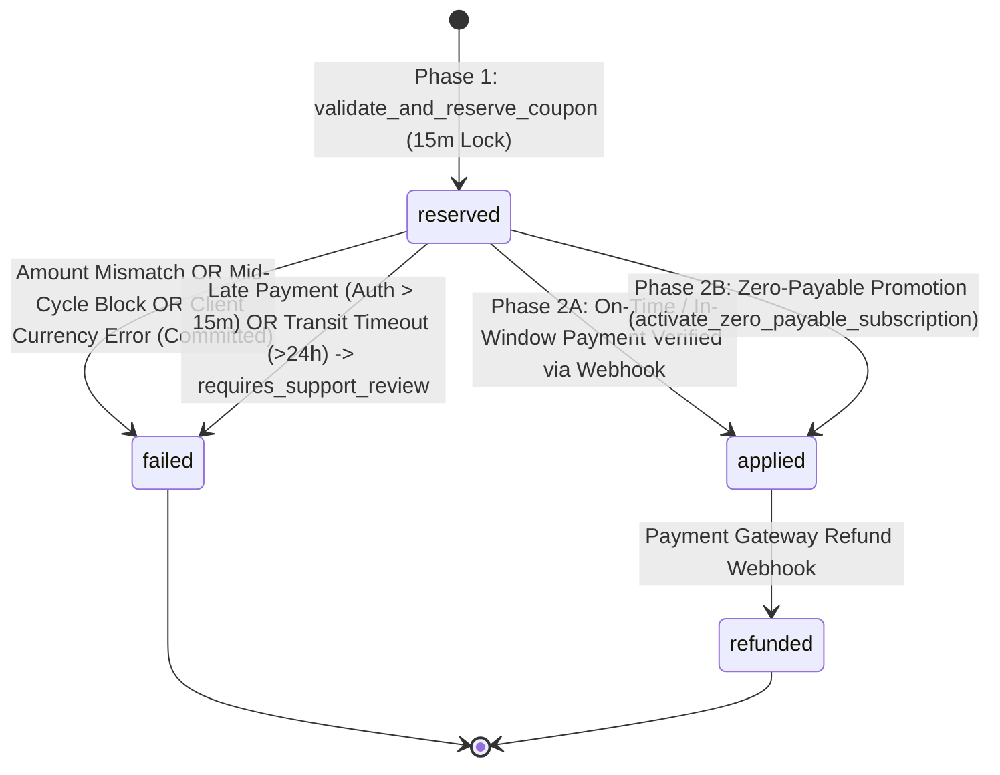

# VISTAAR Super Admin - Coupon & Promotional Campaign Architecture (Phase 2.6 Revised)

**Document Version:** 2.6.0  
**Effective Date:** 2026-11-01  
**Project:** VISTAAR Super Admin Control Plane (`navdeep852/Super-Admin`)  
**Target Domain:** `admin.vistaarone.com`  
**Target Backend:** Existing Production Supabase Infrastructure (`https://kluxsykimnjivkqxelba.supabase.co`)  
**Status:** Phase 2.6 Hardened & Reconciled — Architecture Only

---

## 1. Module Overview & Phase Scope Boundaries

### 1.1 Phase 1 (v1.0) Approved Production Scope
The initial release of Coupon & Promotional Campaign Management is strictly bounded to **one-time discounts** applied at checkout or same-plan subscription renewal:
- Custom alphanumeric coupon codes (e.g., `STARTUP50`, `ANNUAL1000`).
- Percentage discounts with optional rupee caps (e.g., 20% off up to ₹1,500).
- Fixed-amount discounts (e.g., ₹500 flat discount).
- Minimum order purchase thresholds (e.g., minimum cart value ₹2,499).
- Plan restrictions (`all` or explicit subset, e.g., `['starter', 'business']`).
- Interval restrictions (`all`, `monthly`, or `annual`).
- Customer targeting (`all`, `new_customers_only`, or `existing_customers_only`).
- First subscription only flags (`first_subscription_only = TRUE`).
- Campaign validity windows (`valid_from` and `valid_until`).
- Concurrency-safe global redemption limits (`max_total_redemptions`).
- Per-workspace redemption limits (`max_redemptions_per_workspace`).
- Complete coupon privacy lockdown via server-authoritative quoting endpoint (`FOR ALL USING FALSE`).
- Strictly separated customer and backend execution contracts (NO service-role bypass).
- Preservation of existing unexpired subscription periods upon same-plan renewal.
- **Mid-Cycle Plan Change Guard (Blocker 6):** Mid-cycle tier upgrades, downgrades, or interval switches during an active paid period are strictly blocked by stored procedures pending business policy approval on credit formulas.
- Collision-proof idempotent payment settlement via trusted gateway webhooks (`youpi_pg` provider only; captured statuses only).
- **Consistent Expiry & Late Webhook Rules:** In-window payments with transit delays ($\le 24\text{h}$) are settled; late payments authorized after reservation expiry or exceeding transit limits are flagged with `requires_support_review = true` in `payment_transactions`, committed to the audit trail, and **never activate subscriptions**.
- **Committed Failure Audit on Amount Mismatch:** Paid amount mismatches update redemption to `'failed'`, commit a failed `payment_transactions` record for fraud auditing, and return an explicit failure response without transaction rollback.
- Non-destructive `ON DELETE RESTRICT` historical retention with statutory snapshots.

### 1.2 Deferred Scope (Future Releases)
- Multi-cycle recurring subscription discounts (`repeating` duration over $N$ months).
- Lifetime recurring discounts (`forever` duration).
- Automated mid-cycle proration discounts, tier upgrades, and credit balances (deferred under Blocker 6).
- Multi-coupon stacking.

*Database Schema Guard:* In `public.coupons`, the duration column is bounded by `CONSTRAINT check_duration_v1 CHECK (discount_duration = 'once')`.

---

## 2. Complete Coupon Privacy & Execution Contracts

### 2.1 The Vulnerability of Public Coupon Catalogs
Allowing clients to directly read the `public.coupons` table exposes unpublished discount codes, marketing campaign schedules, targeting rules, and internal pricing margins. Malicious actors could scrape promo codes or apply partner discounts without authorization.

### 2.2 Phase 2.6 Privacy & Execution Architecture



1. **Table Lockdown:** `public.coupons` and `public.coupon_redemptions` enforce RLS with `FOR ALL USING (FALSE)` against ordinary client connections.
2. **Customer Direct Contract:** If called with `authenticated` role, caller identity is derived strictly from `auth.uid()`.
3. **Backend Trusted Contract:** If called with `service_role` (from Gateway BFF), the procedure requires explicit verified customer identity (`p_customer_id`). The Gateway extracts this strictly from the verified JWT `sub` and discards any client-supplied body IDs.
4. **Mandatory Authorization (NO service_role bypass):** Both contracts strictly verify workspace ownership and admin rights against actual production schema (`organizations.owner_user_id`, `profiles.role = 'owner'`, `workspace_memberships.role = 'owner'`, or matching `workspaces.owner_email`). Suspended workspaces are rejected.

---

## 3. Two-Phase Reservation & Settlement State Machine

To prevent concurrency race conditions, redemptions transition across a strict two-phase state machine:



### 3.1 Comprehensive State Transition Matrix

| Initial State | Event / Trigger | Preconditions & Validation | Target State | Committed Database Effects | Return Value |
| :--- | :--- | :--- | :---: | :--- | :--- |
| `[None]` | Checkout Code Entered | Target workspace active; customer verified owner/admin; coupon active, within valid dates, plan/interval match, min spend met, quota available. If active paid plan exists, plan and interval must match. | `reserved` | Inserts `coupon_redemptions` with `status = 'reserved'` and `reserved_until = NOW() + 15m`. Holds 1 slot against quota. | `{ "success": true, "redemption_id": ... }` |
| `reserved` | On-Time Payment Settlement | Caller is Gateway (`service_role`); redemption row locked; ref not already bound to another tx; provider is `youpi_pg`; status is `captured` or `verified_success`; authorized $\le$ `reserved_until`; arrival $\le$ `reserved_until`; transit $\le 24\text{h}$; currency is `INR`; `paid_amount == final_payable`. | `applied` | Inserts `payment_transactions` (`verified_success`); updates redemption to `applied`; activates/extends `workspace_subscriptions` with preserved unexpired periods. | `{ "success": true, "status": "settled", ... }` |
| `reserved` | In-Window Payment, Delayed Webhook | Payment authorized before reservation expiry (`p_payment_authorized_at <= reserved_until`), but webhook arrived after expiry (`now > reserved_until`); transit $\le 24\text{h}$; amount/currency valid. | `applied` | Inserts `payment_transactions` (`verified_success`); updates redemption to `applied`; activates/extends `workspace_subscriptions` with preserved periods. | `{ "success": true, "status": "settled", "transit_delayed": true, ... }` |
| `reserved` | Zero-Payable Checkout | Customer verified owner/admin; `final_payable == 0.00`; `reserved_until > NOW()`; workspace active. | `applied` | Inserts zero-cost transaction in `payment_transactions`; updates redemption to `applied`; activates/extends `workspace_subscriptions` with preserved periods. | `{ "success": true, "status": "activated", ... }` |
| `reserved` | Late Payment Authorization | Payment authorized *after* reservation expiry (`p_payment_authorized_at > reserved_until`). | `failed` | Inserts `payment_transactions` with `status = 'failed'` and `provider_payload->>'requires_support_review' = 'true'`; updates redemption to `'failed'`; **does NOT activate subscription**. | `{ "success": false, "status": "requires_support_review", "error": "PAYMENT_AUTHORIZED_AFTER_EXPIRY" }` |
| `reserved` | Webhook Transit Timeout | Webhook arrives > 24 hours after payment authorization (`now - authorized_at > 24h`). | `failed` | Inserts `payment_transactions` with `status = 'failed'` and `provider_payload->>'requires_support_review' = 'true'`; updates redemption to `'failed'`; **does NOT activate subscription**. | `{ "success": false, "status": "requires_support_review", "error": "WEBHOOK_TRANSIT_TIMEOUT" }` |
| `reserved` | Amount Mismatch Webhook | Webhook delivers `paid_amount != final_payable`. | `failed` | Inserts `payment_transactions` with `status = 'failed'` and error metadata; updates redemption to `'failed'`; **does NOT activate subscription**. | `{ "success": false, "status": "failed", "error": "AMOUNT_MISMATCH", "code": "P0006" }` |
| `reserved` | Mid-Cycle Switch Attempt | Active paid subscription on different plan/interval detected at settlement time. | `failed` | Inserts `payment_transactions` with `status = 'failed'`; updates redemption to `'failed'`; **does NOT activate subscription**. | `{ "success": false, "status": "failed", "error": "MID_CYCLE_PLAN_CHANGE_BLOCKED", "code": "P0008" }` |
| `reserved` | Transaction Ref Collision | Incoming `transaction_reference` already exists in `payment_transactions` for a different workspace or redemption. | `reserved` (Unchanged) | Zero mutations; transaction rolls back. | Exception `TRANSACTION_REF_COLLISION (23505)` |
| `applied` | Duplicate Webhook Delivery (Success) | Incoming `transaction_reference` matches existing `payment_transactions` record with same workspace and redemption with `status = 'verified_success'`. | `applied` (Unchanged) | Zero database mutations; subscription dates and quotas are **never re-incremented**. | `{ "success": true, "status": "already_settled" }` |
| `failed` | Duplicate Webhook Delivery (Support Review) | Incoming `transaction_reference` matches existing `payment_transactions` record with same workspace and redemption with `status = 'failed'` and `requires_support_review = true`. | `failed` (Unchanged) | Zero database mutations; subscription untouched. | `{ "success": false, "status": "already_under_support_review" }` |
| `applied` | Gateway Refund Webhook | Verified refund webhook delivered for settled transaction. | `refunded` | Updates `payment_transactions.status = 'refunded'`; updates `coupon_redemptions.status = 'refunded'`; sets `workspace_subscriptions.status = 'expired'`. Quota is NOT restored. | `{ "success": true, "status": "refunded" }` |

---

## 4. Complete Subscription-State Coverage & Date Scenarios

VISTAAR operates on manual renewal rather than automatic recurring credit card charges. When a customer renews their subscription before expiration on the same plan, remaining paid time is preserved.

### 4.1 Exhaustive Subscription State Matrix

#### State 1: No Existing Subscription (Brand New Workspace)
- **Precondition:** Workspace has no record in `public.workspace_subscriptions`.
- **Checkout Action:** Customer applies coupon `STARTUP20` on `2026-11-01 10:00:00 UTC` and purchases `starter` plan with `monthly` interval.
- **Settlement Result:**
  - `status = 'active'`
  - `current_period_start = 2026-11-01 10:00:00 UTC`
  - `current_period_end = 2026-12-01 10:00:00 UTC`

#### State 2: Active Subscription on Same Plan & Interval (Early Renewal)
- **Precondition:** Workspace on `business` monthly with `status = 'active'`, `current_period_start = 2026-11-01 00:00:00 UTC`, and `current_period_end = 2026-12-01 00:00:00 UTC`.
- **Checkout Action:** On `2026-11-20 10:00:00 UTC` (11 days before expiry), customer applies coupon `RENEW10` and renews on the **same** `business` monthly plan.
- **Settlement Result:**
  - `status = 'active'`
  - `current_period_start = 2026-11-01 00:00:00 UTC` (Preserves original cycle start)
  - `current_period_end = 2027-01-01 00:00:00 UTC` (`2026-12-01 + 1 month`)
  - **Zero paid days lost:** The customer receives full credit for the remaining 11 days of their existing subscription plus the full new month.

#### State 3: Trialing Subscription (14-Day Free Trial Conversion)
- **Precondition:** Workspace has existing record with `status = 'trialing'`, `current_period_start = 2026-11-01 00:00:00 UTC`, `current_period_end = 2026-11-15 00:00:00 UTC`.
- **Checkout Action:** On `2026-11-05 14:00:00 UTC`, customer applies coupon `EARLYBIRD` and converts to `business` plan with `annual` interval.
- **Settlement Result:**
  - `status = 'active'`
  - `current_period_start = 2026-11-05 14:00:00 UTC`
  - `current_period_end = 2027-11-05 14:00:00 UTC`
  - Trial terminates immediately; new annual cycle commences from payment timestamp.

#### State 4: Past-Due Subscription (Payment Grace Period Expired)
- **Precondition:** Workspace subscription renewal lapsed on `2026-10-25 00:00:00 UTC`. Status is `'past_due'`.
- **Checkout Action:** On `2026-11-01 12:00:00 UTC`, customer applies coupon `RECOVER15` and purchases `starter` monthly plan.
- **Settlement Result:**
  - `status = 'active'`
  - `current_period_start = 2026-11-01 12:00:00 UTC`
  - `current_period_end = 2026-12-01 12:00:00 UTC`
  - Subscription reactivates immediately for 1 full billing cycle from payment timestamp.

#### State 5: Expired Subscription (Lapsed Subscription)
- **Precondition:** Workspace had a subscription that expired on `2026-10-01 00:00:00 UTC`. Status is `'expired'` or `'cancelled'`.
- **Checkout Action:** On `2026-11-01 15:30:00 UTC`, customer applies coupon `WELCOMEBACK` and renews on `growth` annual plan.
- **Settlement Result:**
  - `status = 'active'`
  - `current_period_start = 2026-11-01 15:30:00 UTC`
  - `current_period_end = 2027-11-01 15:30:00 UTC`
  - Subscription reactivates immediately for 1 full billing cycle from payment timestamp.

#### State 6: Manually Overridden Subscription
- **Precondition:** Workspace subscription was manually extended by Super Admin (`status = 'active'`, `current_period_end = 2027-06-30 00:00:00 UTC`).
- **Checkout Action (Same Plan):** On `2026-11-01`, customer renews on the **same** plan for 1 month.
  - **Settlement Result:** `current_period_end` extends to `2027-07-30 00:00:00 UTC` (`2027-06-30 + 1 month`). Preserves the administrative grant!
- **Checkout Action (Different Plan):** Customer attempts to checkout on a different plan tier while the manual override is active.
  - **Settlement Result:** Blocked as a mid-cycle plan switch (`MID_CYCLE_PLAN_CHANGE_BLOCKED`). Customer must contact billing support to alter an active administrative plan override.

#### State 7: Duplicate Payment Settlement
- **Precondition:** Transaction reference `TX-9988` was already settled and verified for redemption `RED-01`.
- **Action:** Gateway delivers a duplicate webhook for `TX-9988`.
- **Settlement Result:**
  - Database detects existing verified record in `payment_transactions`.
  - Returns `{ success: true, status: 'already_settled' }`.
  - Zero mutations to `workspace_subscriptions` or `coupon_redemptions`.

#### State 8: Existing Active Subscription with Different Plan or Interval (Mid-Cycle Switch Attempt)
- **Precondition:** Workspace on `starter` monthly with `status = 'active'`, `current_period_start = 2026-11-01 00:00:00 UTC`, and `current_period_end = 2026-12-01 00:00:00 UTC`.
- **Action:** On `2026-11-10 15:00:00 UTC`, customer attempts to apply a coupon and checkout for `business` monthly (tier upgrade) or `starter` annual (interval switch).
- **Result:**
  - Stored procedures (`validate_and_reserve_coupon`, `settle_coupon_payment`) detect active paid subscription with mismatched plan or interval.
  - Immediate rejection:
    ```
    ERROR: MID_CYCLE_PLAN_CHANGE_BLOCKED: Mid-cycle plan or billing interval modifications 
    during an active paid subscription are currently restricted. Upgrades/downgrades must 
    be processed at renewal or through billing support. (ERRCODE: P0008)
    ```
  - **Zero state corrupted:** Database blocks ambiguous financial calculations until business leadership formalizes proration policies (Blocker 6).

---

## 5. Strengthened Payment Verification & Gateway Contract

Payment verification is partitioned across two distinct boundaries: the **Gateway Webhook Controller (BFF)** and the **PostgreSQL Database Engine**.

### 5.1 Gateway Webhook Controller Contract
The Gateway BFF is the sole component that interfaces with the external payment provider (`youpi_pg`):
1. **Webhook Ingress & Raw Body Buffering:** Gateway terminates TLS and buffers the unparsed raw request body before JSON deserialization.
2. **Provider HMAC Signature Verification:** Gateway extracts the provider signature header (`X-Gateway-Signature` or `X-Youpi-Signature`) and computes `HMAC-SHA256(GATEWAY_WEBHOOK_SECRET, raw_body_buffer)`. Verifies using constant-time comparison (`crypto.timingSafeEqual`). Unsigned or invalid requests receive `401 Unauthorized`.
3. **Out-of-Band Provider Verification:** For high-value transactions or webhook reconciliation, Gateway queries Youpi PG API: `GET /v1/payments/{transaction_reference}` to confirm captured status and exact amount.
4. **Rejection of Client Settlement:** Direct browser settlement requests (e.g. client checkout redirects) are unconditionally rejected. Settlement is restricted strictly to the server-to-server webhook endpoint.
5. **Sanitization & Invocation:** Gateway invokes database procedure `settle_coupon_payment()` using the trusted `service_role` connection.

### 5.2 PostgreSQL Verification Responsibilities
PostgreSQL does **not** re-verify provider HMAC signatures (as PostgreSQL receives sanitized RPC arguments from the Gateway, not the raw HTTP stream). Instead, PostgreSQL enforces:
- Asserts `auth.role() = 'service_role'`.
- Locks redemption row `FOR UPDATE`.
- Enforces provider is `'youpi_pg'`.
- Enforces captured status (`'captured'`, `'verified_success'`).
- Asserts future-dating tolerance ($\le +5\text{m}$).
- Enforces reservation expiry and transit window rules.
- Matches currency (`INR`) and exact amount (`final_payable_inr`).
- Enforces mid-cycle plan switch guard (`MID_CYCLE_PLAN_CHANGE_BLOCKED`).
- Applies period math and upserts `workspace_subscriptions`.

---

## 6. Financial & Discount Mathematics Specification

### 6.1 Mathematical Formulations

#### Percentage Discount with Rupee Cap:
$$\text{Calculated Discount} = \text{ROUND}\left( \text{Base Price} \times \frac{\text{Discount Value}}{100.0},\; 2 \right)$$
$$\text{Effective Discount} = \min\left( \text{Calculated Discount},\; \text{Max Discount Cap} \right)$$
$$\text{Final Payable Amount} = \max\left( 0.00,\; \text{Base Price} - \text{Effective Discount} \right)$$

#### Fixed Rupee Discount:
$$\text{Effective Discount} = \min\left( \text{Base Price},\; \text{Discount Value} \right)$$
$$\text{Final Payable Amount} = \max\left( 0.00,\; \text{Base Price} - \text{Effective Discount} \right)$$

---

## 7. Super Admin Coupon Management Studio UI

Platform administrators manage campaigns via a dedicated dashboard in the Super Admin SPA (`admin.vistaarone.com`):
1. **Campaign Overview KPIs:** Total Campaigns, Active Campaigns, Total Redemptions, Total Discount Granted (₹), Conversion Rate.
2. **Campaign Creator Drawer:** Code, Name, Discount Type (Percentage / Fixed), Discount Value, Cap, Minimum Spend, Plan Target, Interval Target, Customer Eligibility, Expiry Date, Quotas.
3. **Redemption Ledger Table:** Real-time filterable ledger displaying `Redemption ID`, `Coupon Code`, `Workspace (Legal Name)`, `Authorized User Email`, `Plan`, `Original Price`, `Discount Granted`, `Final Paid`, `Status`, `Redeemed At`.
4. **Access Restrictions:** Access to the Coupon Management Studio requires active `platform_admins` status with `role IN ('super_admin', 'billing_admin')` and verified `AAL2` TOTP.
