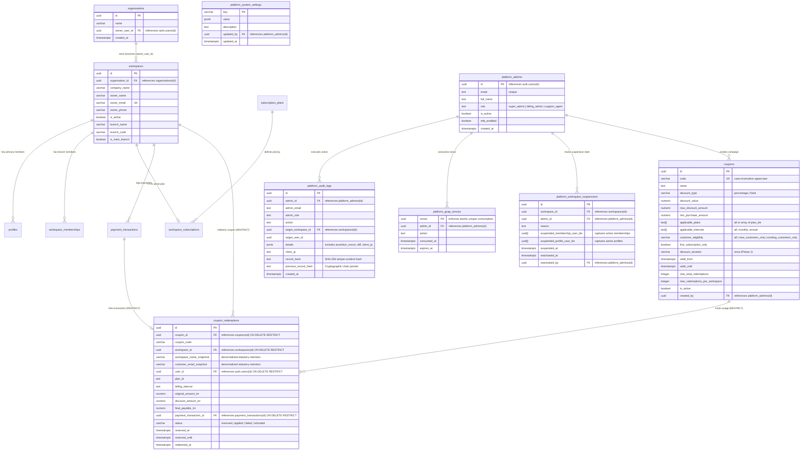

# VISTAAR Super Admin - Database Design & Schema Specification (Phase 2.6 Revised)

**Document Version:** 2.6.0  
**Effective Date:** 2026-11-01  
**Project:** VISTAAR Super Admin Control Plane (`navdeep852/Super-Admin`)  
**Target Domain:** `admin.vistaarone.com`  
**Target Supabase Instance:** Existing Production Database (`https://kluxsykimnjivkqxelba.supabase.co`)  
**Status:** Phase 2.6 Hardened SQL & Schema Specification — Architecture Only (No Live Migrations Executed)

---

## 1. Guiding Principles & Architectural Mandates

1. **Strict Production Schema Integrity:**
   - Existing tables, columns, indexes, foreign keys, triggers, and sequences in the VISTAAR production database are **never deleted, renamed, altered in type, or dropped**.
   - Verified production schema constraints:
     - `public.workspaces` does **not** have an `owner_id` column. Business ownership is resolved exclusively via `public.organizations.owner_user_id` (via `workspaces.organization_id`), `public.profiles` (`role = 'owner'`), `public.workspace_memberships` (`role = 'owner'`), and `workspaces.owner_email`.
     - Status values enforce exact production enums and casing: `public.employee_status` ENUM (`'Active'`, `'Suspended'`, `'Inactive'`, `'Pending'`) and `workspace_memberships.status` (`VARCHAR(50)` defaulting to `'Active'`).
2. **Atomic Nonce-Consumption in Gateway Cryptographic Assertion Protocol (GCAP):**
   - Privileged administrative procedures consume assertion nonces via an atomic `INSERT` into `public.platform_gcap_nonces` governed by a primary key unique constraint within the same transaction, eliminating TOCTOU race conditions.
   - Stored procedures assert `service_role`, verify timestamp freshness ($\pm 30\text{s}$), recompute HMAC-SHA256 signatures using `GATEWAY_ASSERTION_SECRET`, and assert admin status and role in `public.platform_admins`.
3. **Strict Separation of Customer & Backend Execution Contracts:**
   - Possessing a `service_role` key **never** bypasses customer workspace authorization.
   - For direct customer checkout calls, caller identity is derived strictly from `auth.uid()`.
   - For trusted backend gateway calls, the gateway must provide verified customer identity (`p_customer_id`), and the database strictly verifies customer ownership/admin authority in all cases.
4. **Subscription Commercial Policy Integrity:**
   - Same-plan renewals preserve all remaining unexpired paid days.
   - Converting 14-day free trials (`trialing`) or renewing expired subscriptions start fresh cycles from `NOW()`.
   - Mid-cycle plan switches (upgrades, downgrades, monthly-to-annual switches during an active paid period) are **BLOCKED** from automated checkout until formal commercial proration/credit policies are approved by business leadership.
5. **Captured-Funds Payment Verification:**
   - Uncaptured statuses (such as `payment.authorized`) are strictly rejected. Only confirmed captured funds (`'captured'`, `'verified_success'`) can settle subscriptions.
   - Ambiguous late payments (authorized after reservation expiry) are flagged for support review and **never** silently activate subscriptions.
6. **State-Preserving Suspension & Reactivation:**
   - Platform suspension captures the exact IDs of employees who were active at the moment of suspension into `public.platform_workspace_suspensions`.
   - Reactivation restores **only** those specific accounts, preserving pre-existing inactive or suspended statuses.
7. **Database-Enforced Immutability for Audit Records:**
   - `public.platform_audit_logs` is protected by trigger `enforce_platform_audit_immutability()` which unconditionally rejects `UPDATE` and `DELETE` statements.

---

## 2. Complete Entity-Relationship (ER) Architecture



---

## 3. Production Schema Compatibility & Invariants

| Production Entity | Verified Column / Enum | Exact Architecture Alignment | Compatibility Invariant |
| :--- | :--- | :--- | :--- |
| `public.workspaces` | `organization_id`, `owner_email`, `company_name`, `is_active` | **No `owner_id` column exists.** Ownership resolves via `organizations.owner_user_id` or `workspaces.owner_email`. | Code must **never** reference `workspaces.owner_id`. |
| `public.organizations` | `id`, `owner_user_id` (FK &rarr; `auth.users(id)`) | Parent entity owning multiple workspace branches. | Primary anchor for multi-branch ownership checks. |
| `public.profiles` | `status` (ENUM `public.employee_status`) | Values: `'Active'`, `'Suspended'`, `'Inactive'`, `'Pending'`. | Enforces Title Case `'Active'` and `'Suspended'`. |
| `public.workspace_memberships` | `status` (`VARCHAR(50)` default `'Active'`) | Values: `'Active'`, `'Suspended'`, `'Inactive'`. | Enforces Title Case `'Active'` and `'Suspended'`. |
| `public.subscription_plans` | `id`, `price_annual_inr`, `price_monthly_inr` | Canonical plan IDs: `free_trial`, `starter`, `starter_mobile`, `business`, `growth`. | Validated during quoting and settlement. |
| `public.workspace_subscriptions` | `status`, `current_period_start`, `current_period_end` | Status: `trialing`, `active`, `past_due`, `cancelled`, `expired`. | Dates preserved on early renewal. |

---

## 4. Additive Administrative Tables (Full DDL Specifications)

### 4.1 Platform Administrators Table (`public.platform_admins`)

```sql
CREATE TABLE IF NOT EXISTS public.platform_admins (
    id UUID PRIMARY KEY REFERENCES auth.users(id) ON DELETE CASCADE,
    email TEXT NOT NULL UNIQUE,
    full_name TEXT NOT NULL,
    role TEXT NOT NULL DEFAULT 'super_admin' CHECK (role IN ('super_admin', 'billing_admin', 'support_agent')),
    is_active BOOLEAN NOT NULL DEFAULT TRUE,
    mfa_enabled BOOLEAN NOT NULL DEFAULT FALSE,
    phone_number TEXT,
    created_at TIMESTAMPTZ NOT NULL DEFAULT NOW(),
    updated_at TIMESTAMPTZ NOT NULL DEFAULT NOW()
);

CREATE INDEX IF NOT EXISTS idx_platform_admins_role ON public.platform_admins(role, is_active);
CREATE INDEX IF NOT EXISTS idx_platform_admins_email ON public.platform_admins(email);

ALTER TABLE public.platform_admins ENABLE ROW LEVEL SECURITY;
CREATE POLICY "Strict platform admin isolation" ON public.platform_admins
    FOR ALL USING (FALSE);
```

### 4.2 Dedicated GCAP Nonce Registry (`public.platform_gcap_nonces`)

```sql
CREATE TABLE IF NOT EXISTS public.platform_gcap_nonces (
    nonce UUID PRIMARY KEY,
    admin_id UUID NOT NULL REFERENCES public.platform_admins(id) ON DELETE CASCADE,
    action TEXT NOT NULL,
    consumed_at TIMESTAMPTZ NOT NULL DEFAULT NOW(),
    expires_at TIMESTAMPTZ NOT NULL DEFAULT (NOW() + INTERVAL '5 minutes')
);

CREATE INDEX IF NOT EXISTS idx_platform_gcap_nonces_expiry ON public.platform_gcap_nonces(expires_at);

ALTER TABLE public.platform_gcap_nonces ENABLE ROW LEVEL SECURITY;
CREATE POLICY "Strict GCAP nonce isolation" ON public.platform_gcap_nonces
    FOR ALL USING (FALSE);

CREATE OR REPLACE FUNCTION public.cleanup_expired_gcap_nonces()
RETURNS INTEGER
LANGUAGE plpgsql
SECURITY DEFINER
SET search_path = public, pg_temp
AS $$
DECLARE
    v_deleted INTEGER;
BEGIN
    DELETE FROM public.platform_gcap_nonces WHERE expires_at < NOW();
    GET DIAGNOSTICS v_deleted = ROW_COUNT;
    RETURN v_deleted;
END;
$$;
```

### 4.3 State-Preserving Workspace Suspension Registry (`public.platform_workspace_suspensions`)

Captures the exact snapshot of employee memberships and profiles that were active at suspension, ensuring pre-existing inactive accounts are not erroneously reactivated.

```sql
CREATE TABLE IF NOT EXISTS public.platform_workspace_suspensions (
    id UUID PRIMARY KEY DEFAULT gen_random_uuid(),
    workspace_id UUID NOT NULL REFERENCES public.workspaces(id) ON DELETE RESTRICT,
    admin_id UUID NOT NULL REFERENCES public.platform_admins(id) ON DELETE RESTRICT,
    reason TEXT NOT NULL,
    suspended_membership_user_ids UUID[] NOT NULL DEFAULT '{}',
    suspended_profile_user_ids UUID[] NOT NULL DEFAULT '{}',
    is_active_suspension BOOLEAN NOT NULL DEFAULT TRUE,
    suspended_at TIMESTAMPTZ NOT NULL DEFAULT timezone('utc'::text, now()),
    reactivated_at TIMESTAMPTZ DEFAULT NULL,
    reactivated_by UUID REFERENCES public.platform_admins(id) ON DELETE RESTRICT DEFAULT NULL,
    reactivation_reason TEXT DEFAULT NULL
);

CREATE INDEX IF NOT EXISTS idx_workspace_suspensions_ws ON public.platform_workspace_suspensions(workspace_id) WHERE is_active_suspension = TRUE;

ALTER TABLE public.platform_workspace_suspensions ENABLE ROW LEVEL SECURITY;
CREATE POLICY "Strict suspension registry isolation" ON public.platform_workspace_suspensions
    FOR ALL USING (FALSE);
```

### 4.4 Platform Audit Logs Table (`public.platform_audit_logs`)

```sql
CREATE TABLE IF NOT EXISTS public.platform_audit_logs (
    id UUID PRIMARY KEY DEFAULT gen_random_uuid(),
    admin_id UUID REFERENCES public.platform_admins(id) ON DELETE SET NULL,
    admin_email TEXT NOT NULL,
    admin_role TEXT NOT NULL,
    action TEXT NOT NULL,
    target_workspace_id UUID REFERENCES public.workspaces(id) ON DELETE SET NULL,
    target_user_id UUID DEFAULT NULL,
    details JSONB NOT NULL DEFAULT '{}'::jsonb,
    client_ip TEXT,
    user_agent TEXT,
    record_hash TEXT,
    previous_record_hash TEXT,
    created_at TIMESTAMPTZ NOT NULL DEFAULT NOW()
);

CREATE INDEX IF NOT EXISTS idx_platform_audit_created ON public.platform_audit_logs(created_at DESC);
CREATE INDEX IF NOT EXISTS idx_platform_audit_admin ON public.platform_audit_logs(admin_id, created_at DESC);
CREATE INDEX IF NOT EXISTS idx_platform_audit_workspace ON public.platform_audit_logs(target_workspace_id);
CREATE INDEX IF NOT EXISTS idx_platform_audit_action ON public.platform_audit_logs(action);

ALTER TABLE public.platform_audit_logs ENABLE ROW LEVEL SECURITY;
CREATE POLICY "Strict platform audit isolation" ON public.platform_audit_logs
    FOR ALL USING (FALSE);

CREATE OR REPLACE FUNCTION public.enforce_platform_audit_immutability()
RETURNS TRIGGER
LANGUAGE plpgsql
SECURITY DEFINER
SET search_path = public, pg_temp
AS $$
BEGIN
    RAISE EXCEPTION 'SECURITY_VIOLATION: platform_audit_logs is an immutable append-only ledger. Updates and deletions are strictly prohibited.'
        USING ERRCODE = '55000';
END;
$$;

DROP TRIGGER IF EXISTS trg_protect_platform_audit_logs ON public.platform_audit_logs;
CREATE TRIGGER trg_protect_platform_audit_logs
    BEFORE UPDATE OR DELETE ON public.platform_audit_logs
    FOR EACH ROW
    EXECUTE FUNCTION public.enforce_platform_audit_immutability();

REVOKE UPDATE, DELETE, TRUNCATE ON public.platform_audit_logs FROM PUBLIC, anon, authenticated;
REVOKE TRUNCATE ON public.platform_audit_logs FROM service_role;
```

### 4.5 Canonical Coupons Table (`public.coupons`)

```sql
CREATE TABLE IF NOT EXISTS public.coupons (
    id UUID PRIMARY KEY DEFAULT gen_random_uuid(),
    code VARCHAR(50) NOT NULL,
    name VARCHAR(255) NOT NULL,
    description TEXT,
    discount_type VARCHAR(20) NOT NULL CHECK (discount_type IN ('percentage', 'fixed')),
    discount_value NUMERIC(10, 2) NOT NULL CHECK (discount_value > 0),
    max_discount_amount NUMERIC(10, 2) DEFAULT NULL,
    min_purchase_amount NUMERIC(10, 2) NOT NULL DEFAULT 0.00,
    applicable_plans TEXT[] NOT NULL DEFAULT ARRAY['all'],
    applicable_intervals TEXT[] NOT NULL DEFAULT ARRAY['all'],
    customer_eligibility VARCHAR(30) NOT NULL DEFAULT 'all' CHECK (customer_eligibility IN ('all', 'new_customers_only', 'existing_customers_only')),
    first_subscription_only BOOLEAN NOT NULL DEFAULT FALSE,
    discount_duration VARCHAR(20) NOT NULL DEFAULT 'once' CHECK (discount_duration = 'once'),
    duration_in_months INTEGER DEFAULT NULL,
    valid_from TIMESTAMPTZ NOT NULL DEFAULT NOW(),
    valid_until TIMESTAMPTZ DEFAULT NULL,
    max_total_redemptions INTEGER DEFAULT NULL,
    max_redemptions_per_workspace INTEGER NOT NULL DEFAULT 1,
    is_active BOOLEAN NOT NULL DEFAULT TRUE,
    created_by UUID REFERENCES public.platform_admins(id) ON DELETE SET NULL,
    created_at TIMESTAMPTZ NOT NULL DEFAULT NOW(),
    updated_at TIMESTAMPTZ NOT NULL DEFAULT NOW(),
    CONSTRAINT uq_coupons_code UNIQUE (code)
);

CREATE INDEX IF NOT EXISTS idx_coupons_code ON public.coupons(code);
CREATE INDEX IF NOT EXISTS idx_coupons_active_dates ON public.coupons(is_active, valid_from, valid_until);

ALTER TABLE public.coupons ENABLE ROW LEVEL SECURITY;
CREATE POLICY "Prevent direct client access to coupons" ON public.coupons
    FOR ALL USING (FALSE);
```

### 4.6 Coupon Redemptions Table (`public.coupon_redemptions`)

```sql
CREATE TABLE IF NOT EXISTS public.coupon_redemptions (
    id UUID PRIMARY KEY DEFAULT gen_random_uuid(),
    coupon_id UUID NOT NULL REFERENCES public.coupons(id) ON DELETE RESTRICT,
    coupon_code VARCHAR(50) NOT NULL,
    workspace_id UUID NOT NULL REFERENCES public.workspaces(id) ON DELETE RESTRICT,
    workspace_name_snapshot VARCHAR(255) NOT NULL,
    customer_email_snapshot VARCHAR(255) NOT NULL,
    user_id UUID REFERENCES auth.users(id) ON DELETE RESTRICT,
    plan_id TEXT NOT NULL REFERENCES public.subscription_plans(id),
    billing_interval TEXT NOT NULL CHECK (billing_interval IN ('annual', 'monthly')),
    original_amount_inr NUMERIC(10, 2) NOT NULL,
    discount_amount_inr NUMERIC(10, 2) NOT NULL,
    final_payable_inr NUMERIC(10, 2) NOT NULL,
    payment_transaction_id UUID REFERENCES public.payment_transactions(id) ON DELETE RESTRICT,
    status VARCHAR(20) NOT NULL DEFAULT 'reserved' CHECK (status IN ('reserved', 'applied', 'failed', 'refunded')),
    reserved_at TIMESTAMPTZ NOT NULL DEFAULT NOW(),
    reserved_until TIMESTAMPTZ NOT NULL DEFAULT (NOW() + INTERVAL '15 minutes'),
    redeemed_at TIMESTAMPTZ DEFAULT NULL,
    created_at TIMESTAMPTZ NOT NULL DEFAULT NOW()
);

CREATE INDEX IF NOT EXISTS idx_coupon_redemptions_ws ON public.coupon_redemptions(workspace_id, coupon_id);
CREATE INDEX IF NOT EXISTS idx_coupon_redemptions_status ON public.coupon_redemptions(status);
CREATE INDEX IF NOT EXISTS idx_coupon_redemptions_expiry ON public.coupon_redemptions(status, reserved_until);

ALTER TABLE public.coupon_redemptions ENABLE ROW LEVEL SECURITY;
CREATE POLICY "Prevent direct client mutation of redemptions" ON public.coupon_redemptions
    FOR ALL USING (FALSE);
```

### 4.7 Platform System Settings (`public.platform_system_settings`)

```sql
CREATE TABLE IF NOT EXISTS public.platform_system_settings (
    key VARCHAR(100) PRIMARY KEY,
    value JSONB NOT NULL,
    description TEXT,
    updated_by UUID REFERENCES public.platform_admins(id) ON DELETE SET NULL,
    updated_at TIMESTAMPTZ NOT NULL DEFAULT NOW()
);

ALTER TABLE public.platform_system_settings ENABLE ROW LEVEL SECURITY;
CREATE POLICY "Prevent direct client mutation of system settings" ON public.platform_system_settings
    FOR ALL USING (FALSE);
```

---

## 5. Non-Breaking Additive Extensions to Existing Tables

```sql
ALTER TABLE public.workspaces
    ADD COLUMN IF NOT EXISTS suspension_reason TEXT,
    ADD COLUMN IF NOT EXISTS suspended_at TIMESTAMPTZ,
    ADD COLUMN IF NOT EXISTS suspended_by UUID REFERENCES public.platform_admins(id) ON DELETE SET NULL;

ALTER TABLE public.workspace_subscriptions
    ADD COLUMN IF NOT EXISTS applied_coupon_id UUID REFERENCES public.coupons(id) ON DELETE RESTRICT,
    ADD COLUMN IF NOT EXISTS discount_amount_inr NUMERIC(10, 2) DEFAULT 0.00;

ALTER TABLE public.payment_transactions
    ADD COLUMN IF NOT EXISTS coupon_redemption_id UUID REFERENCES public.coupon_redemptions(id) ON DELETE RESTRICT;
```

---

## 6. Authoritative Database Stored Procedures & RPCs

### 6.1 `super_admin_get_platform_metrics`

```sql
CREATE OR REPLACE FUNCTION public.super_admin_get_platform_metrics(
    p_admin_id UUID,
    p_request_timestamp TIMESTAMPTZ,
    p_nonce UUID,
    p_signature TEXT
)
RETURNS JSONB
LANGUAGE plpgsql
SECURITY DEFINER
SET search_path = public, pg_temp
AS $$
DECLARE
    v_gateway_secret TEXT;
    v_canonical_string TEXT;
    v_expected_signature TEXT;
    v_admin_role TEXT;
    v_total_workspaces INTEGER;
    v_active_workspaces INTEGER;
    v_suspended_workspaces INTEGER;
    v_total_users INTEGER;
    v_active_subscriptions INTEGER;
    v_trialing_subscriptions INTEGER;
    v_tenant_gmv_sales NUMERIC(14, 2);
    v_gross_sub_revenue NUMERIC(14, 2);
    v_gst_component NUMERIC(14, 2);
    v_net_sub_revenue NUMERIC(14, 2);
    v_mrr NUMERIC(14, 2);
    v_arr NUMERIC(14, 2);
    v_total_coupons INTEGER;
    v_active_coupons INTEGER;
    v_total_redemptions INTEGER;
    v_total_discount_granted NUMERIC(14, 2);
BEGIN
    -- 1. Assert Caller is Trusted Gateway Service Role
    IF auth.role() IS DISTINCT FROM 'service_role' THEN
        RAISE EXCEPTION 'FORBIDDEN: Administrative metrics can only be invoked by the trusted Backend Gateway.'
            USING ERRCODE = '42501';
    END IF;

    -- 2. Validate Assertion Freshness (30-second skew window)
    IF ABS(EXTRACT(EPOCH FROM (NOW() - p_request_timestamp))) > 30 THEN
        RAISE EXCEPTION 'ASSERTION_EXPIRED: Request timestamp skewed or expired (allowed window: 30 seconds).'
            USING ERRCODE = '28000';
    END IF;

    -- 3. Atomic Nonce Consumption via Dedicated Registry Table
    BEGIN
        INSERT INTO public.platform_gcap_nonces (nonce, admin_id, action, consumed_at, expires_at)
        VALUES (p_nonce, p_admin_id, 'GET_PLATFORM_METRICS', NOW(), NOW() + INTERVAL '5 minutes');
    EXCEPTION WHEN unique_violation THEN
        RAISE EXCEPTION 'REPLAY_DETECTED: Assertion nonce % has already been consumed or is concurrently executing.', p_nonce
            USING ERRCODE = '23505';
    END;

    -- 4. Verify Gateway Cryptographic Signature
    v_gateway_secret := NULLIF(current_setting('app.settings.gateway_assertion_secret', true), '');
    IF v_gateway_secret IS NULL THEN
        RAISE EXCEPTION 'CONFIGURATION_ERROR: Gateway assertion secret is not provisioned on database engine.'
            USING ERRCODE = '55000';
    END IF;

    v_canonical_string := p_admin_id::TEXT || ':GET_PLATFORM_METRICS:ALL:' || 
                          EXTRACT(EPOCH FROM p_request_timestamp)::BIGINT::TEXT || ':' || p_nonce::TEXT;
    v_expected_signature := encode(extensions.hmac(v_canonical_string::bytea, v_gateway_secret::bytea, 'sha256'), 'hex');

    IF p_signature IS DISTINCT FROM v_expected_signature THEN
        RAISE EXCEPTION 'AUTHENTICATION_FAILED: Gateway assertion signature mismatch.'
            USING ERRCODE = '28000';
    END IF;

    -- 5. Verify Administrator Status & Role in Database
    SELECT role INTO v_admin_role
    FROM public.platform_admins
    WHERE id = p_admin_id AND is_active = TRUE;

    IF v_admin_role IS NULL OR v_admin_role NOT IN ('super_admin', 'billing_admin') THEN
        RAISE EXCEPTION 'FORBIDDEN: Administrator is inactive or unauthorized to view platform metrics.'
            USING ERRCODE = '42501';
    END IF;

    -- 6. Metric Calculations
    SELECT COUNT(*), 
           COUNT(*) FILTER (WHERE is_active = TRUE),
           COUNT(*) FILTER (WHERE is_active = FALSE)
    INTO v_total_workspaces, v_active_workspaces, v_suspended_workspaces
    FROM public.workspaces;

    SELECT COUNT(*) INTO v_total_users FROM public.profiles;

    SELECT COUNT(*) FILTER (WHERE status = 'active'),
           COUNT(*) FILTER (WHERE status = 'trialing')
    INTO v_active_subscriptions, v_trialing_subscriptions
    FROM public.workspace_subscriptions;

    SELECT COALESCE(SUM(total_amount), 0.00) INTO v_tenant_gmv_sales
    FROM public.invoices
    WHERE status NOT IN ('cancelled', 'draft');

    SELECT COALESCE(SUM(amount_inr), 0.00) INTO v_gross_sub_revenue
    FROM public.payment_transactions
    WHERE status = 'verified_success';

    v_gst_component := ROUND((v_gross_sub_revenue - (v_gross_sub_revenue / 1.18)), 2);
    v_net_sub_revenue := v_gross_sub_revenue - v_gst_component;

    SELECT 
        COALESCE(SUM(
            CASE 
                WHEN ws.billing_interval = 'monthly' THEN sp.price_monthly_inr
                WHEN ws.billing_interval = 'annual' THEN ROUND(sp.price_annual_inr / 12.0, 2)
                ELSE 0.00 
            END
        ), 0.00)
    INTO v_mrr
    FROM public.workspace_subscriptions ws
    JOIN public.subscription_plans sp ON ws.plan_id = sp.id
    WHERE ws.status = 'active';

    v_arr := ROUND(v_mrr * 12.0, 2);

    SELECT COUNT(*), COUNT(*) FILTER (WHERE is_active = TRUE)
    INTO v_total_coupons, v_active_coupons
    FROM public.coupons;

    SELECT COUNT(*), COALESCE(SUM(discount_amount_inr), 0.00)
    INTO v_total_redemptions, v_total_discount_granted
    FROM public.coupon_redemptions
    WHERE status = 'applied';

    RETURN jsonb_build_object(
        'workspaces', jsonb_build_object(
            'total', v_total_workspaces,
            'active', v_active_workspaces,
            'suspended', v_suspended_workspaces
        ),
        'users', jsonb_build_object('total_registered', v_total_users),
        'subscriptions', jsonb_build_object(
            'active_paid', v_active_subscriptions,
            'active_trial', v_trialing_subscriptions
        ),
        'revenue', jsonb_build_object(
            'tenant_gmv_sales_inr', v_tenant_gmv_sales,
            'gross_collected_subscription_inr', v_gross_sub_revenue,
            'gst_tax_collected_inr', v_gst_component,
            'net_platform_revenue_inr', v_net_sub_revenue,
            'mrr_inr', v_mrr,
            'arr_inr', v_arr
        ),
        'promotions', jsonb_build_object(
            'total_campaigns', v_total_coupons,
            'active_campaigns', v_active_coupons,
            'total_redemptions', v_total_redemptions,
            'total_discount_granted_inr', v_total_discount_granted
        )
    );
END;
$$;

REVOKE ALL ON FUNCTION public.super_admin_get_platform_metrics(UUID, TIMESTAMPTZ, UUID, TEXT) FROM PUBLIC, anon, authenticated;
GRANT EXECUTE ON FUNCTION public.super_admin_get_platform_metrics(UUID, TIMESTAMPTZ, UUID, TEXT) TO service_role;
```

---

### 6.2 `super_admin_suspend_workspace`

Suspends a tenant across database and session layers. Multi-branch aware. Captures exact active memberships and profiles to prevent corrupting pre-existing inactive statuses upon reactivation.

```sql
CREATE OR REPLACE FUNCTION public.super_admin_suspend_workspace(
    p_workspace_id UUID,
    p_reason TEXT,
    p_admin_id UUID,
    p_request_timestamp TIMESTAMPTZ,
    p_nonce UUID,
    p_signature TEXT
)
RETURNS JSONB
LANGUAGE plpgsql
SECURITY DEFINER
SET search_path = public, pg_temp
AS $$
DECLARE
    v_gateway_secret TEXT;
    v_canonical_string TEXT;
    v_expected_signature TEXT;
    v_admin_email TEXT;
    v_admin_role TEXT;
    v_ws_name TEXT;
    v_is_active BOOLEAN;
    v_active_membership_user_ids UUID[] := '{}';
    v_active_profile_user_ids UUID[] := '{}';
    v_user RECORD;
    v_has_other_active_branches BOOLEAN;
BEGIN
    -- 1. Assert Caller is Trusted Gateway Service Role
    IF auth.role() IS DISTINCT FROM 'service_role' THEN
        RAISE EXCEPTION 'FORBIDDEN: Administrative actions can only be invoked by the trusted Backend Gateway.'
            USING ERRCODE = '42501';
    END IF;

    -- 2. Validate Assertion Freshness (30-second skew window)
    IF ABS(EXTRACT(EPOCH FROM (NOW() - p_request_timestamp))) > 30 THEN
        RAISE EXCEPTION 'ASSERTION_EXPIRED: Request timestamp skewed or expired (allowed window: 30 seconds).'
            USING ERRCODE = '28000';
    END IF;

    -- 3. Atomic Nonce Consumption via Dedicated Registry Table
    BEGIN
        INSERT INTO public.platform_gcap_nonces (nonce, admin_id, action, consumed_at, expires_at)
        VALUES (p_nonce, p_admin_id, 'SUSPEND_WORKSPACE', NOW(), NOW() + INTERVAL '5 minutes');
    EXCEPTION WHEN unique_violation THEN
        RAISE EXCEPTION 'REPLAY_DETECTED: Assertion nonce % has already been consumed or is concurrently executing.', p_nonce
            USING ERRCODE = '23505';
    END;

    -- 4. Verify Gateway Cryptographic Signature
    v_gateway_secret := NULLIF(current_setting('app.settings.gateway_assertion_secret', true), '');
    IF v_gateway_secret IS NULL THEN
        RAISE EXCEPTION 'CONFIGURATION_ERROR: Gateway assertion secret is not provisioned on database engine.'
            USING ERRCODE = '55000';
    END IF;

    v_canonical_string := p_admin_id::TEXT || ':SUSPEND_WORKSPACE:' || p_workspace_id::TEXT || ':' || 
                          EXTRACT(EPOCH FROM p_request_timestamp)::BIGINT::TEXT || ':' || p_nonce::TEXT;
    v_expected_signature := encode(extensions.hmac(v_canonical_string::bytea, v_gateway_secret::bytea, 'sha256'), 'hex');

    IF p_signature IS DISTINCT FROM v_expected_signature THEN
        RAISE EXCEPTION 'AUTHENTICATION_FAILED: Gateway assertion signature mismatch.'
            USING ERRCODE = '28000';
    END IF;

    -- 5. Verify Administrator Status & Role in Database
    SELECT email, role INTO v_admin_email, v_admin_role
    FROM public.platform_admins
    WHERE id = p_admin_id AND is_active = TRUE;

    IF v_admin_role IS NULL OR v_admin_role <> 'super_admin' THEN
        RAISE EXCEPTION 'FORBIDDEN: Only active Super Admins can suspend workspaces.'
            USING ERRCODE = '42501';
    END IF;

    -- 6. Lock and Verify Target Workspace
    SELECT company_name, is_active INTO v_ws_name, v_is_active
    FROM public.workspaces
    WHERE id = p_workspace_id
    FOR UPDATE;

    IF v_ws_name IS NULL THEN
        RAISE EXCEPTION 'NOT_FOUND: Workspace % does not exist.', p_workspace_id
            USING ERRCODE = 'P0002';
    END IF;

    IF v_is_active = FALSE THEN
        RETURN jsonb_build_object(
            'success', true,
            'workspace_id', p_workspace_id,
            'status', 'already_suspended'
        );
    END IF;

    -- 7. Snapshot ONLY Memberships That Are Currently 'Active'
    SELECT COALESCE(array_agg(user_id), '{}') INTO v_active_membership_user_ids
    FROM public.workspace_memberships
    WHERE workspace_id = p_workspace_id AND status = 'Active';

    -- 8. Snapshot ONLY Profiles That Are Currently 'Active' and have NO other active branch
    FOR v_user IN 
        SELECT id FROM public.profiles 
        WHERE workspace_id = p_workspace_id AND status = 'Active'::public.employee_status
          AND deleted_at IS NULL
    LOOP
        SELECT EXISTS (
            SELECT 1 
            FROM public.workspace_memberships wm
            JOIN public.workspaces w ON wm.workspace_id = w.id
            WHERE wm.user_id = v_user.id 
              AND wm.workspace_id <> p_workspace_id
              AND wm.status = 'Active'
              AND w.is_active = TRUE
        ) INTO v_has_other_active_branches;

        IF NOT v_has_other_active_branches THEN
            v_active_profile_user_ids := array_append(v_active_profile_user_ids, v_user.id);
        END IF;
    END LOOP;

    -- 9. Record State-Preserving Suspension Snapshot
    INSERT INTO public.platform_workspace_suspensions (
        workspace_id, admin_id, reason, suspended_membership_user_ids, suspended_profile_user_ids, is_active_suspension
    ) VALUES (
        p_workspace_id, p_admin_id, p_reason, v_active_membership_user_ids, v_active_profile_user_ids, TRUE
    );

    -- 10. Deactivate Workspace
    UPDATE public.workspaces
    SET is_active = FALSE,
        suspension_reason = p_reason,
        suspended_at = NOW(),
        suspended_by = p_admin_id,
        updated_at = NOW()
    WHERE id = p_workspace_id;

    -- 11. Suspend ONLY the Snapshotted Active Memberships
    IF array_length(v_active_membership_user_ids, 1) > 0 THEN
        UPDATE public.workspace_memberships
        SET status = 'Suspended'
        WHERE workspace_id = p_workspace_id AND user_id = ANY(v_active_membership_user_ids);
    END IF;

    -- 12. Suspend ONLY the Snapshotted Active Profiles
    IF array_length(v_active_profile_user_ids, 1) > 0 THEN
        UPDATE public.profiles
        SET status = 'Suspended'::public.employee_status
        WHERE id = ANY(v_active_profile_user_ids);
    END IF;

    -- 13. Record Immutably in Platform Audit Log
    INSERT INTO public.platform_audit_logs (
        admin_id, admin_email, admin_role, action, target_workspace_id,
        details, client_ip
    ) VALUES (
        p_admin_id, v_admin_email, v_admin_role, 'SUSPEND_WORKSPACE', p_workspace_id,
        jsonb_build_object(
            'workspace_name', v_ws_name,
            'reason', p_reason,
            'memberships_suspended_count', coalesce(array_length(v_active_membership_user_ids, 1), 0),
            'profiles_suspended_count', coalesce(array_length(v_active_profile_user_ids, 1), 0),
            'assertion_nonce', p_nonce
        ),
        current_setting('request.headers', true)::jsonb->>'x-forwarded-for'
    );

    RETURN jsonb_build_object(
        'success', true,
        'workspace_id', p_workspace_id,
        'status', 'suspended',
        'memberships_suspended', coalesce(array_length(v_active_membership_user_ids, 1), 0),
        'profiles_suspended', coalesce(array_length(v_active_profile_user_ids, 1), 0),
        'session_revocation_required', true
    );
END;
$$;

REVOKE ALL ON FUNCTION public.super_admin_suspend_workspace(UUID, TEXT, UUID, TIMESTAMPTZ, UUID, TEXT) FROM PUBLIC, anon, authenticated;
GRANT EXECUTE ON FUNCTION public.super_admin_suspend_workspace(UUID, TEXT, UUID, TIMESTAMPTZ, UUID, TEXT) TO service_role;
```

---

### 6.3 `super_admin_reactivate_workspace`

Restores a suspended tenant by referencing `platform_workspace_suspensions`. Restores ONLY the specific accounts that were active prior to suspension, leaving previously terminated or suspended accounts untouched.

```sql
CREATE OR REPLACE FUNCTION public.super_admin_reactivate_workspace(
    p_workspace_id UUID,
    p_reason TEXT,
    p_admin_id UUID,
    p_request_timestamp TIMESTAMPTZ,
    p_nonce UUID,
    p_signature TEXT
)
RETURNS JSONB
LANGUAGE plpgsql
SECURITY DEFINER
SET search_path = public, pg_temp
AS $$
DECLARE
    v_gateway_secret TEXT;
    v_canonical_string TEXT;
    v_expected_signature TEXT;
    v_admin_email TEXT;
    v_admin_role TEXT;
    v_ws_name TEXT;
    v_is_active BOOLEAN;
    v_suspension RECORD;
    v_restored_members INTEGER := 0;
    v_restored_profiles INTEGER := 0;
BEGIN
    -- 1. Assert Caller is Trusted Gateway Service Role
    IF auth.role() IS DISTINCT FROM 'service_role' THEN
        RAISE EXCEPTION 'FORBIDDEN: Administrative actions can only be invoked by the trusted Backend Gateway.'
            USING ERRCODE = '42501';
    END IF;

    -- 2. Validate Assertion Freshness (30-second skew window)
    IF ABS(EXTRACT(EPOCH FROM (NOW() - p_request_timestamp))) > 30 THEN
        RAISE EXCEPTION 'ASSERTION_EXPIRED: Request timestamp skewed or expired (allowed window: 30 seconds).'
            USING ERRCODE = '28000';
    END IF;

    -- 3. Atomic Nonce Consumption via Dedicated Registry Table
    BEGIN
        INSERT INTO public.platform_gcap_nonces (nonce, admin_id, action, consumed_at, expires_at)
        VALUES (p_nonce, p_admin_id, 'REACTIVATE_WORKSPACE', NOW(), NOW() + INTERVAL '5 minutes');
    EXCEPTION WHEN unique_violation THEN
        RAISE EXCEPTION 'REPLAY_DETECTED: Assertion nonce % has already been consumed or is concurrently executing.', p_nonce
            USING ERRCODE = '23505';
    END;

    -- 4. Verify Gateway Cryptographic Signature
    v_gateway_secret := NULLIF(current_setting('app.settings.gateway_assertion_secret', true), '');
    IF v_gateway_secret IS NULL THEN
        RAISE EXCEPTION 'CONFIGURATION_ERROR: Gateway assertion secret is not provisioned on database engine.'
            USING ERRCODE = '55000';
    END IF;

    v_canonical_string := p_admin_id::TEXT || ':REACTIVATE_WORKSPACE:' || p_workspace_id::TEXT || ':' || 
                          EXTRACT(EPOCH FROM p_request_timestamp)::BIGINT::TEXT || ':' || p_nonce::TEXT;
    v_expected_signature := encode(extensions.hmac(v_canonical_string::bytea, v_gateway_secret::bytea, 'sha256'), 'hex');

    IF p_signature IS DISTINCT FROM v_expected_signature THEN
        RAISE EXCEPTION 'AUTHENTICATION_FAILED: Gateway assertion signature mismatch.'
            USING ERRCODE = '28000';
    END IF;

    -- 5. Verify Administrator Status & Role in Database
    SELECT email, role INTO v_admin_email, v_admin_role
    FROM public.platform_admins
    WHERE id = p_admin_id AND is_active = TRUE;

    IF v_admin_role IS NULL OR v_admin_role <> 'super_admin' THEN
        RAISE EXCEPTION 'FORBIDDEN: Only active Super Admins can reactivate workspaces.'
            USING ERRCODE = '42501';
    END IF;

    -- 6. Lock and Verify Target Workspace
    SELECT company_name, is_active INTO v_ws_name, v_is_active
    FROM public.workspaces
    WHERE id = p_workspace_id
    FOR UPDATE;

    IF v_ws_name IS NULL THEN
        RAISE EXCEPTION 'NOT_FOUND: Workspace % does not exist.', p_workspace_id
            USING ERRCODE = 'P0002';
    END IF;

    IF v_is_active = TRUE THEN
        RETURN jsonb_build_object(
            'success', true,
            'workspace_id', p_workspace_id,
            'status', 'already_active'
        );
    END IF;

    -- 7. Locate Active Suspension Snapshot Record
    SELECT * INTO v_suspension
    FROM public.platform_workspace_suspensions
    WHERE workspace_id = p_workspace_id AND is_active_suspension = TRUE
    ORDER BY suspended_at DESC
    LIMIT 1
    FOR UPDATE;

    -- 8. Reactivate Target Workspace
    UPDATE public.workspaces
    SET is_active = TRUE,
        suspension_reason = NULL,
        suspended_at = NULL,
        suspended_by = NULL,
        updated_at = NOW()
    WHERE id = p_workspace_id;

    -- 9. Restore ONLY the Specifically Snapshotted Memberships that are still 'Suspended'
    IF v_suspension.id IS NOT NULL AND array_length(v_suspension.suspended_membership_user_ids, 1) > 0 THEN
        UPDATE public.workspace_memberships
        SET status = 'Active'
        WHERE workspace_id = p_workspace_id 
          AND user_id = ANY(v_suspension.suspended_membership_user_ids)
          AND status = 'Suspended';
        GET DIAGNOSTICS v_restored_members = ROW_COUNT;
    END IF;

    -- 10. Restore ONLY the Specifically Snapshotted Profiles that are still 'Suspended' and not deleted
    IF v_suspension.id IS NOT NULL AND array_length(v_suspension.suspended_profile_user_ids, 1) > 0 THEN
        UPDATE public.profiles
        SET status = 'Active'::public.employee_status
        WHERE id = ANY(v_suspension.suspended_profile_user_ids)
          AND status = 'Suspended'::public.employee_status
          AND deleted_at IS NULL;
        GET DIAGNOSTICS v_restored_profiles = ROW_COUNT;
    END IF;

    -- 11. Close Suspension Record
    IF v_suspension.id IS NOT NULL THEN
        UPDATE public.platform_workspace_suspensions
        SET is_active_suspension = FALSE,
            reactivated_at = NOW(),
            reactivated_by = p_admin_id,
            reactivation_reason = p_reason
        WHERE id = v_suspension.id;
    END IF;

    -- 12. Record in Platform Audit Log
    INSERT INTO public.platform_audit_logs (
        admin_id, admin_email, admin_role, action, target_workspace_id,
        details, client_ip
    ) VALUES (
        p_admin_id, v_admin_email, v_admin_role, 'REACTIVATE_WORKSPACE', p_workspace_id,
        jsonb_build_object(
            'workspace_name', v_ws_name,
            'reason', p_reason,
            'memberships_restored', v_restored_members,
            'profiles_restored', v_restored_profiles,
            'assertion_nonce', p_nonce
        ),
        current_setting('request.headers', true)::jsonb->>'x-forwarded-for'
    );

    RETURN jsonb_build_object(
        'success', true,
        'workspace_id', p_workspace_id,
        'status', 'active',
        'memberships_restored', v_restored_members,
        'profiles_restored', v_restored_profiles
    );
END;
$$;

REVOKE ALL ON FUNCTION public.super_admin_reactivate_workspace(UUID, TEXT, UUID, TIMESTAMPTZ, UUID, TEXT) FROM PUBLIC, anon, authenticated;
GRANT EXECUTE ON FUNCTION public.super_admin_reactivate_workspace(UUID, TEXT, UUID, TIMESTAMPTZ, UUID, TEXT) TO service_role;
```

---

### 6.4 `validate_and_reserve_coupon` (Private Checkout Quoting)

Reconciled with production schema: ownership is verified through `organizations.owner_user_id`, `profiles`, `workspace_memberships`, and `workspaces.owner_email` (no `owner_id` column). Blocks mid-cycle plan changes.

```sql
CREATE OR REPLACE FUNCTION public.validate_and_reserve_coupon(
    p_code TEXT,
    p_workspace_id UUID,
    p_plan_id TEXT,
    p_billing_interval TEXT,
    p_customer_id UUID DEFAULT NULL
)
RETURNS JSONB
LANGUAGE plpgsql
SECURITY DEFINER
SET search_path = public, pg_temp
AS $$
DECLARE
    v_caller_id UUID;
    v_is_authorized BOOLEAN := FALSE;
    v_coupon RECORD;
    v_plan RECORD;
    v_ws RECORD;
    v_existing_sub RECORD;
    v_base_price NUMERIC(10, 2);
    v_discount NUMERIC(10, 2) := 0;
    v_final NUMERIC(10, 2);
    v_applied_total_count INTEGER;
    v_applied_ws_count INTEGER;
    v_has_past_payments BOOLEAN;
    v_redemption_id UUID;
    v_now TIMESTAMPTZ := NOW();
BEGIN
    -- 1. Resolve Effective Customer Identity (Separate Contracts)
    IF auth.role() = 'authenticated' THEN
        v_caller_id := auth.uid();
    ELSIF auth.role() = 'service_role' THEN
        IF p_customer_id IS NULL THEN
            RETURN jsonb_build_object('success', false, 'error', 'MISSING_CUSTOMER_CONTEXT: Trusted backend calls must supply verified customer identity.');
        END IF;
        v_caller_id := p_customer_id;
    ELSE
        RETURN jsonb_build_object('success', false, 'error', 'UNAUTHORIZED: Missing session token.');
    END IF;

    -- 2. Fetch Workspace Details (Verified Schema)
    SELECT * INTO v_ws FROM public.workspaces WHERE id = p_workspace_id;
    IF NOT FOUND THEN
        RETURN jsonb_build_object('success', false, 'error', 'Invalid workspace specified.');
    END IF;

    -- 3. Reject Inactive / Suspended Workspaces
    IF NOT v_ws.is_active THEN
        RETURN jsonb_build_object('success', false, 'error', 'Workspace is suspended or inactive. Subscriptions cannot be purchased.');
    END IF;

    -- 4. Verified Production Workspace Authorization (NO owner_id assumption; NO service_role bypass)
    -- Check 4A: Parent Organization Owner (Migration 058 canonical architecture)
    IF v_ws.organization_id IS NOT NULL THEN
        SELECT EXISTS (
            SELECT 1 FROM public.organizations 
            WHERE id = v_ws.organization_id AND owner_user_id = v_caller_id
        ) INTO v_is_authorized;
    END IF;

    -- Check 4B: Active Profile with Owner or Admin Role
    IF NOT v_is_authorized THEN
        SELECT EXISTS (
            SELECT 1 FROM public.profiles 
            WHERE id = v_caller_id 
              AND workspace_id = p_workspace_id 
              AND LOWER(role::TEXT) IN ('owner', 'admin')
              AND status = 'Active'::public.employee_status
        ) INTO v_is_authorized;
    END IF;

    -- Check 4C: Active Workspace Membership with Owner or Admin Role
    IF NOT v_is_authorized THEN
        SELECT EXISTS (
            SELECT 1 FROM public.workspace_memberships 
            WHERE user_id = v_caller_id 
              AND workspace_id = p_workspace_id 
              AND LOWER(role::TEXT) IN ('owner', 'admin')
              AND status = 'Active'
        ) INTO v_is_authorized;
    END IF;

    -- Check 4D: Direct Owner Email Match
    IF NOT v_is_authorized AND v_ws.owner_email IS NOT NULL THEN
        SELECT EXISTS (
            SELECT 1 FROM auth.users 
            WHERE id = v_caller_id AND LOWER(email) = LOWER(v_ws.owner_email)
        ) INTO v_is_authorized;
    END IF;

    IF NOT v_is_authorized THEN
        RETURN jsonb_build_object('success', false, 'error', 'FORBIDDEN: You do not have authorization to manage subscriptions for this workspace.');
    END IF;

    -- 5. Commercial Policy Guard: Block Mid-Cycle Plan Changes Pending Business Approval
    SELECT * INTO v_existing_sub
    FROM public.workspace_subscriptions
    WHERE workspace_id = p_workspace_id;

    IF v_existing_sub.id IS NOT NULL AND v_existing_sub.status = 'active' AND v_existing_sub.current_period_end > v_now THEN
        IF v_existing_sub.plan_id <> p_plan_id OR v_existing_sub.billing_interval <> p_billing_interval THEN
            RETURN jsonb_build_object(
                'success', false, 
                'error', 'MID_CYCLE_PLAN_CHANGE_BLOCKED: Mid-cycle plan upgrades, downgrades, and interval switches during an active paid period require manual Super Admin assistance. You may renew your current plan or switch plans upon period expiration.'
            );
        END IF;
    END IF;

    -- 6. Fetch Plan Details
    SELECT * INTO v_plan FROM public.subscription_plans WHERE id = p_plan_id;
    IF NOT FOUND THEN
        RETURN jsonb_build_object('success', false, 'error', 'Invalid subscription plan specified.');
    END IF;

    IF p_billing_interval = 'monthly' THEN
        v_base_price := v_plan.price_monthly_inr;
    ELSE
        v_base_price := v_plan.price_annual_inr;
    END IF;

    IF v_base_price <= 0 THEN
        RETURN jsonb_build_object('success', false, 'error', 'Coupons cannot be applied to free tiers.');
    END IF;

    -- 7. Fetch and Lock Coupon Row (Atomic Concurrency Protection)
    SELECT * INTO v_coupon
    FROM public.coupons
    WHERE UPPER(code) = UPPER(TRIM(p_code))
    FOR UPDATE;

    IF NOT FOUND THEN
        RETURN jsonb_build_object('success', false, 'error', 'Invalid coupon code.');
    END IF;

    IF NOT v_coupon.is_active THEN
        RETURN jsonb_build_object('success', false, 'error', 'This coupon is no longer active.');
    END IF;

    IF v_now < v_coupon.valid_from THEN
        RETURN jsonb_build_object('success', false, 'error', 'This promotion has not started yet.');
    END IF;

    IF v_coupon.valid_until IS NOT NULL AND v_now > v_coupon.valid_until THEN
        RETURN jsonb_build_object('success', false, 'error', 'This coupon has expired.');
    END IF;

    -- 8. Plan and Interval Eligibility
    IF NOT ('all' = ANY(v_coupon.applicable_plans) OR p_plan_id = ANY(v_coupon.applicable_plans)) THEN
        RETURN jsonb_build_object('success', false, 'error', 'This coupon is not valid for the selected plan.');
    END IF;

    IF NOT ('all' = ANY(v_coupon.applicable_intervals) OR p_billing_interval = ANY(v_coupon.applicable_intervals)) THEN
        RETURN jsonb_build_object('success', false, 'error', 'This coupon is not valid for ' || p_billing_interval || ' billing.');
    END IF;

    -- 9. Minimum Spend Threshold
    IF v_base_price < v_coupon.min_purchase_amount THEN
        RETURN jsonb_build_object('success', false, 'error', 'Minimum purchase amount of ₹' || v_coupon.min_purchase_amount || ' required.');
    END IF;

    -- 10. Customer Eligibility
    IF v_coupon.customer_eligibility = 'new_customers_only' OR v_coupon.first_subscription_only THEN
        SELECT EXISTS(
            SELECT 1 FROM public.payment_transactions 
            WHERE workspace_id = p_workspace_id AND status = 'verified_success'
        ) INTO v_has_past_payments;

        IF v_has_past_payments THEN
            RETURN jsonb_build_object('success', false, 'error', 'This coupon is strictly reserved for new subscriptions.');
        END IF;
    END IF;

    -- 11. Global Quota Check
    IF v_coupon.max_total_redemptions IS NOT NULL THEN
        SELECT COUNT(*) INTO v_applied_total_count
        FROM public.coupon_redemptions
        WHERE coupon_id = v_coupon.id 
          AND (status = 'applied' OR (status = 'reserved' AND reserved_until > v_now));

        IF v_applied_total_count >= v_coupon.max_total_redemptions THEN
            RETURN jsonb_build_object('success', false, 'error', 'This coupon has reached its maximum redemption limit.');
        END IF;
    END IF;

    -- 12. Per-Workspace Limit Check
    SELECT COUNT(*) INTO v_applied_ws_count
    FROM public.coupon_redemptions
    WHERE coupon_id = v_coupon.id 
      AND workspace_id = p_workspace_id 
      AND (status = 'applied' OR (status = 'reserved' AND reserved_until > v_now));

    IF v_applied_ws_count >= v_coupon.max_redemptions_per_workspace THEN
        RETURN jsonb_build_object('success', false, 'error', 'Your business has already redeemed this coupon.');
    END IF;

    -- 13. Compute Discount Math
    IF v_coupon.discount_type = 'percentage' THEN
        v_discount := ROUND((v_base_price * (v_coupon.discount_value / 100.0)), 2);
        IF v_coupon.max_discount_amount IS NOT NULL AND v_discount > v_coupon.max_discount_amount THEN
            v_discount := v_coupon.max_discount_amount;
        END IF;
    ELSE
        v_discount := LEAST(v_base_price, v_coupon.discount_value);
    END IF;

    v_final := GREATEST(0.00, v_base_price - v_discount);

    -- 14. Insert Phase 1 Reservation with Snapshot Metadata
    INSERT INTO public.coupon_redemptions (
        coupon_id,
        coupon_code,
        workspace_id,
        workspace_name_snapshot,
        customer_email_snapshot,
        user_id,
        plan_id,
        billing_interval,
        original_amount_inr,
        discount_amount_inr,
        final_payable_inr,
        status,
        reserved_at,
        reserved_until
    ) VALUES (
        v_coupon.id,
        v_coupon.code,
        p_workspace_id,
        v_ws.company_name,
        v_ws.owner_email,
        v_caller_id,
        p_plan_id,
        p_billing_interval,
        v_base_price,
        v_discount,
        v_final,
        'reserved',
        v_now,
        v_now + INTERVAL '15 minutes'
    ) RETURNING id INTO v_redemption_id;

    RETURN jsonb_build_object(
        'success', true,
        'redemption_id', v_redemption_id,
        'coupon_code', v_coupon.code,
        'discount_type', v_coupon.discount_type,
        'discount_value', v_coupon.discount_value,
        'original_amount_inr', v_base_price,
        'discount_amount_inr', v_discount,
        'final_payable_inr', v_final,
        'reserved_until', v_now + INTERVAL '15 minutes'
    );
END;
$$;

REVOKE ALL ON FUNCTION public.validate_and_reserve_coupon(TEXT, UUID, TEXT, TEXT, UUID) FROM PUBLIC, anon;
GRANT EXECUTE ON FUNCTION public.validate_and_reserve_coupon(TEXT, UUID, TEXT, TEXT, UUID) TO authenticated, service_role;
```

---

### 6.5 `activate_zero_payable_subscription` (100% Discount Path)

Provides a dedicated, secure server-side activation path for promotions where `final_payable_inr = 0.00`. Verifies caller ownership over the reservation's workspace and preserves existing unexpired subscription periods.

```sql
CREATE OR REPLACE FUNCTION public.activate_zero_payable_subscription(
    p_redemption_id UUID,
    p_customer_id UUID DEFAULT NULL
)
RETURNS JSONB
LANGUAGE plpgsql
SECURITY DEFINER
SET search_path = public, pg_temp
AS $$
DECLARE
    v_caller_id UUID;
    v_is_authorized BOOLEAN := FALSE;
    v_redemption RECORD;
    v_ws RECORD;
    v_existing_sub RECORD;
    v_period_interval INTERVAL;
    v_new_period_start TIMESTAMPTZ;
    v_new_period_end TIMESTAMPTZ;
    v_now TIMESTAMPTZ := NOW();
BEGIN
    -- 1. Resolve Effective Customer Identity (Separate Contracts)
    IF auth.role() = 'authenticated' THEN
        v_caller_id := auth.uid();
    ELSIF auth.role() = 'service_role' THEN
        IF p_customer_id IS NULL THEN
            RETURN jsonb_build_object('success', false, 'error', 'MISSING_CUSTOMER_CONTEXT: Trusted backend calls must supply verified customer identity.');
        END IF;
        v_caller_id := p_customer_id;
    ELSE
        RETURN jsonb_build_object('success', false, 'error', 'UNAUTHORIZED: Missing session token.');
    END IF;

    -- 2. Fetch and Lock Redemption Record
    SELECT * INTO v_redemption
    FROM public.coupon_redemptions
    WHERE id = p_redemption_id
    FOR UPDATE;

    IF NOT FOUND THEN
        RETURN jsonb_build_object('success', false, 'error', 'Invalid redemption ID.');
    END IF;

    -- 3. Assert Active Reservation Status & Expiry
    IF v_redemption.status <> 'reserved' THEN
        RETURN jsonb_build_object('success', false, 'error', 'Reservation is not active (current status: ' || v_redemption.status || ').');
    END IF;

    IF v_redemption.reserved_until < v_now THEN
        RETURN jsonb_build_object('success', false, 'error', 'Coupon reservation has expired.');
    END IF;

    -- 4. Assert Exact Zero Cost
    IF v_redemption.final_payable_inr <> 0.00 THEN
        RETURN jsonb_build_object('success', false, 'error', 'This promotion requires payment settlement (payable: ₹' || v_redemption.final_payable_inr || ').');
    END IF;

    -- 5. Fetch Target Workspace & Check Active Status
    SELECT * INTO v_ws FROM public.workspaces WHERE id = v_redemption.workspace_id;
    IF NOT FOUND THEN
        RETURN jsonb_build_object('success', false, 'error', 'Target workspace does not exist.');
    END IF;

    IF NOT v_ws.is_active THEN
        RETURN jsonb_build_object('success', false, 'error', 'Target workspace is suspended or inactive.');
    END IF;

    -- 6. Strict Workspace Authorization Guard (Verified Schema, NO owner_id assumption)
    IF v_ws.organization_id IS NOT NULL THEN
        SELECT EXISTS (
            SELECT 1 FROM public.organizations 
            WHERE id = v_ws.organization_id AND owner_user_id = v_caller_id
        ) INTO v_is_authorized;
    END IF;

    IF NOT v_is_authorized THEN
        SELECT EXISTS (
            SELECT 1 FROM public.profiles 
            WHERE id = v_caller_id 
              AND workspace_id = v_redemption.workspace_id 
              AND LOWER(role::TEXT) IN ('owner', 'admin')
              AND status = 'Active'::public.employee_status
        ) INTO v_is_authorized;
    END IF;

    IF NOT v_is_authorized THEN
        SELECT EXISTS (
            SELECT 1 FROM public.workspace_memberships 
            WHERE user_id = v_caller_id 
              AND workspace_id = v_redemption.workspace_id 
              AND LOWER(role::TEXT) IN ('owner', 'admin')
              AND status = 'Active'
        ) INTO v_is_authorized;
    END IF;

    IF NOT v_is_authorized AND v_ws.owner_email IS NOT NULL THEN
        SELECT EXISTS (
            SELECT 1 FROM auth.users 
            WHERE id = v_caller_id AND LOWER(email) = LOWER(v_ws.owner_email)
        ) INTO v_is_authorized;
    END IF;

    IF NOT v_is_authorized THEN
        RETURN jsonb_build_object('success', false, 'error', 'FORBIDDEN: You do not have authorization to manage subscriptions for this workspace.');
    END IF;

    -- 7. Commercial Policy Guard: Block Mid-Cycle Plan Changes
    SELECT * INTO v_existing_sub
    FROM public.workspace_subscriptions
    WHERE workspace_id = v_redemption.workspace_id
    FOR UPDATE;

    IF v_existing_sub.id IS NOT NULL AND v_existing_sub.status = 'active' AND v_existing_sub.current_period_end > v_now THEN
        IF v_existing_sub.plan_id <> v_redemption.plan_id OR v_existing_sub.billing_interval <> v_redemption.billing_interval THEN
            RETURN jsonb_build_object(
                'success', false, 
                'error', 'MID_CYCLE_PLAN_CHANGE_BLOCKED: Mid-cycle plan switches require formal commercial approval. You may renew your current plan.'
            );
        END IF;
    END IF;

    -- 8. Subscription Period Preservation Mathematics
    IF v_redemption.billing_interval = 'monthly' THEN
        v_period_interval := INTERVAL '1 month';
    ELSE
        v_period_interval := INTERVAL '1 year';
    END IF;

    IF v_existing_sub.id IS NULL THEN
        -- Scenario A: Brand New Subscription
        v_new_period_start := v_now;
        v_new_period_end := v_now + v_period_interval;
    ELSIF v_existing_sub.status = 'trialing' THEN
        -- Scenario B: Converting 14-Day Free Trial to Paid Active Plan
        v_new_period_start := v_now;
        v_new_period_end := v_now + v_period_interval;
    ELSIF v_existing_sub.status = 'active' AND v_existing_sub.current_period_end >= v_now THEN
        -- Scenario C: Same-Plan Early Renewal (preserves unexpired days)
        v_new_period_start := v_existing_sub.current_period_start;
        v_new_period_end := v_existing_sub.current_period_end + v_period_interval;
    ELSE
        -- Scenario D: Renewal After Expiry
        v_new_period_start := v_now;
        v_new_period_end := v_now + v_period_interval;
    END IF;

    -- 9. Atomically Transition Redemption to Applied
    UPDATE public.coupon_redemptions
    SET status = 'applied',
        redeemed_at = v_now
    WHERE id = p_redemption_id;

    -- 10. Insert Zero-Cost Transaction Audit Record
    INSERT INTO public.payment_transactions (
        workspace_id, transaction_reference, provider, amount_inr, currency,
        plan_id, status, provider_payload, verified_at, coupon_redemption_id
    ) VALUES (
        v_redemption.workspace_id,
        'ZERO_PROMO_' || SUBSTRING(p_redemption_id::TEXT, 1, 8) || '_' || EXTRACT(EPOCH FROM v_now)::BIGINT,
        'promotional_grant',
        0.00,
        'INR',
        v_redemption.plan_id,
        'verified_success',
        jsonb_build_object('coupon_code', v_redemption.coupon_code, 'discount_amount', v_redemption.discount_amount_inr),
        v_now,
        p_redemption_id
    );

    -- 11. Activate or Extend Workspace Subscription
    INSERT INTO public.workspace_subscriptions (
        workspace_id, plan_id, status, current_period_start, current_period_end,
        billing_interval, applied_coupon_id, discount_amount_inr, updated_at
    ) VALUES (
        v_redemption.workspace_id, v_redemption.plan_id, 'active', v_new_period_start, v_new_period_end,
        v_redemption.billing_interval, v_redemption.coupon_id, v_redemption.discount_amount_inr, v_now
    )
    ON CONFLICT (workspace_id) DO UPDATE SET
        plan_id = EXCLUDED.plan_id,
        status = 'active',
        current_period_start = EXCLUDED.current_period_start,
        current_period_end = EXCLUDED.current_period_end,
        billing_interval = EXCLUDED.billing_interval,
        applied_coupon_id = EXCLUDED.applied_coupon_id,
        discount_amount_inr = EXCLUDED.discount_amount_inr,
        updated_at = v_now;

    RETURN jsonb_build_object(
        'success', true,
        'status', 'activated',
        'plan_id', v_redemption.plan_id,
        'period_start', v_new_period_start,
        'period_end', v_new_period_end
    );
END;
$$;

REVOKE ALL ON FUNCTION public.activate_zero_payable_subscription(UUID, UUID) FROM PUBLIC, anon;
GRANT EXECUTE ON FUNCTION public.activate_zero_payable_subscription(UUID, UUID) TO authenticated, service_role;
```

---

### 6.6 `settle_coupon_payment` (Webhook Settlement Procedure)

Settles a verified payment from `youpi_pg`. Rejects uncaptured funds (`payment.authorized`). Handles late payments and ambiguous expiry safely. Preserves existing subscription periods.

```sql
CREATE OR REPLACE FUNCTION public.settle_coupon_payment(
    p_redemption_id UUID,
    p_transaction_reference TEXT,
    p_gateway_provider TEXT,
    p_amount_paid NUMERIC,
    p_currency TEXT,
    p_provider_payload JSONB,
    p_payment_authorized_at TIMESTAMPTZ,
    p_provider_status TEXT DEFAULT 'captured'
)
RETURNS JSONB
LANGUAGE plpgsql
SECURITY DEFINER
SET search_path = public, pg_temp
AS $$
DECLARE
    v_redemption RECORD;
    v_existing_tx RECORD;
    v_existing_sub RECORD;
    v_tx_id UUID;
    v_period_interval INTERVAL;
    v_new_period_start TIMESTAMPTZ;
    v_new_period_end TIMESTAMPTZ;
    v_now TIMESTAMPTZ := NOW();
BEGIN
    -- 1. Assert Execution via Trusted Backend Gateway Service Role
    IF auth.role() IS DISTINCT FROM 'service_role' THEN
        RAISE EXCEPTION 'FORBIDDEN: Payment settlement can only be executed by the trusted Backend Gateway.'
            USING ERRCODE = '42501';
    END IF;

    -- 2. Validate Allowed Payment Provider
    IF LOWER(TRIM(p_gateway_provider)) NOT IN ('youpi_pg') THEN
        RAISE EXCEPTION 'UNSUPPORTED_PROVIDER: Payment provider % is not permitted.', p_gateway_provider
            USING ERRCODE = '22023';
    END IF;

    -- 3. Validate Authoritative Captured Status (Reject uncaptured payment.authorized)
    IF LOWER(TRIM(p_provider_status)) NOT IN ('captured', 'verified_success') THEN
        RAISE EXCEPTION 'PAYMENT_NOT_CAPTURED: Payment status % cannot settle subscription. Funds must be captured.', p_provider_status
            USING ERRCODE = '22023';
    END IF;

    -- 4. Future-Dated Authorization Tolerance Check (+5 minutes maximum clock skew)
    IF p_payment_authorized_at > (v_now + INTERVAL '5 minutes') THEN
        RAISE EXCEPTION 'FUTURE_DATED_PAYMENT: Authorization timestamp % exceeds allowed clock skew.', p_payment_authorized_at
            USING ERRCODE = '22008';
    END IF;

    -- 5. Fetch and Exclusively Lock Redemption Record
    SELECT * INTO v_redemption
    FROM public.coupon_redemptions
    WHERE id = p_redemption_id
    FOR UPDATE;

    IF NOT FOUND THEN
        RETURN jsonb_build_object('success', false, 'error', 'Invalid redemption ID.');
    END IF;

    -- 6. Check Existing Transaction Reference Collisions
    SELECT * INTO v_existing_tx
    FROM public.payment_transactions
    WHERE transaction_reference = p_transaction_reference
    FOR UPDATE;

    IF v_existing_tx.id IS NOT NULL THEN
        -- Case 6A: Idempotent duplicate delivery of identical verified transaction
        IF v_existing_tx.coupon_redemption_id = p_redemption_id AND 
           v_existing_tx.workspace_id = v_redemption.workspace_id AND
           v_existing_tx.status = 'verified_success' THEN
            RETURN jsonb_build_object(
                'success', true, 
                'status', 'already_settled', 
                'message', 'Idempotent duplicate webhook handled cleanly.'
            );
        END IF;

        -- Case 6B: Idempotent duplicate delivery of support review transaction
        IF v_existing_tx.coupon_redemption_id = p_redemption_id AND 
           v_existing_tx.workspace_id = v_redemption.workspace_id AND
           v_existing_tx.status = 'failed' AND
           (v_existing_tx.provider_payload->>'requires_support_review')::boolean = true THEN
            RETURN jsonb_build_object(
                'success', false, 
                'status', 'already_under_support_review', 
                'message', 'Duplicate webhook for transaction already flagged for manual support review.'
            );
        END IF;

        -- Case 6C: Collision / Reused transaction reference across different redemptions
        RAISE EXCEPTION 'TRANSACTION_REF_COLLISION: Transaction reference % is already bound to workspace % or redemption %.',
            p_transaction_reference, v_existing_tx.workspace_id, v_existing_tx.coupon_redemption_id
            USING ERRCODE = '23505';
    END IF;

    -- 7. Validate Reservation Status
    IF v_redemption.status <> 'reserved' THEN
        RETURN jsonb_build_object(
            'success', false, 
            'error', 'Reservation is not in reserved state (current: ' || v_redemption.status || ').'
        );
    END IF;

    -- 8. Ambiguous Payment & Late Expiry Policy
    -- 8A. Payment authorized AFTER reservation expired: flag for support review and DO NOT activate
    IF p_payment_authorized_at > v_redemption.reserved_until THEN
        UPDATE public.coupon_redemptions SET status = 'failed' WHERE id = p_redemption_id;
        
        INSERT INTO public.payment_transactions (
            workspace_id, transaction_reference, provider, amount_inr, currency,
            plan_id, status, provider_payload, coupon_redemption_id
        ) VALUES (
            v_redemption.workspace_id, p_transaction_reference, p_gateway_provider, p_amount_paid, p_currency,
            v_redemption.plan_id, 'failed',
            p_provider_payload || jsonb_build_object(
                'requires_support_review', true,
                'support_review_reason', 'PAYMENT_AUTHORIZED_AFTER_RESERVATION_EXPIRY',
                'authorized_at', p_payment_authorized_at,
                'reserved_until', v_redemption.reserved_until
            ),
            p_redemption_id
        );

        RETURN jsonb_build_object(
            'success', false, 
            'status', 'requires_support_review',
            'error', 'PAYMENT_AUTHORIZED_AFTER_EXPIRY',
            'message', 'Payment was authorized after reservation expired. Held for manual support reconciliation. Subscription not activated.'
        );
    END IF;

    -- 8B. Webhook transit arrival delayed beyond 24 hours of gateway authorization
    IF (v_now - p_payment_authorized_at) > INTERVAL '24 hours' THEN
        UPDATE public.coupon_redemptions SET status = 'failed' WHERE id = p_redemption_id;

        INSERT INTO public.payment_transactions (
            workspace_id, transaction_reference, provider, amount_inr, currency,
            plan_id, status, provider_payload, coupon_redemption_id
        ) VALUES (
            v_redemption.workspace_id, p_transaction_reference, p_gateway_provider, p_amount_paid, p_currency,
            v_redemption.plan_id, 'failed',
            p_provider_payload || jsonb_build_object(
                'requires_support_review', true,
                'support_review_reason', 'WEBHOOK_TRANSIT_TIMEOUT',
                'authorized_at', p_payment_authorized_at,
                'received_at', v_now
            ),
            p_redemption_id
        );

        RETURN jsonb_build_object(
            'success', false, 
            'status', 'requires_support_review',
            'error', 'WEBHOOK_TRANSIT_TIMEOUT',
            'message', 'Webhook delivery exceeded 24-hour maximum transit window. Held for manual support review. Subscription not activated.'
        );
    END IF;

    -- 9. Validate Currency Standards (INR Only)
    IF UPPER(TRIM(p_currency)) <> 'INR' THEN
        UPDATE public.coupon_redemptions SET status = 'failed' WHERE id = p_redemption_id;
        RETURN jsonb_build_object('success', false, 'error', 'CURRENCY_MISMATCH: Only INR settlements supported.');
    END IF;

    -- 10. Validate Amount Equality (Exact Match Protection)
    IF p_amount_paid <> v_redemption.final_payable_inr THEN
        UPDATE public.coupon_redemptions SET status = 'failed' WHERE id = p_redemption_id;
        
        INSERT INTO public.payment_transactions (
            workspace_id, transaction_reference, provider, amount_inr, currency,
            plan_id, status, provider_payload, coupon_redemption_id
        ) VALUES (
            v_redemption.workspace_id, p_transaction_reference, p_gateway_provider, p_amount_paid, p_currency,
            v_redemption.plan_id, 'failed',
            p_provider_payload || jsonb_build_object(
                'error', 'AMOUNT_MISMATCH',
                'expected_amount', v_redemption.final_payable_inr,
                'paid_amount', p_amount_paid
            ),
            p_redemption_id
        );

        RETURN jsonb_build_object(
            'success', false, 
            'status', 'failed',
            'error', 'AMOUNT_MISMATCH',
            'code', 'P0006',
            'expected_amount', v_redemption.final_payable_inr,
            'paid_amount', p_amount_paid
        );
    END IF;

    -- 10B. Commercial Rule Guard: Block Mid-Cycle Plan Switches
    SELECT * INTO v_existing_sub
    FROM public.workspace_subscriptions
    WHERE workspace_id = v_redemption.workspace_id
    FOR UPDATE;

    IF v_existing_sub.id IS NOT NULL AND v_existing_sub.status = 'active' AND v_existing_sub.current_period_end > v_now THEN
        IF v_existing_sub.plan_id <> v_redemption.plan_id OR v_existing_sub.billing_interval <> v_redemption.billing_interval THEN
            UPDATE public.coupon_redemptions SET status = 'failed' WHERE id = p_redemption_id;

            INSERT INTO public.payment_transactions (
                workspace_id, transaction_reference, provider, amount_inr, currency,
                plan_id, status, provider_payload, coupon_redemption_id
            ) VALUES (
                v_redemption.workspace_id, p_transaction_reference, p_gateway_provider, p_amount_paid, p_currency,
                v_redemption.plan_id, 'failed',
                p_provider_payload || jsonb_build_object(
                    'error', 'MID_CYCLE_PLAN_CHANGE_BLOCKED',
                    'existing_plan', v_existing_sub.plan_id,
                    'attempted_plan', v_redemption.plan_id
                ),
                p_redemption_id
            );

            RETURN jsonb_build_object(
                'success', false, 
                'status', 'failed',
                'error', 'MID_CYCLE_PLAN_CHANGE_BLOCKED',
                'code', 'P0008',
                'message', 'Mid-cycle plan or interval changes during active paid subscription are blocked. Settlement aborted and logged.'
            );
        END IF;
    END IF;

    -- 11. Record Verified Payment Transaction
    INSERT INTO public.payment_transactions (
        workspace_id, transaction_reference, provider, amount_inr, currency,
        plan_id, status, provider_payload, verified_at, coupon_redemption_id
    ) VALUES (
        v_redemption.workspace_id, p_transaction_reference, p_gateway_provider, p_amount_paid, p_currency,
        v_redemption.plan_id, 'verified_success', p_provider_payload, v_now, p_redemption_id
    ) RETURNING id INTO v_tx_id;

    -- 12. Atomically Transition Redemption to Applied
    UPDATE public.coupon_redemptions
    SET status = 'applied',
        payment_transaction_id = v_tx_id,
        redeemed_at = v_now
    WHERE id = p_redemption_id;

    -- 13. Subscription Period Preservation Mathematics
    IF v_redemption.billing_interval = 'monthly' THEN
        v_period_interval := INTERVAL '1 month';
    ELSE
        v_period_interval := INTERVAL '1 year';
    END IF;

    IF v_existing_sub.id IS NULL THEN
        -- Scenario A: Brand New Subscription
        v_new_period_start := v_now;
        v_new_period_end := v_now + v_period_interval;
    ELSIF v_existing_sub.status = 'trialing' THEN
        -- Scenario B: Converting 14-Day Free Trial to Paid Active Plan
        v_new_period_start := v_now;
        v_new_period_end := v_now + v_period_interval;
    ELSIF v_existing_sub.status = 'active' AND v_existing_sub.current_period_end >= v_now THEN
        -- Scenario C: Same-Plan Early Renewal (preserves unexpired days)
        v_new_period_start := v_existing_sub.current_period_start;
        v_new_period_end := v_existing_sub.current_period_end + v_period_interval;
    ELSE
        -- Scenario D: Renewal After Expiry
        v_new_period_start := v_now;
        v_new_period_end := v_now + v_period_interval;
    END IF;

    -- 14. Activate or Extend Workspace Subscription with Preserved Period
    INSERT INTO public.workspace_subscriptions (
        workspace_id, plan_id, status, current_period_start, current_period_end,
        billing_interval, applied_coupon_id, discount_amount_inr, updated_at
    ) VALUES (
        v_redemption.workspace_id, v_redemption.plan_id, 'active', v_new_period_start, v_new_period_end,
        v_redemption.billing_interval, v_redemption.coupon_id, v_redemption.discount_amount_inr, v_now
    )
    ON CONFLICT (workspace_id) DO UPDATE SET
        plan_id = EXCLUDED.plan_id,
        status = 'active',
        current_period_start = EXCLUDED.current_period_start,
        current_period_end = EXCLUDED.current_period_end,
        billing_interval = EXCLUDED.billing_interval,
        applied_coupon_id = EXCLUDED.applied_coupon_id,
        discount_amount_inr = EXCLUDED.discount_amount_inr,
        updated_at = v_now;

    RETURN jsonb_build_object(
        'success', true, 
        'status', 'settled', 
        'transaction_id', v_tx_id,
        'period_start', v_new_period_start,
        'period_end', v_new_period_end
    );
END;
$$;

REVOKE ALL ON FUNCTION public.settle_coupon_payment(UUID, TEXT, TEXT, NUMERIC, TEXT, JSONB, TIMESTAMPTZ, TEXT) FROM PUBLIC, anon, authenticated;
GRANT EXECUTE ON FUNCTION public.settle_coupon_payment(UUID, TEXT, TEXT, NUMERIC, TEXT, JSONB, TIMESTAMPTZ, TEXT) TO service_role;
```

---

### 6.7 Comprehensive Function Authorization Inventory

| Function Name | Security Type | Owner / `search_path` | Identity Derivation | Required Role | MFA Required | Workspace Auth | Execution Grants | Direct Client Invocation? |
| :--- | :--- | :--- | :--- | :--- | :---: | :--- | :--- | :---: |
| `super_admin_get_platform_metrics(admin_id, ts, nonce, sig)` | `SECURITY DEFINER` | `postgres` / `public, pg_temp` | Gateway Cryptographic Assertion (GCAP) | `platform_admins` (`super_admin` or `billing_admin`) | **Yes (Verified by Gateway before GCAP)** | N/A (Platform Scope) | `service_role` | **NO** (Gateway Only) |
| `super_admin_suspend_workspace(ws_id, reason, admin_id, ts, nonce, sig)` | `SECURITY DEFINER` | `postgres` / `public, pg_temp` | Gateway Cryptographic Assertion (GCAP) | `platform_admins` (`super_admin`) | **Yes (Verified by Gateway before GCAP)** | Target workspace existence | `service_role` | **NO** (Gateway Only) |
| `super_admin_reactivate_workspace(ws_id, reason, admin_id, ts, nonce, sig)` | `SECURITY DEFINER` | `postgres` / `public, pg_temp` | Gateway Cryptographic Assertion (GCAP) | `platform_admins` (`super_admin`) | **Yes (Verified by Gateway before GCAP)** | Target workspace existence | `service_role` | **NO** (Gateway Only) |
| `validate_and_reserve_coupon(code, ws_id, plan, interval, customer_id)` | `SECURITY DEFINER` | `postgres` / `public, pg_temp` | Client `auth.uid()` or Gateway `p_customer_id` | Workspace Owner, Org Owner, or Profile with Owner/Admin role | No (AAL1 standard customer) | Verified Schema (No `owner_id`; NO service_role bypass) | `authenticated`, `service_role` | **YES** (Tenant Checkout) |
| `activate_zero_payable_subscription(redemption_id, customer_id)` | `SECURITY DEFINER` | `postgres` / `public, pg_temp` | Client `auth.uid()` or Gateway `p_customer_id` | Workspace Owner, Org Owner, or Profile with Owner/Admin role | No (AAL1 standard customer) | Verified Schema (No `owner_id`; NO service_role bypass) | `authenticated`, `service_role` | **YES** (Tenant Checkout) |
| `settle_coupon_payment(redemption_id, ref, provider, amt, curr, payload, auth_time, status)` | `SECURITY DEFINER` | `postgres` / `public, pg_temp` | Webhook Controller Context | `service_role` only | N/A (Server-to-Server HMAC) | Provider is `youpi_pg`; status is `captured` | `service_role` | **NO** (Webhook Handler Only) |
| `enforce_platform_audit_immutability()` | `SECURITY DEFINER` | `postgres` / `public, pg_temp` | Internal Trigger | Internal Database Engine | N/A | N/A | Trigger on `platform_audit_logs` | **NO** (Trigger Only) |
| `cleanup_expired_gcap_nonces()` | `SECURITY DEFINER` | `postgres` / `public, pg_temp` | Background Maintenance | `service_role` only | N/A | N/A | `service_role` | **NO** (Cron Worker Only) |

---

## 7. Migration Execution Blueprint

All database structures detailed above are compiled into two clean, self-contained migration scripts:
1. `supabase/migrations/077_super_admin_infrastructure.sql` (`platform_admins`, `platform_gcap_nonces`, `platform_workspace_suspensions`, `platform_audit_logs`, `platform_system_settings`, immutability trigger, GCAP administrative RPCs, grants/revokes).
2. `supabase/migrations/078_coupon_and_promotional_campaign_system.sql` (`coupons`, `coupon_redemptions`, additive subscription fields, coupon quoting, zero-payable with period preservation, and settlement RPCs, grants/revokes).

*No migrations have been executed. Live database remains clean and unmodified.*
