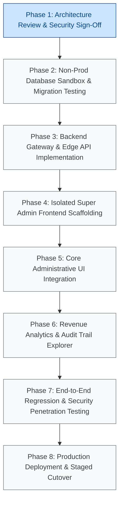

# VISTAAR Super Admin - Phased Implementation Roadmap & Execution Plan (Phase 2.6 Revised)

**Document Version:** 2.6.0  
**Effective Date:** 2026-11-01  
**Project:** VISTAAR Super Admin Control Plane (`navdeep852/Super-Admin`)  
**Target Domain:** `admin.vistaarone.com`  
**Execution Paradigm:** Security-First, Database-Sandboxed, Zero-Production-Risk Rollout  
**Status:** Phase 2.6 Hardened & Reconciled — Architecture Only

---

## 1. Roadmap Architecture & Security-First Sequencing

The implementation of VISTAAR Super Admin is structured into eight distinct phases following a **Security-First Lifecycle**. Database migrations, security definer stored procedures, and gateway access controls are verified in an isolated non-production staging environment before frontend UI scaffolding commences.

---

## 2. Detailed Phase Specifications

### Phase 1: Security Architecture Review & Formal Sign-Off (Current Phase)
- **Objective:** Finalize, reconcile, and mathematically verify all architectural blueprints, threat defense designs, and database specifications.
- **Key Deliverables:**
  - `SUPER_ADMIN_IMPLEMENTATION_BLUEPRINT.md` (v2.6.0)
  - `SUPER_ADMIN_DATABASE_DESIGN.md` (v2.6.0)
  - `SUPER_ADMIN_SECURITY_DESIGN.md` (v2.6.0)
  - `SUPER_ADMIN_COUPON_DESIGN.md` (v2.6.0)
  - `SUPER_ADMIN_IMPLEMENTATION_PHASES.md` (v2.6.0)
  - `SUPER_ADMIN_PHASE_2_6_CHANGELOG.md` (v2.6.0)
- **Gate 1 Exit Criteria:**
  - [x] Dedicated atomic GCAP nonce registry table (`public.platform_gcap_nonces`) specified.
  - [x] Strict separation of customer and backend execution contracts (NO service-role bypass).
  - [x] Customer identity derivation strictly from verified JWT `sub` (browser-supplied IDs ignored).
  - [x] Canonical schema compatibility verified: eliminated non-existent `workspaces.owner_id` references.
  - [x] State-preserving suspension and reactivation table (`public.platform_workspace_suspensions`) specified with multi-branch isolation and eligibility status guards.
  - [x] Full subscription state coverage and same-plan subscription renewal period preservation specified.
  - [x] Mid-cycle plan switches during active paid periods strictly blocked (`MID_CYCLE_PLAN_CHANGE_BLOCKED`) pending leadership approval (Blocker 6).
  - [x] Strengthened payment settlement: removed `payment.authorized`; strictly requires captured funds (`captured`, `verified_success`), `youpi_pg` provider, and late payment routing to `requires_support_review`.
  - [x] Committed failed payment audit on amount mismatch without transaction rollback.
  - [x] Mandatory AAL2 TOTP enforcement in middleware and stored procedures.
  - [x] Complete coupon catalog privacy lockdown (`FOR ALL USING (FALSE)`).
  - [x] Database-enforced audit log immutability triggers and DAC permission revocations.
  - [x] Human sign-off on Critical Blockers.

---

### Phase 2: Non-Production Database Sandbox & Migration Testing
- **Objective:** Execute and validate proposed DDL scripts against an isolated Supabase database sandbox or branching instance.
- **Prerequisites:** Dedicated staging database instance provisioned (Blocker 4 resolved).
- **Execution Scope:**
  1. Compile DDL scripts:
     - `supabase/migrations/077_super_admin_infrastructure.sql` (includes `platform_gcap_nonces`, `platform_workspace_suspensions`)
     - `supabase/migrations/078_coupon_and_promotional_campaign_system.sql`
  2. Execute migrations against sandbox database.
  3. Validate Atomic Nonce Replay Prevention:
     - Issue two concurrent transactions with identical `p_nonce`; verify exactly one succeeds and second raises `unique_violation (23505)`.
     - Verify rollback on failed assertion leaves no orphaned active state.
  4. Validate Customer vs Backend Execution Contracts:
     - Test calling `validate_and_reserve_coupon` with `service_role` without `p_customer_id`; verify `MISSING_CUSTOMER_CONTEXT`.
     - Test calling `activate_zero_payable_subscription` with `service_role` on unauthorized workspace; verify `FORBIDDEN`.
     - Verify ownership resolution succeeds against `organizations.owner_user_id`, `profiles`, `workspace_memberships`, and `workspaces.owner_email` without referencing `workspaces.owner_id`.
  5. Validate Subscription Commercial Rules:
     - Test early renewal on same plan: verify `current_period_end` extended without losing remaining days.
     - Test mid-cycle plan switch: verify database returns/aborts with `MID_CYCLE_PLAN_CHANGE_BLOCKED` (`P0008`).
     - Test trial conversion: verify transition to active with new billing cycle.
  6. Validate State-Preserving Suspension & Reactivation:
     - Setup workspace with 1 Active employee, 1 Suspended employee, and 1 multi-branch Active employee.
     - Suspend workspace: verify workspace and single-branch Active employee become Suspended; multi-branch employee retains active profile; snapshot stored in `platform_workspace_suspensions`.
     - Modify an employee to `Inactive` during suspension.
     - Reactivate workspace: verify workspace active; originally Active employee restored to Active; modified `Inactive` employee remains `Inactive`; previously Suspended employee remains Suspended.
  7. Validate Strengthened Payment Evidence:
     - Test unsupported gateway provider (`p_gateway_provider = 'unauthorized'`); verify rejection.
     - Test uncaptured status (`p_provider_status = 'payment.authorized'`); verify rejection.
     - Test future-dated authorization timestamp (+10m); verify `FUTURE_DATED_PAYMENT`.
     - Test amount mismatch: verify failed transaction committed to `payment_transactions` and redemption set to `failed` without transaction rollback.
     - Test late payment authorized after reservation expiry: verify routing to `requires_support_review` and no subscription activation.
     - Test duplicate webhook delivery: verify idempotency and zero period mutations.
- **Gate 2 Exit Criteria:** 100% migration success in sandbox; zero regression on existing VISTAAR test suites.

---

### Phase 3: Backend Gateway & Edge API Implementation
- **Objective:** Build the trusted BFF Gateway layer to securely mediate between the Super Admin SPA and the Supabase database.
- **Execution Scope:**
  1. Implement JWT verification middleware asserting `auth.jwt() ->> 'aal' === 'aal2'`.
  2. Implement dual-gate check: query `public.platform_admins WHERE id = auth.uid() AND is_active = TRUE`.
  3. Implement GCAP Assertion Generator (UUIDv4 nonce, UTC timestamp, HMAC-SHA256 signature).
  4. Implement Gateway endpoints:
     - `GET /api/admin/metrics` &rarr; issues GCAP envelope; calls `super_admin_get_platform_metrics()`.
     - `GET /api/admin/workspaces` &rarr; paginated directory with branch hierarchy.
     - `POST /api/admin/workspaces/:id/suspend` &rarr; issues GCAP envelope; calls `super_admin_suspend_workspace()`.
     - `POST /api/admin/workspaces/:id/reactivate` &rarr; issues GCAP envelope; calls `super_admin_reactivate_workspace()`.
     - `GET / POST /api/admin/coupons` &rarr; campaign management.
     - `GET /api/admin/redemptions` &rarr; statutory redemption history.
     - `GET /api/admin/audit-logs` &rarr; immutable audit trail explorer.
     - `POST /api/checkout/validate-coupon` &rarr; extracts JWT `sub` as customer context; calls `validate_and_reserve_coupon()`.
     - `POST /api/checkout/activate-zero-promo` &rarr; extracts JWT `sub` as customer context; calls `activate_zero_payable_subscription()`.
     - `POST /api/webhooks/payment` &rarr; validates raw payload HMAC; queries provider API; calls `settle_coupon_payment()`.
  5. Implement offline provisioning CLI tool (`scripts/provision-super-admin.js`).
- **Gate 3 Exit Criteria:** Gateway test suite achieves >90% coverage; service-role keys and assertion secrets are strictly encapsulated within Gateway environment variables.

---

### Phase 4: Isolated Super Admin Frontend Scaffolding
- **Objective:** Scaffold the independent React + TypeScript application in `super_admin/`.
- **Execution Scope:**
  1. Initialize Vite + React 18 + TypeScript in `super_admin/`.
  2. Configure Tailwind CSS, Lucide icons, and routing.
  3. Implement `AdminAuthContext` and `ThemeContext`.
  4. Implement `AdminRouteGuard` (blocks non-admins) and `MfaRouteGuard` (forces TOTP challenge).
  5. Build authentication views: `AdminLoginPage`, `SetupMfaPage`, `VerifyMfaPage`.
- **Gate 4 Exit Criteria:** Application builds cleanly (`npm run build`); unauthenticated or AAL1 sessions cannot view administrative layouts.

---

### Phase 5: Core Administrative UI Integration
- **Objective:** Implement management interfaces for workspaces, subscriptions, and promotional coupons.
- **Execution Scope:**
  1. Business Directory & Tenant Management (branch explorer, state-preserving suspension and reactivation modals).
  2. Subscription Management (active plans, manual tier overrides).
  3. Coupon Management Studio (campaign drawer, quota progress bars, statutory redemption ledger).
- **Gate 5 Exit Criteria:** All administrative actions trigger immutable audit logging and display real-time feedback.

---

### Phase 6: Revenue Analytics & Audit Trail Explorer
- **Objective:** Build executive financial dashboards and statutory audit trail viewers.
- **Execution Scope:**
  1. Financial Dashboard (Platform Collected Revenue, GST Component, Net Revenue, MRR, ARR, separate Tenant Sales GMV).
  2. Audit Log Explorer (Searchable, filterable view of `public.platform_audit_logs` with cryptographic hash indicators).
- **Gate 6 Exit Criteria:** Financial metrics reconcile with database aggregates; audit explorer reflects real-time administrative actions.

---

### Phase 7: End-to-End Regression & Security Penetration Testing
- **Objective:** Perform adversarial penetration testing and regression verification against the complete integrated platform.
- **Execution Scope:**
  1. **GCAP Concurrency & Replay Testing:**
     - Attempt high-concurrency race conditions submitting identical nonces; verify strict database serialization.
     - Attempt assertion with timestamp skewed > 30 seconds; verify rejection.
  2. **Cross-Tenant Authorization Testing:**
     - Attempt invoking `activate_zero_payable_subscription` with service_role against unowned workspace; verify `FORBIDDEN`.
  3. **Payment Integrity Testing:**
     - Attempt reused transaction reference; verify collision rejection.
     - Simulate duplicate webhook deliveries; verify idempotency without period extensions.
     - Verify early renewal preserves exact remaining days.
     - Verify mid-cycle plan switch attempts are blocked.
  4. **State-Preserving Suspension Testing:**
     - Verify previously inactive staff remain inactive after workspace reactivation.
  5. **Audit Immutability Verification:**
     - Attempt raw SQL updates or deletions on `public.platform_audit_logs`; verify database trigger rejection.
- **Gate 7 Exit Criteria:** Zero high or critical vulnerabilities; signed-off penetration testing report.

---

### Phase 8: Production Deployment & Staged Cutover
- **Objective:** Execute production rollout to `admin.vistaarone.com`.
- **Execution Scope:**
  1. Execute additive migration scripts (`077`, `078`) against production Supabase instance.
  2. Provision `GATEWAY_ASSERTION_SECRET` in database settings and Gateway environment.
  3. Run offline provisioning script to create initial root Super Admin account.
  4. Deploy Backend Gateway and Super Admin SPA to production hosting (`admin.vistaarone.com`).
  5. Configure DNS and Cloudflare WAF rules.
- **Gate 8 Exit Criteria:** `admin.vistaarone.com` live with verified AAL2 enforcement; production VISTAAR Business OS operating with zero interruption.

---

## 3. Deliverable Tracking & Phase Gate Checklist

| Phase | Core Deliverable | Prerequisites | Exit Gate Status |
| :---: | :--- | :--- | :---: |
| **Phase 1** | Hardened Architecture Blueprints & Security Models | Complete Technical Review | :white_check_mark: Completed |
| **Phase 2** | Sandbox Migration & Stored Procedure Tests | Staging Database Instance | :hourglass_flowing_sand: Pending Sign-Off |
| **Phase 3** | BFF Gateway & Server-Authoritative API | Phase 2 Sandbox Approval | :black_square_button: Pending |
| **Phase 4** | Isolated Super Admin React Frontend Scaffolding | Phase 3 Gateway Ready | :black_square_button: Pending |
| **Phase 5** | Workspaces, Subscriptions & Coupon Studio UI | Phase 4 Scaffolding Ready | :black_square_button: Pending |
| **Phase 6** | Revenue KPIs & Immutable Audit Explorer | Phase 5 Admin UI Ready | :black_square_button: Pending |
| **Phase 7** | Adversarial Penetration Testing & Regression | Full System Integrated | :black_square_button: Pending |
| **Phase 8** | Production Deployment to `admin.vistaarone.com` | Phase 7 Pentest Sign-Off | :black_square_button: Pending |

---

## 4. Execution Directives & Non-Negotiables

- **Zero Modifications to Existing Code:** Never modify files in `Vistaar/`.
- **No Direct Live Migrations:** Never execute SQL DDL directly against `kluxsykimnjivkqxelba` until Phase 8.
- **Service-Role Boundary:** Never bundle Supabase service-role keys into frontend client builds.
- **Stop Condition:** Implementation stops immediately upon completing Phase 1 documentation. Coding commences only upon formal human approval of Phase 1 deliverables and resolution of Critical Blockers.
