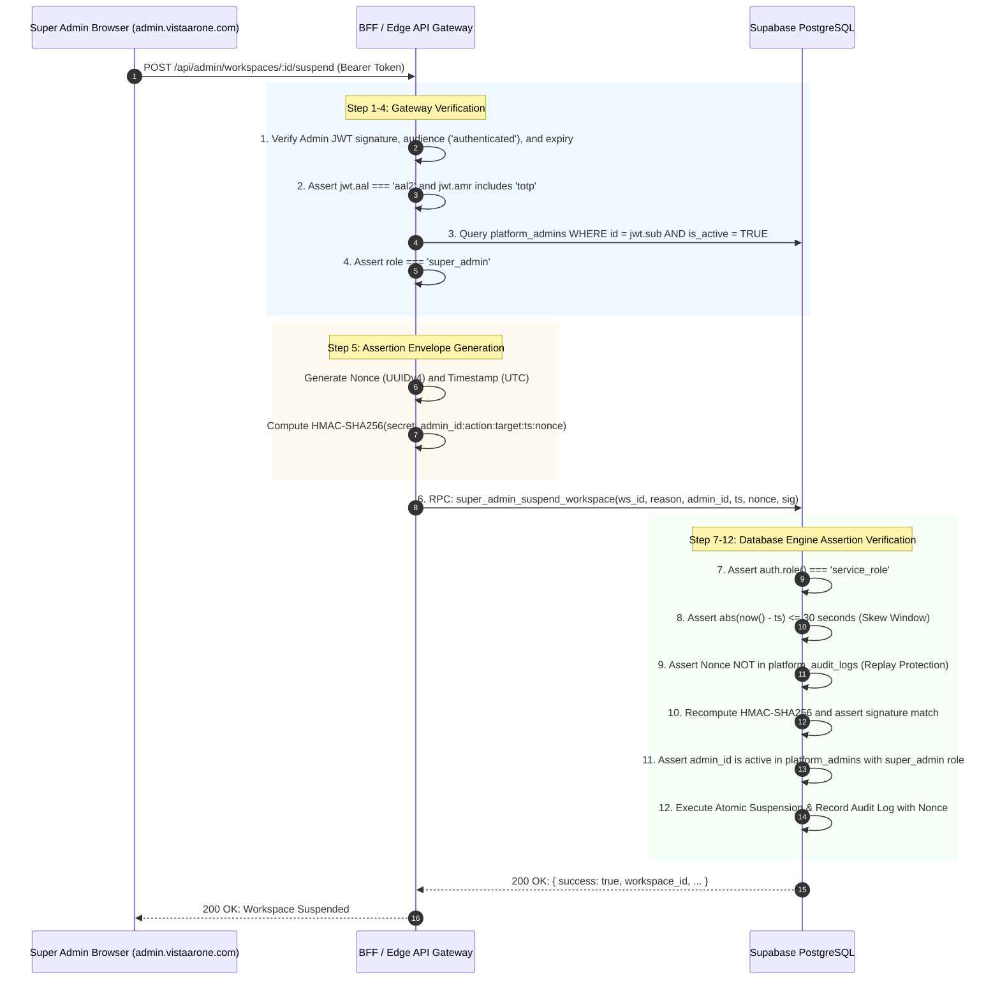

# VISTAAR Super Admin — Phase 2.3 RPC Authorization & Payment Integrity Changelog

**Document Version:** 2.3.0  
**Effective Date:** 2026-11-01  
**Project:** VISTAAR Super Admin Control Plane (`navdeep852/Super-Admin`)  
**Target Domain:** `admin.vistaarone.com`  
**Target Backend:** Existing Production Supabase Infrastructure (`https://kluxsykimnjivkqxelba.supabase.co`)  
**Sibling Business Application:** VISTAAR Business OS (`Vistaar/`)  
**Status:** Architecture Blueprint Corrections Complete — Awaiting Human Review & Formal Sign-Off  

---

## 1. Executive Summary

During the Phase 2.3 SQL-level verification of the VISTAAR Super Admin database specifications, three unresolved critical security and integrity vulnerabilities were identified and resolved:

1. **Authorization Bypass in Zero-Payable Subscriptions (`activate_zero_payable_subscription`):** The procedure verified status, expiry, and zero amount, but lacked verification of caller authority over the redemption's workspace, permitting cross-tenant subscription theft.
2. **Transaction Collision & Unsafe Locking in Settlement (`settle_coupon_payment`):** The procedure used an unsafe `ON CONFLICT` clause that could reassign existing transaction references to new redemptions, lacked idempotency guards for duplicate webhook deliveries, and lacked pre-authorization expiry checks.
3. **Execution-Contract Contradiction in Privileged RPCs (Administrator Identity Propagation):** Privileged RPCs were granted exclusively to `service_role`, but internally depended on ambient `auth.uid()` and JWT claims (which are null under `service_role`).

This changelog documents the exact technical remediations, complete function authorization matrix, Gateway-to-Database identity propagation sequence, coupon state-transition table, formal test cases, and critical approval blockers.

---

## 2. Itemized Vulnerability Analysis & Exact SQL Remediations

### Vulnerability 1: Cross-Tenant Zero-Payable Subscription Theft (`activate_zero_payable_subscription`)
* **Vulnerability Analysis:** When a promotional coupon granted a 100% discount (`final_payable_inr = 0.00`), `activate_zero_payable_subscription(p_redemption_id)` verified that the redemption existed, was in `reserved` status, had not expired, and that the workspace was active. However, it failed to verify that `auth.uid()` possessed subscription management rights for `redemption.workspace_id`. A malicious authenticated tenant user who obtained or guessed a redemption UUID could invoke the RPC to activate a free subscription for any tenant or hijack an unredeemed coupon slot.
* **Exact SQL Remediation ([SUPER_ADMIN_DATABASE_DESIGN.md Section 6.5](file:///d:/Project/vistaar-main/super_admin/SUPER_ADMIN_DATABASE_DESIGN.md#L670-L755)):**
  1. Implemented row locking on the redemption: `SELECT * INTO v_redemption FROM public.coupon_redemptions WHERE id = p_redemption_id FOR UPDATE;`
  2. Implemented active workspace check: `IF NOT v_ws.is_active THEN RETURN error; END IF;`
  3. Implemented multi-branch aware workspace authorization verification:
     ```sql
     -- Check 6A: Direct Workspace Owner
     IF v_ws.owner_id = v_caller_id THEN v_is_authorized := TRUE; END IF;
     -- Check 6B: Active Profile with Owner/Admin Role
     IF NOT v_is_authorized THEN
         SELECT EXISTS (SELECT 1 FROM public.profiles WHERE id = v_caller_id AND workspace_id = v_redemption.workspace_id AND LOWER(role::TEXT) IN ('owner', 'admin') AND status = 'Active') INTO v_is_authorized;
     END IF;
     -- Check 6C: Active Workspace Membership with Owner/Admin Role
     IF NOT v_is_authorized THEN
         SELECT EXISTS (SELECT 1 FROM public.workspace_memberships WHERE user_id = v_caller_id AND workspace_id = v_redemption.workspace_id AND LOWER(role::TEXT) IN ('owner', 'admin') AND status = 'Active') INTO v_is_authorized;
     END IF;
     -- Check 6D: Parent Organization Owner
     IF NOT v_is_authorized AND v_ws.organization_id IS NOT NULL THEN
         SELECT EXISTS (SELECT 1 FROM public.organizations WHERE id = v_ws.organization_id AND owner_user_id = v_caller_id) INTO v_is_authorized;
     END IF;

     IF NOT v_is_authorized THEN
         RETURN jsonb_build_object('success', false, 'error', 'FORBIDDEN: You do not have authorization to manage subscriptions for this workspace.');
     END IF;
     ```
  4. Rejected unauthorized attempts immediately without mutating redemption, payment, or subscription state.

---

### Vulnerability 2: Transaction Reference Collision & Reassignment (`settle_coupon_payment`)
* **Vulnerability Analysis:** In earlier revisions, `settle_coupon_payment` executed:
  `INSERT INTO public.payment_transactions (...) ON CONFLICT (transaction_reference) DO UPDATE SET coupon_redemption_id = p_redemption_id`.
  If a payment transaction reference was duplicated or manipulated, this statement would silently reassign an existing transaction reference from another payment/redemption to the new redemption. Furthermore, it lacked row locking against concurrent settlement calls and did not account for gateway authorization timestamps vs reservation expiry.
* **Exact SQL Remediation ([SUPER_ADMIN_DATABASE_DESIGN.md Section 6.6](file:///d:/Project/vistaar-main/super_admin/SUPER_ADMIN_DATABASE_DESIGN.md#L758-L835)):**
  1. Exclusive row locking on redemption: `SELECT * INTO v_redemption FROM public.coupon_redemptions WHERE id = p_redemption_id FOR UPDATE;`
  2. Strict status check: `IF v_redemption.status <> 'reserved' THEN RETURN error; END IF;`
  3. Pre-authorization expiry check: Accepts `p_payment_authorized_at TIMESTAMPTZ` from gateway; verifies `p_payment_authorized_at <= v_redemption.reserved_until`.
  4. Collision-Proof Transaction Reference Check:
     ```sql
     SELECT * INTO v_existing_tx FROM public.payment_transactions WHERE transaction_reference = p_transaction_reference FOR UPDATE;
     IF v_existing_tx.id IS NOT NULL THEN
         -- Idempotent duplicate delivery check
         IF v_existing_tx.coupon_redemption_id = p_redemption_id AND 
            v_existing_tx.workspace_id = v_redemption.workspace_id AND
            v_existing_tx.status = 'verified_success' THEN
             RETURN jsonb_build_object('success', true, 'status', 'already_settled');
         END IF;

         -- Reused reference collision across different workspace or redemption
         RAISE EXCEPTION 'TRANSACTION_REF_COLLISION: Transaction reference % is already bound to workspace % or redemption %.',
             p_transaction_reference, v_existing_tx.workspace_id, v_existing_tx.coupon_redemption_id
             USING ERRCODE = '23505';
     END IF;
     ```
  5. Exact amount reconciliation: `IF p_amount_paid <> v_redemption.final_payable_inr THEN ... mark status = 'failed' ... END IF;`

---

### Vulnerability 3: Privileged RPC Identity Contract Contradiction (GCAP Architecture)
* **Vulnerability Analysis:** In Phase 2.2, privileged procedures (`super_admin_suspend_workspace`, `super_admin_get_platform_metrics`, `super_admin_reactivate_workspace`) were granted strictly to `service_role` to prevent client PostgREST invocation. However, inside their bodies, they evaluated `auth.uid()` and `(auth.jwt() ->> 'aal') = 'aal2'`. Under a `service_role` connection from the Backend Gateway, `auth.uid()` is `NULL` and `aal` claims do not exist, causing every administrative RPC to fail with `UNAUTHORIZED`.
* **Exact SQL Remediation ([SUPER_ADMIN_DATABASE_DESIGN.md Section 6.1–6.3](file:///d:/Project/vistaar-main/super_admin/SUPER_ADMIN_DATABASE_DESIGN.md#L254-L525)):**
  Implemented the **Gateway Cryptographic Assertion Protocol (GCAP)**:
  1. Privileged procedures accept an assertion envelope: `(..., p_admin_id UUID, p_request_timestamp TIMESTAMPTZ, p_nonce UUID, p_signature TEXT)`.
  2. Procedure asserts `auth.role() = 'service_role'`.
  3. Procedure asserts timestamp freshness ($\pm 30$ seconds).
  4. Procedure asserts nonce has never been used by querying `platform_audit_logs WHERE details->>'assertion_nonce' = p_nonce::TEXT`.
  5. Procedure recomputes HMAC-SHA256 over `p_admin_id:ACTION:TARGET:TIMESTAMP:NONCE` using `app.settings.gateway_assertion_secret` and asserts signature equality.
  6. Procedure verifies `p_admin_id` exists in `public.platform_admins` with `is_active = TRUE` and the required administrative role.
  7. Audit log records `p_admin_id` and `p_nonce` for tamper-evident attribution.

---

## 3. Gateway-to-Database Identity Propagation Sequence (GCAP)



---

## 4. Coupon Reservation & Settlement State-Transition Table

| Initial State | Event / Trigger | Preconditions & Validation | Target State | Side Effects & Actions |
| :--- | :--- | :--- | :---: | :--- |
| `[None]` | Checkout Code Entered | Target workspace active; caller is owner/admin; coupon active, within valid dates, plan/interval match, min spend met, quota available. | `reserved` | Inserts `coupon_redemptions` with `status = 'reserved'` and `reserved_until = NOW() + 15m`. Holds 1 slot against quota. |
| `reserved` | Webhook: Payment Settled | Caller is Gateway (`service_role`); redemption row locked; ref not already bound to another tx; payment authorized $\le$ `reserved_until`; currency is `INR`; `paid_amount == final_payable`. | `applied` | Inserts `payment_transactions` (`verified_success`); updates redemption to `applied`; activates/extends `workspace_subscriptions`. |
| `reserved` | Zero-Payable Checkout | Caller is authenticated owner/admin of workspace; `final_payable == 0.00`; `reserved_until > NOW()`; workspace active. | `applied` | Inserts zero-cost transaction in `payment_transactions`; updates redemption to `applied`; activates `workspace_subscriptions`. |
| `reserved` | Amount Mismatch Webhook | Webhook delivers `paid_amount != final_payable`. | `failed` | Updates redemption to `failed`; records failed `payment_transactions` record for fraud auditing; aborts subscription activation. |
| `reserved` | Reservation TTL Expiry | `reserved_until < NOW()` without verified payment. | `failed` / Expired | Slot is ignored by subsequent quota checks, returning capacity to the campaign pool. |
| `reserved` | Transaction Ref Collision | Incoming `transaction_reference` already exists in `payment_transactions` for a different workspace or redemption. | `reserved` (Unchanged) | Transaction aborts with `TRANSACTION_REF_COLLISION (23505)`. Zero state mutated. |
| `applied` | Duplicate Webhook Delivery | Incoming `transaction_reference` matches existing `payment_transactions` record with same workspace and redemption ID. | `applied` (Unchanged) | Idempotent response: returns `{ success: true, status: 'already_settled' }`. Zero quotas or dates re-incremented. |
| `applied` | Gateway Refund Webhook | Verified refund webhook delivered for settled transaction. | `refunded` | Updates `payment_transactions.status = 'refunded'`; updates `coupon_redemptions.status = 'refunded'`; reverts `workspace_subscriptions.status = 'expired'`. Quota is NOT restored. |

---

## 5. Comprehensive Function Authorization Matrix

| Function Name | Security Type | Owner / `search_path` | Identity Derivation | Required Role | MFA Required | Workspace Auth | Execution Grants | Direct Client Invocation? |
| :--- | :--- | :--- | :--- | :--- | :---: | :--- | :--- | :---: |
| `super_admin_get_platform_metrics(admin_id, ts, nonce, sig)` | `SECURITY DEFINER` | `postgres` / `public, pg_temp` | Gateway Cryptographic Assertion (GCAP) | `platform_admins` (`super_admin` or `billing_admin`) | **Yes (Verified by Gateway before GCAP)** | N/A (Platform Scope) | `service_role` | **NO** (Gateway Only) |
| `super_admin_suspend_workspace(ws_id, reason, admin_id, ts, nonce, sig)` | `SECURITY DEFINER` | `postgres` / `public, pg_temp` | Gateway Cryptographic Assertion (GCAP) | `platform_admins` (`super_admin`) | **Yes (Verified by Gateway before GCAP)** | Target workspace existence | `service_role` | **NO** (Gateway Only) |
| `super_admin_reactivate_workspace(ws_id, reason, admin_id, ts, nonce, sig)` | `SECURITY DEFINER` | `postgres` / `public, pg_temp` | Gateway Cryptographic Assertion (GCAP) | `platform_admins` (`super_admin`) | **Yes (Verified by Gateway before GCAP)** | Target workspace existence | `service_role` | **NO** (Gateway Only) |
| `validate_and_reserve_coupon(p_code, p_workspace_id, p_plan_id, p_interval)` | `SECURITY DEFINER` | `postgres` / `public, pg_temp` | `auth.uid()` (or `service_role`) | Workspace Owner, Org Owner, or Active Profile with Owner/Admin role | No (AAL1 standard customer) | Active workspace + caller ownership check | `authenticated`, `service_role` | **YES** (Tenant Checkout) |
| `activate_zero_payable_subscription(p_redemption_id)` | `SECURITY DEFINER` | `postgres` / `public, pg_temp` | `auth.uid()` (or `service_role`) | Workspace Owner, Org Owner, or Active Profile with Owner/Admin role | No (AAL1 standard customer) | Valid reservation + caller ownership check | `authenticated`, `service_role` | **YES** (Tenant Checkout) |
| `settle_coupon_payment(p_redemption_id, p_ref, p_provider, p_amount, p_curr, p_payload, p_auth_time)` | `SECURITY DEFINER` | `postgres` / `public, pg_temp` | Webhook Controller Context | `service_role` only | N/A (Server-to-Server HMAC) | Reservation vs transaction match | `service_role` | **NO** (Webhook Handler Only) |
| `enforce_platform_audit_immutability()` | `SECURITY DEFINER` | `postgres` / `public, pg_temp` | Internal Trigger | Internal Database Engine | N/A | N/A | Trigger on `platform_audit_logs` | **NO** (Trigger Only) |

---

## 6. Formal Test Cases Specification

### 6.1 Transaction-Reference Collision Test Cases

```sql
-- TEST CASE TRC-01: Collision Across Workspaces
-- Setup: Workspace A successfully settles transaction with reference 'TX_REF_999'
-- Action: Webhook delivers identical reference 'TX_REF_999' for Workspace B
-- Expected: Rejection with SQLSTATE 23505 (TRANSACTION_REF_COLLISION); zero state mutation on Workspace B.

-- TEST CASE TRC-02: Collision Across Different Redemptions in Same Workspace
-- Setup: Redemption R1 in Workspace A settles with 'TX_REF_888'
-- Action: Webhook delivers 'TX_REF_888' for Redemption R2 in Workspace A
-- Expected: Rejection with SQLSTATE 23505; R2 remains 'reserved'; subscription not extended.
```

### 6.2 Cross-Tenant Zero-Payable Activation Test Cases

```sql
-- TEST CASE CTZ-01: Malicious Tenant Invokes Another Tenant's Zero-Cost Reservation
-- Setup: Workspace A reserves 100% discount coupon (redemption R_ZERO_A, final_payable = 0.00)
-- Action: Authenticated user from Workspace B calls activate_zero_payable_subscription(R_ZERO_A)
-- Expected: Returns { success: false, error: 'FORBIDDEN: You do not have authorization to manage subscriptions for this workspace.' };
--           R_ZERO_A remains 'reserved'; Workspace A subscription unchanged.

-- TEST CASE CTZ-02: Legitimate Multi-Branch Owner Invokes Activation
-- Setup: User U owns parent Org owning Workspace Branch 1 and Branch 2; Branch 2 reserves 100% coupon
-- Action: User U calls activate_zero_payable_subscription(Branch 2 reservation)
-- Expected: Returns { success: true, status: 'activated' }; subscription activated for Branch 2.
```

### 6.3 Duplicate Webhook Test Cases

```sql
-- TEST CASE DWH-01: Identical Webhook Delivered Twice
-- Setup: Gateway receives payment webhook for 'TX_REF_777', settling Redemption R_PAID
-- Action: Gateway delivers duplicate webhook for 'TX_REF_777' 5 minutes later
-- Expected: settle_coupon_payment returns { success: true, status: 'already_settled' };
--           workspace_subscriptions current_period_end is NOT extended a second time;
--           coupon redemptions count is NOT incremented again.
```

---

## 7. Critical Approval Blockers Awaiting Human Authorization

```
+----------------------------------------------------------------------------------------------------+
|                                    CRITICAL APPROVAL BLOCKERS                                      |
+---+------------------------------------+-----------------------------------------------------------+
| # | Blocker Item                       | Impact / Description                                      |
+---+------------------------------------+-----------------------------------------------------------+
| 1 | Gateway Assertion Secret (GCAP)    | Requirement: Provisioning of high-entropy shared secret   |
|   | Configuration                      | (`GATEWAY_ASSERTION_SECRET`) configured in Gateway env    |
|   |                                    | and database engine (`app.settings.gateway_assertion_     |
|   |                                    | secret`). Administrative RPCs cannot execute without it.  |
+---+------------------------------------+-----------------------------------------------------------+
| 2 | Payment Gateway Webhook Secret     | Requirement: Secure configuration of the webhook HMAC     |
|   | Configuration                      | secret for the payment gateway integration (`youpi_pg`).  |
|   |                                    | Gateway settlement cannot proceed without verification.   |
+---+------------------------------------+-----------------------------------------------------------+
| 3 | Initial Platform Super Admin       | Requirement: Explicit approval of the root Super Admin     |
|   | Identity Approval                  | email address (`admin@vistaarone.com`) and the authorized  |
|   |                                    | platform operator who will conduct the offline CLI        |
|   |                                    | provisioning ceremony.                                    |
+---+------------------------------------+-----------------------------------------------------------+
| 4 | Non-Production Staging Sandbox     | Requirement: Formal provision of a non-production         |
|   | Environment Authorization          | Supabase branch or staging database instance to execute   |
|   |                                    | Phase 2 migration and RPC unit tests. No DDL will run     |
|   |                                    | against live production (`kluxsykimnjivkqxelba`).         |
+---+------------------------------------+-----------------------------------------------------------+
| 5 | Phase 1 (v1.0) Coupon Scope        | Requirement: Explicit commercial sign-off that Phase 1    |
|   | Confirmation                       | supports one-time checkout discounts only, deferring      |
|   |                                    | multi-cycle recurring subscription discounts to Phase 2.  |
+---+------------------------------------+-----------------------------------------------------------+
```

---

## 8. Production Codebase & Database Safety Verification

Prior to completing Phase 2.3 documentation, safety audits confirmed:
1. **Production Repository (`Vistaar/` at `d:\Project\vistaar-main\vistaar-main`):**
   - Git status check: `On branch main, working tree clean`.
   - **Zero** production application files modified, created, or deleted.
2. **Production Supabase Database (`kluxsykimnjivkqxelba`):**
   - **Zero** migrations executed.
   - **Zero** live tables, schemas, roles, or policies altered.
   - All proposed SQL scripts reside exclusively as documentation artifacts inside `super_admin/`.

---

*End of Changelog — Phase 2.3 RPC Authorization & Payment Integrity Corrections.*

