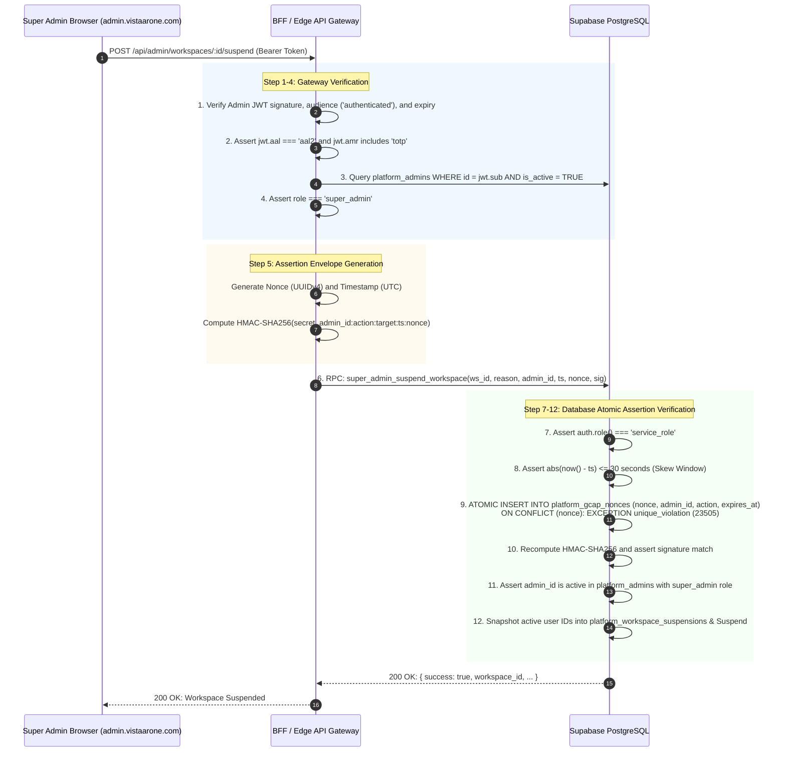

# VISTAAR Super Admin - Security Architecture & Threat Defense Design (Phase 2.6 Revised)

**Document Version:** 2.6.0  
**Effective Date:** 2026-11-01  
**Project:** VISTAAR Super Admin Control Plane (`navdeep852/Super-Admin`)  
**Target Domain:** `admin.vistaarone.com`  
**Security Boundary:** Multi-Tenant Isolation, Platform Administration, State-Preserving Tenant Controls, and Financial Settlement  
**Status:** Phase 2.6 Hardened & Reconciled — Architecture Only

---

## 1. Threat Modeling & Threat Matrix (STRIDE Framework)

| Threat Category | Attack Vector / Scenario | Severity | Mitigation & Defense-in-Depth Control |
| :--- | :--- | :---: | :--- |
| **Spoofing** | Attacker issues concurrent requests with identical assertion nonces to replay an administrative action. | **FATAL** | **Atomic Nonce Registry:** Nonces are inserted into `public.platform_gcap_nonces` governed by a primary key unique constraint within the same transaction. Concurrent duplicate nonces immediately raise `unique_violation (23505)`. |
| **Spoofing** | Compromised or rogue backend worker attempts to bypass customer workspace ownership using `service_role`. | **CRITICAL** | **Strict Contract Separation:** Possessing a `service_role` key never bypasses workspace authorization. Backend calls must provide verified `p_customer_id`, and the database strictly verifies customer ownership/admin authority. |
| **Spoofing** | Malicious client submits fabricated `p_customer_id` via browser payload during checkout or promo activation. | **CRITICAL** | **Client Injection Immunity:** In direct checkout, customer identity is derived strictly from `auth.uid()`. Gateway API endpoints extract `sub` exclusively from verified cryptographically validated Supabase JWTs, discarding any client-supplied customer IDs. |
| **Tampering** | User tampered with payment amount at gateway or forged client transaction reference to activate subscription. | **CRITICAL** | **Server-Authoritative Settlement & Committed Audit:** Webhook verifies HMAC-SHA256 signature, matches workspace, checks coupon reservation, asserts provider `'youpi_pg'`, and verifies `paid_amount == expected_final_payable`. Amount mismatches update redemption to `'failed'`, commit a failed `payment_transactions` row, and return an explicit failure response. |
| **Tampering** | Payment gateway delivers uncaptured or pending authorization webhook (`payment.authorized`). | **CRITICAL** | **Captured Funds Enforcement:** Eliminated `payment.authorized` from accepted settlement statuses. Only final captured funds (`'captured'`, `'verified_success'`) can trigger subscription activation. |
| **Tampering** | Attacker replays transaction reference from a previous payment to claim a new subscription or coupon. | **CRITICAL** | **Collision-Proof Transaction Guard:** `settle_coupon_payment` locks the reference row and strictly rejects any transaction reference already bound to a different workspace or redemption (`TRANSACTION_REF_COLLISION`). Duplicate webhooks for the same redemption return idempotent responses without re-incrementing periods. |
| **Repudiation** | Administrator denies executing a destructive action (suspending a tenant or overriding a plan). | **HIGH** | **Append-Only Audit Trail:** Database triggers block `UPDATE` and `DELETE` on `public.platform_audit_logs`. Every administrative action records administrator UUID, role, action, client IP, assertion nonce, state diff, and cryptographic hash chain pointers. |
| **Repudiation** | Superuser or database operator directly modifies or deletes rows in `public.platform_audit_logs`. | **HIGH** | **Operator Audit Boundary:** PostgreSQL triggers defend against application roles (`service_role`, `authenticated`). Database superuser operations bypass triggers; long-term immutability is guaranteed by asynchronous WAL-level log shipping to an external, write-once audit sink (S3 Object Lock / CloudWatch Logs). |
| **Information Disclosure** | Scraping the promotional coupon catalog via client-side GraphQL/REST queries. | **HIGH** | **Complete Coupon Privacy Lockdown:** Broad public `SELECT` policy removed. `public.coupons` is locked down with `FOR ALL USING (FALSE)`. Validation occurs only via an RPC returning computed totals. |
| **Elevation of Privilege** | Compromised session without MFA executes administrative mutations. | **CRITICAL** | **Mandatory AAL2 Enforcement:** All privileged operations check `auth.jwt() ->> 'aal' = 'aal2'`. Sessions at AAL1 are rejected at Gateway before any cryptographic assertion is generated. |
| **Elevation of Privilege** | Tenant user attempts direct PostgREST execution of privileged administrative stored procedures. | **CRITICAL** | **Explicit Function Revocations:** `EXECUTE` privileges on privileged RPCs (`super_admin_get_platform_metrics`, `super_admin_suspend_workspace`, `super_admin_reactivate_workspace`) are revoked from `PUBLIC`, `anon`, and `authenticated`, granted strictly to `service_role`. |
| **Denial of History** | Hard-deletion of a business workspace destroys historical tax records and coupon redemptions. | **HIGH** | **Non-Destructive Foreign Keys:** Replaced `ON DELETE CASCADE` with `ON DELETE RESTRICT` and snapshot columns (`workspace_name_snapshot`, `customer_email_snapshot`). |
| **Privilege Restoration Bug** | Reactivating a suspended workspace restores access to employees who were independently disabled during suspension. | **HIGH** | **State-Preserving Suspension Snapshots:** `public.platform_workspace_suspensions` stores exact arrays of active memberships and profiles. Reactivation restores *only* users whose records are still in `'Suspended'` state, preserving independent terminations or status changes. |
| **Multi-Branch Privilege Leak** | Suspending a branch workspace globally suspends an employee who belongs to another active branch. | **HIGH** | **Cross-Branch Isolation Guard:** Suspension checks if an employee belongs to any other active workspace before suspending their global profile record. If active elsewhere, their profile remains untouched. |
| **Financial Inconsistency**| Subscription renewal or plan change silently overwrites remaining paid days or applies incorrect credit. | **HIGH** | **Period Preservation & Mid-Cycle Block:** Early renewal on the same plan preserves unexpired days. Mid-cycle plan switches during an active paid period are strictly blocked (`MID_CYCLE_PLAN_CHANGE_BLOCKED`) pending business proration rules. |

---

## 2. Administrator Identity Propagation & Atomic GCAP Protocol

### 2.1 The Race Condition in Pre-Insert Checks
In earlier revisions, GCAP replay protection relied on a pre-insert existence check:
```sql
IF EXISTS (SELECT 1 FROM public.platform_audit_logs WHERE details->>'assertion_nonce' = p_nonce::TEXT) THEN ...
```
This check was vulnerable to a classic **Time-of-Check to Time-of-Use (TOCTOU)** race condition: two concurrent HTTP requests carrying the exact same nonce could execute the `SELECT` query simultaneously before either transaction committed its row to `platform_audit_logs`. Both queries would see "does not exist", and both transactions would proceed, defeating replay defense.

### 2.2 Atomic Nonce-Consumption Architecture

To eliminate this vulnerability with mathematical certainty, Phase 2.6 enforces a dedicated registry table (`public.platform_gcap_nonces`) with an atomic `INSERT` inside the privileged transaction:



### 2.3 Concurrency & Rollback Invariants
1. **Concurrency Serialization:** PostgreSQL locks the primary key B-Tree index page during `INSERT INTO platform_gcap_nonces`. If two concurrent transactions attempt to insert the same `p_nonce`, the second transaction waits for the first. When the first commits, the second immediately raises `unique_violation (23505)` and aborts.
2. **Transaction Rollback:** If any subsequent assertion check fails (e.g., signature mismatch, inactive admin), the entire transaction rolls back cleanly, ensuring database state remains consistent.
3. **Retention & TTL:** Nonces carry an `expires_at` timestamp set to `consumed_at + INTERVAL '5 minutes'`. A lightweight maintenance function (`cleanup_expired_gcap_nonces`) routinely purges expired entries.

---

## 3. Customer Identity Delineation: Gateway vs Database Responsibilities

To eliminate client injection and cross-tenant authorization vulnerabilities, responsibilities between the Gateway BFF and the PostgreSQL database engine are strictly delineated:

### 3.1 Delineation Matrix

| Security Layer | Responsibility | Mechanism & Invariants |
| :--- | :--- | :--- |
| **Client (Browser)** | Presentation & Input | Submits discount codes, selected plan IDs, and billing intervals. **Never** trusted for user identity, workspace permissions, or payment status. |
| **Gateway BFF (API)** | Cryptographic Authentication & Claim Extraction | 1. Verifies Supabase Auth JWT signature against `SUPABASE_JWT_SECRET`.<br/>2. Asserts token validity (`exp > NOW()`, `aud = 'authenticated'`).<br/>3. Extracts customer identity strictly from `jwtClaims.sub`.<br/>4. Completely discards or ignores any `customer_id` supplied in request body.<br/>5. Passes extracted `sub` as `p_customer_id` to database RPC. |
| **PostgreSQL Database** | Authorization, Tenant Isolation & Schema Enforcement | 1. Accepts `p_customer_id` from Gateway or resolves `auth.uid()` directly.<br/>2. Resolves workspace ownership and administrative rights against actual production schema (checking `organizations.owner_user_id`, `profiles.role = 'owner'`, `workspace_memberships.role = 'owner'`, and matching `workspaces.owner_email`).<br/>3. Enforces that workspace is active (`workspaces.is_active = TRUE`).<br/>4. Rejects request with `FORBIDDEN (42501)` if customer lacks authority over the workspace. |

### 3.2 Elimination of `workspaces.owner_id` Assumption
The production VISTAAR database schema (`001_initial_schema.sql`, `058_organization_branch_architecture.sql`) contains **no** `owner_id` column on `public.workspaces`. All stored procedures in Phase 2.6 verify ownership through canonical schema paths:
```sql
SELECT 
    EXISTS (
        SELECT 1 FROM public.organizations org
        WHERE org.id = v_ws.organization_id AND org.owner_user_id = v_effective_user_id
    ) OR
    EXISTS (
        SELECT 1 FROM public.profiles p
        WHERE p.id = v_effective_user_id 
          AND p.workspace_id = p_workspace_id 
          AND LOWER(p.role::TEXT) IN ('owner', 'admin')
          AND p.status = 'Active'::public.employee_status
          AND p.deleted_at IS NULL
    ) OR
    EXISTS (
        SELECT 1 FROM public.workspace_memberships wm
        WHERE wm.user_id = v_effective_user_id 
          AND wm.workspace_id = p_workspace_id 
          AND LOWER(wm.role::TEXT) IN ('owner', 'admin')
          AND wm.status = 'Active'
    ) OR
    EXISTS (
        SELECT 1 FROM auth.users u
        WHERE u.id = v_effective_user_id AND lower(u.email) = lower(v_ws.owner_email)
    )
INTO v_is_authorized;
```

---

## 4. State-Preserving Workspace Suspension Architecture

When a business workspace is suspended by a Super Admin, employee access must be blocked immediately. However, when the workspace is reactivated, the system must **not** blindly reactivate all employee accounts, as doing so would restore access to employees who had been previously fired, resigned, or suspended before the workspace was suspended, or who were independently terminated during suspension.

### 4.1 Dedicated Snapshot Table (`public.platform_workspace_suspensions`)

```sql
CREATE TABLE IF NOT EXISTS public.platform_workspace_suspensions (
    id UUID PRIMARY KEY DEFAULT gen_random_uuid(),
    workspace_id UUID NOT NULL REFERENCES public.workspaces(id) ON DELETE RESTRICT,
    admin_id UUID NOT NULL REFERENCES public.platform_admins(id) ON DELETE RESTRICT,
    reason TEXT NOT NULL,
    suspended_membership_user_ids UUID[] NOT NULL DEFAULT '{}',
    suspended_profile_user_ids UUID[] NOT NULL DEFAULT '{}',
    is_active_suspension BOOLEAN NOT NULL DEFAULT TRUE,
    suspended_at TIMESTAMPTZ NOT NULL DEFAULT timezone('utc'::text, now()),
    reactivated_at TIMESTAMPTZ,
    reactivated_by UUID REFERENCES public.platform_admins(id) ON DELETE RESTRICT,
    reactivation_reason TEXT
);
```

### 4.2 State-Preserving Suspension Workflow
1. Lock workspace row: `SELECT company_name, is_active FROM public.workspaces WHERE id = p_workspace_id FOR UPDATE`.
   If `is_active = FALSE`, return already suspended.
2. Snapshot IDs of memberships where `status = 'Active'`:
   ```sql
   SELECT coalesce(array_agg(user_id), '{}') FROM public.workspace_memberships
   WHERE workspace_id = p_workspace_id AND status = 'Active';
   ```
3. Snapshot IDs of profiles where `status = 'Active'` AND employee has **no other active workspace memberships**:
   ```sql
   FOR v_user IN 
       SELECT id FROM public.profiles 
       WHERE workspace_id = p_workspace_id AND status = 'Active'::public.employee_status
         AND deleted_at IS NULL
   LOOP
       SELECT EXISTS (
           SELECT 1 FROM public.workspace_memberships wm
           JOIN public.workspaces w ON wm.workspace_id = w.id
           WHERE wm.user_id = v_user.id 
             AND wm.workspace_id <> p_workspace_id
             AND wm.status = 'Active'
             AND w.is_active = TRUE
       ) INTO v_has_other_active_branches;

       IF NOT v_has_other_active_branches THEN
           v_active_profile_user_ids := array_append(v_active_profile_user_ids, v_user.id);
       END IF;
   END LOOP;
   ```
4. Insert snapshot record into `public.platform_workspace_suspensions`.
5. Suspend workspace (`is_active = FALSE`), update snapshotted memberships to `'Suspended'`, and update isolated snapshotted profiles to `'Suspended'`. Employees with active memberships in other branches retain their active profile.

### 4.3 State-Preserving Reactivation Workflow
1. Lock workspace row and locate latest active suspension record:
   ```sql
   SELECT * FROM public.platform_workspace_suspensions
   WHERE workspace_id = p_workspace_id AND is_active_suspension = TRUE
   ORDER BY suspended_at DESC LIMIT 1 FOR UPDATE;
   ```
2. Set `workspaces.is_active = TRUE`.
3. Restore status to `'Active'` **only** for users present in `suspended_membership_user_ids` whose current status is still `'Suspended'`:
   ```sql
   UPDATE public.workspace_memberships
   SET status = 'Active'
   WHERE workspace_id = p_workspace_id 
     AND user_id = ANY(v_suspension.suspended_membership_user_ids)
     AND status = 'Suspended';
   ```
   *Invariant:* If an employee's membership was deleted or independently changed to `'Inactive'` or `'Pending'` by HR during suspension, it is **not** restored to `'Active'`.
4. Restore profile status to `'Active'` **only** for users present in `suspended_profile_user_ids` whose profile is still `'Suspended'` and not deleted:
   ```sql
   UPDATE public.profiles
   SET status = 'Active'::public.employee_status
   WHERE id = ANY(v_suspension.suspended_profile_user_ids)
     AND status = 'Suspended'::public.employee_status
     AND deleted_at IS NULL;
   ```
5. Close suspension snapshot: `is_active_suspension = FALSE`, recording `reactivated_at`, `reactivated_by`, and `reactivation_reason`.

---

## 5. Subscription Commercial Rules & Period Preservation

### 5.1 Same-Plan Early Renewal
When a workspace with an active paid subscription (`status = 'active'`, `current_period_end >= NOW()`) renews its subscription on the **same plan and billing interval**, no remaining paid days are lost:
$$\text{Start} = \text{Existing.current\_period\_start},\quad \text{End} = \text{Existing.current\_period\_end} + \text{Interval}$$

### 5.2 Mid-Cycle Plan Switches Blocked (Blocker 6)
In VISTAAR v1.0, mid-cycle plan switches (upgrading/downgrading tiers or switching between monthly and annual intervals while an active paid subscription is ongoing) are **strictly blocked** by the database stored procedures (`validate_and_reserve_coupon`, `settle_coupon_payment`).
- **Exception Raised:** `MID_CYCLE_PLAN_CHANGE_BLOCKED` (`P0008`).
- **Justification:** VISTAAR manual renewal has no automated proration or credit conversion engine. Automating tier switches mid-cycle without approved accounting rules risks financial discrepancies. Upgrades/downgrades must occur at renewal or via manual billing support.

---

## 6. Payment Evidence Verification & Gateway Contract

Payment evidence is verified across two distinct perimeters: the **BFF Gateway** and the **PostgreSQL Engine**.

### 6.1 Verification Responsibility Matrix

| Verification Check | Enforcing Layer | Mechanism & Criteria |
| :--- | :---: | :--- |
| **TLS & Raw Body Buffering** | Gateway BFF | Ingress TLS termination; unparsed raw buffer retained for signature check. |
| **Provider HMAC Signature** | Gateway BFF | Validates `X-Gateway-Signature` / `X-Youpi-Signature` using `GATEWAY_WEBHOOK_SECRET` over raw body buffer. Rejects unsigned requests with `401 Unauthorized`. |
| **Out-of-Band Provider Query** | Gateway BFF | Queries Youpi PG API: `GET /v1/payments/{tx_ref}` to confirm captured funds and exact amount before forwarding. |
| **Client Settlement Rejection**| Gateway BFF | Direct browser requests to settlement routes are rejected. Only trusted server-side webhook handler can invoke settlement. |
| **Caller Role Enforcement** | PostgreSQL Engine | Asserts `auth.role() = 'service_role'`. Direct client invocation is revoked. |
| **Allowed Payment Provider** | PostgreSQL Engine | Strict check: `p_gateway_provider IN ('youpi_pg')`. |
| **Captured Payment Status** | PostgreSQL Engine | Strict check: `p_provider_status IN ('captured', 'verified_success')`. **`payment.authorized` is strictly rejected.** |
| **Future-Dating Tolerance** | PostgreSQL Engine | Asserts `p_payment_authorized_at <= NOW() + INTERVAL '5 minutes'`. |
| **In-Window Auth, Delayed Webhook** | PostgreSQL Engine | If authorized $\le$ `reserved_until` and transit $\le 24\text{h}$, settlement proceeds successfully. |
| **Late Payment Authorization** | PostgreSQL Engine | If authorized *after* `reserved_until`, redemption marked `'failed'`, `payment_transactions` marked `'failed'` with `requires_support_review = true`, **subscription is NOT activated**. |
| **Webhook Transit Timeout** | PostgreSQL Engine | If webhook arrives > 24h after authorization, transaction marked `'failed'` with `requires_support_review = true`, **subscription is NOT activated**. |
| **Amount Mismatch Committed Failure**| PostgreSQL Engine | Paid amount mismatch marks redemption `'failed'`, inserts failed `payment_transactions` record for fraud auditing, and returns failure response (COMMITTED). |
| **Transaction Uniqueness** | PostgreSQL Engine | Row-locked check against `payment_transactions(transaction_reference)`. |
| **Collision Rejection** | PostgreSQL Engine | Reused reference on different workspace/redemption raises `TRANSACTION_REF_COLLISION (23505)`. |
| **Duplicate Delivery Idempotency**| PostgreSQL Engine | Duplicate reference matching same redemption returns `already_settled` (or `already_under_support_review`) without re-incrementing dates. |
| **Exact Amount & Currency** | PostgreSQL Engine | Currency must be `INR`; `amount_paid == final_payable_inr`. |

---

## 7. PostgreSQL Function Security & Complete Inventory

| Function Name | Security Type | Owner / `search_path` | Identity Derivation | Required Role | MFA Required | Workspace Auth | Execution Grants | Direct Client Invocation? |
| :--- | :--- | :--- | :--- | :--- | :--- | :---: | :--- | :--- | :---: |
| `super_admin_get_platform_metrics(admin_id, ts, nonce, sig)` | `SECURITY DEFINER` | `postgres` / `public, pg_temp` | Gateway Cryptographic Assertion (GCAP) | `platform_admins` (`super_admin` or `billing_admin`) | **Yes (Verified by Gateway before GCAP)** | N/A (Platform Scope) | `service_role` | **NO** (Gateway Only) |
| `super_admin_suspend_workspace(ws_id, reason, admin_id, ts, nonce, sig)` | `SECURITY DEFINER` | `postgres` / `public, pg_temp` | Gateway Cryptographic Assertion (GCAP) | `platform_admins` (`super_admin`) | **Yes (Verified by Gateway before GCAP)** | Target workspace existence + cross-branch profile check + snapshot to `platform_workspace_suspensions` | `service_role` | **NO** (Gateway Only) |
| `super_admin_reactivate_workspace(ws_id, reason, admin_id, ts, nonce, sig)` | `SECURITY DEFINER` | `postgres` / `public, pg_temp` | Gateway Cryptographic Assertion (GCAP) | `platform_admins` (`super_admin`) | **Yes (Verified by Gateway before GCAP)** | Restores snapshotted users still in `'Suspended'` state | `service_role` | **NO** (Gateway Only) |
| `validate_and_reserve_coupon(code, ws_id, plan, interval, customer_id)` | `SECURITY DEFINER` | `postgres` / `public, pg_temp` | Client `auth.uid()` or Gateway `p_customer_id` | Workspace Owner, Org Owner, or Profile with Owner/Admin role | No (AAL1 standard customer) | Active workspace + schema ownership check (NO service_role bypass) + Blocker 6 guard | `authenticated`, `service_role` | **YES** (Tenant Checkout) |
| `activate_zero_payable_subscription(redemption_id, customer_id)` | `SECURITY DEFINER` | `postgres` / `public, pg_temp` | Client `auth.uid()` or Gateway `p_customer_id` | Workspace Owner, Org Owner, or Profile with Owner/Admin role | No (AAL1 standard customer) | Valid reservation + schema ownership check (NO service_role bypass) | `authenticated`, `service_role` | **YES** (Tenant Checkout) |
| `settle_coupon_payment(redemption_id, ref, provider, amt, curr, payload, auth_time, status)` | `SECURITY DEFINER` | `postgres` / `public, pg_temp` | Webhook Controller Context | `service_role` only | N/A (Server-to-Server HMAC) | Reservation vs transaction match + strict captured status + committed failure audit + Blocker 6 guard | `service_role` | **NO** (Webhook Handler Only) |
| `enforce_platform_audit_immutability()` | `SECURITY DEFINER` | `postgres` / `public, pg_temp` | Internal Trigger | Internal Database Engine | N/A | N/A | Trigger on `platform_audit_logs` | **NO** (Trigger Only) |
| `cleanup_expired_gcap_nonces()` | `SECURITY DEFINER` | `postgres` / `public, pg_temp` | Background Maintenance | `service_role` only | N/A | N/A | `service_role` | **NO** (Cron Worker Only) |
