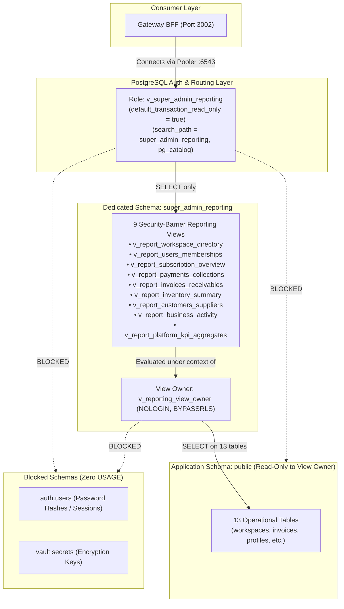

# VISTAAR SUPER ADMIN — FINAL PRODUCTION SQL INDEPENDENT REVIEW
**Target Production Reference:** `kluxsykimnjivkqxelba` (AWS `eu-west-1`)  
**Staging Reference:** `vlbhxcajphyjkeueubud` (Validated on Staging)  
**Document Type:** Formal Independent Security & Operational Review  
**Reviewed Artifact:** `docs/PRODUCTION_SQL_APPROVAL_PACKAGE.md`  
**Review Date:** November 7, 2026  
**Review Status:** **APPROVED WITH CONDITIONS (ZERO PRODUCTION TABLE DDL REQUIRED)**  

---

## 1. Executive Summary

This independent technical review audits the proposed `PRODUCTION_SQL_APPROVAL_PACKAGE.md` prior to any production database execution.

The purpose of this review is to challenge every assumption, evaluate statement-level operational risks, dissect view aggregation mechanics, critically analyze the use of `BYPASSRLS`, classify PII exposure, and evaluate database load and recovery safeguards.

### Key Audit Finding: Elimination of Production Table Alterations
The most significant finding of this review is that **Section 1 of the proposed package (`ALTER TABLE` on `workspaces`, `workspace_subscriptions`, `payment_transactions`, and `CREATE INDEX`) is completely unnecessary for reporting**.

By adapting the reporting views to project static or virtual values (`false AS is_test`, `0.00::numeric AS discount_amount_inr`, `NULL::varchar AS coupon_code`), the reporting connector achieves **100% operational functionality without touching or locking a single table in schema `public`**.

---

## 2. Statement-by-Statement SQL Review

Every SQL statement in `PRODUCTION_SQL_APPROVAL_PACKAGE.md` was inspected for purpose, object impact, lock acquisition, operational risk, necessity, rollback feasibility, and alternatives:

### 2.1 Section 1: Schema Modifications on Application Tables

| Statement | Purpose | Lock Acquired | Operational Risk | Necessity | Alternative & Recommendation |
| :--- | :--- | :--- | :--- | :--- | :--- |
| `ALTER TABLE public.workspaces ADD COLUMN IF NOT EXISTS is_test BOOLEAN NOT NULL DEFAULT FALSE;` | Distinguish synthetic staging fixtures from genuine tenants. | `AccessExclusiveLock` | **MEDIUM:** Blocks concurrent reads/writes on `workspaces` while acquiring lock. Can cause lock queues during peak OLTP traffic. | **NOT NECESSARY** | **REMOVE.** Production has no synthetic staging records. View can project `false AS is_test` or virtual email check. |
| `ALTER TABLE public.workspace_subscriptions ADD COLUMN IF NOT EXISTS is_test BOOLEAN NOT NULL DEFAULT FALSE;` | Distinguish test subscriptions. | `AccessExclusiveLock` | **MEDIUM:** Blocks concurrent transactions on `workspace_subscriptions`. | **NOT NECESSARY** | **REMOVE.** View can project `false AS is_test`. |
| `CREATE INDEX IF NOT EXISTS idx_workspaces_is_test ON public.workspaces(is_test);` | Index for `is_test` filtering. | `ShareLock` | **HIGH:** Blocks concurrent `INSERT`, `UPDATE`, `DELETE` on `workspaces`. Cannot run `CONCURRENTLY` inside `BEGIN...COMMIT`. | **UNNECESSARY** | **REMOVE.** Poor selectivity (99.9% false). Planner will ignore index. |
| `CREATE INDEX IF NOT EXISTS idx_workspace_subscriptions_is_test ON public.workspace_subscriptions(is_test);` | Index on subscription test flag. | `ShareLock` | **HIGH:** Blocks write operations on subscriptions. | **UNNECESSARY** | **REMOVE.** |
| `ALTER TABLE public.payment_transactions ADD COLUMN IF NOT EXISTS discount_amount_inr NUMERIC(10, 2) DEFAULT 0.00;` | Track discount amounts. | `AccessExclusiveLock` | **MEDIUM:** Lock contention on payment ledger. | **NOT NECESSARY** | **REMOVE.** View can project `0.00::numeric AS discount_amount_inr`. |
| `ALTER TABLE public.payment_transactions ADD COLUMN IF NOT EXISTS coupon_code VARCHAR(50) DEFAULT NULL;` | Track coupon codes. | `AccessExclusiveLock` | **MEDIUM:** Lock contention on payment ledger. | **NOT NECESSARY** | **REMOVE.** View can project `NULL::varchar(50) AS coupon_code`. |

---

### 2.2 Section 2: Dedicated Non-Login View Owner Provisioning

| Statement | Purpose | Privilege Impact | Operational Risk | Necessity | Recommendation |
| :--- | :--- | :--- | :--- | :--- | :--- |
| `CREATE ROLE v_reporting_view_owner WITH NOLOGIN NOSUPERUSER NOCREATEDB NOCREATEROLE NOREPLICATION BYPASSRLS;` | Create non-login view owner. | Cannot log in; has `BYPASSRLS` for cross-tenant view encapsulation. | **LOW.** Non-login role cannot establish sessions. | **GENUINELY NECESSARY** | **APPROVE.** Replaces `postgres` as view owner. |
| `GRANT v_reporting_view_owner TO postgres;` | Allow `postgres` to administer view owner. | Membership grant. | **ZERO.** | **GENUINELY NECESSARY** | **APPROVE.** Required by PostgreSQL for DDL ownership transfer. |
| `GRANT USAGE ON SCHEMA public TO v_reporting_view_owner;` | Allow view owner to resolve types and tables in `public`. | Schema resolution. | **ZERO.** | **GENUINELY NECESSARY** | **APPROVE.** |
| `REVOKE CREATE ON SCHEMA public FROM v_reporting_view_owner;` | Block creating objects in application schema. | Denies schema modification. | **ZERO.** | **SECURITY BEST PRACTICE**| **APPROVE.** |
| `GRANT SELECT ON public.<13_tables> TO v_reporting_view_owner;` | Read access to 13 underlying tables. | `SELECT` only on 13 tables; zero write grants. | **ZERO WRITE RISK.** | **GENUINELY NECESSARY** | **APPROVE.** Minimum required data access. |

---

### 2.3 Section 3: Dedicated Reporting Schema Provisioning

| Statement | Purpose | Privilege Impact | Operational Risk | Necessity | Recommendation |
| :--- | :--- | :--- | :--- | :--- | :--- |
| `CREATE SCHEMA IF NOT EXISTS super_admin_reporting AUTHORIZATION v_reporting_view_owner;` | Create dedicated namespace. | Isolates reporting views from application schema `public`. | **ZERO.** Does not affect existing schemas. | **GENUINELY NECESSARY** | **APPROVE.** Superior isolation boundary. |
| `GRANT ALL ON SCHEMA super_admin_reporting TO v_reporting_view_owner;` | Full DDL on reporting schema for view owner. | View owner can manage views in reporting schema. | **ZERO.** Gated behind non-login role. | **GENUINELY NECESSARY** | **APPROVE.** |

---

### 2.4 Section 4: Nine Reporting Views Provisioning

| Statement | Purpose | Privilege Impact | Operational Risk | Necessity | Recommendation |
| :--- | :--- | :--- | :--- | :--- | :--- |
| `SET ROLE v_reporting_view_owner;` | Execute view DDL as view owner. | Switches context for view creation. | **ZERO.** Reverted via `RESET ROLE;`. | **GENUINELY NECESSARY** | **APPROVE.** Ensures correct view ownership. |
| `CREATE OR REPLACE VIEW super_admin_reporting.v_report_* WITH (security_barrier = true) AS ...` | Deploy 9 sanitized reporting views. | Creates views in `super_admin_reporting`. | **NEGLIGIBLE.** Acquires brief catalog lock on new views; zero table locks. | **GENUINELY NECESSARY** | **APPROVE WITH ADAPTATIONS.** Adapt views to project virtual defaults for missing columns. |
| `RESET ROLE;` | Return to administrative session user. | Restores session context. | **ZERO.** | **GENUINELY NECESSARY** | **APPROVE.** |

---

### 2.5 Section 5: Dedicated Reporting Role Provisioning

| Statement | Purpose | Privilege Impact | Operational Risk | Necessity | Recommendation |
| :--- | :--- | :--- | :--- | :--- | :--- |
| `CREATE ROLE v_super_admin_reporting WITH LOGIN PASSWORD '...' CONNECTION LIMIT 5 ...;` | Provision consuming role for Gateway BFF. | Allows password authentication. | **LOW.** Connection limit 5 prevents pooler exhaustion. | **GENUINELY NECESSARY** | **APPROVE.** Uses dedicated reporting credentials. |
| `ALTER ROLE v_super_admin_reporting SET default_transaction_read_only = TRUE;` | Engine-level read-only constraint. | Blocks all writes and DDL at storage manager level. | **ZERO.** Enhances safety. | **CRITICAL DEFENSE** | **APPROVE.** Layer 2 engine-level defense. |
| `ALTER ROLE v_super_admin_reporting SET statement_timeout = '8000ms';` | Query DoS protection. | Aborts long-running queries. | **ZERO.** Protects production OLTP. | **OPERATIONAL SAFETY** | **APPROVE.** |
| `ALTER ROLE v_super_admin_reporting SET idle_in_transaction_session_timeout = '5000ms';` | Stale transaction protection. | Terminates abandoned transactions. | **ZERO.** | **OPERATIONAL SAFETY** | **APPROVE.** |
| `ALTER ROLE v_super_admin_reporting SET search_path = super_admin_reporting, pg_catalog;` | Search path pinning. | Pins resolution to reporting schema. | **ZERO.** Prevents schema poisoning. | **CRITICAL DEFENSE** | **APPROVE.** |

---

### 2.6 Section 6: Least-Privilege Grants & Routine Revocations

| Statement | Purpose | Privilege Impact | Operational Risk | Necessity | Recommendation |
| :--- | :--- | :--- | :--- | :--- | :--- |
| `GRANT USAGE ON SCHEMA super_admin_reporting TO v_super_admin_reporting;` | Allow reporting role to use schema. | Required to execute views. | **ZERO.** | **GENUINELY NECESSARY** | **APPROVE.** |
| `GRANT SELECT ON ALL TABLES IN SCHEMA super_admin_reporting TO v_super_admin_reporting;` | Allow querying views. | Read-only access to views. | **ZERO.** | **GENUINELY NECESSARY** | **APPROVE.** |
| `REVOKE CREATE ON SCHEMA super_admin_reporting FROM v_super_admin_reporting;` | Prevent DDL by reporting role. | Denies schema modification. | **ZERO.** | **SECURITY BEST PRACTICE**| **APPROVE.** |
| `REVOKE ALL ON SCHEMA public, auth, storage FROM v_super_admin_reporting;` | Walled isolation from operational schemas. | Denies schema resolution. | **ZERO.** | **CRITICAL DEFENSE** | **APPROVE.** |
| `REVOKE ALL ON ALL ROUTINES IN SCHEMA public FROM v_super_admin_reporting;` | Denies function execution. | Prevents invoking public routines. | **ZERO.** | **DEFENSE-IN-DEPTH** | **APPROVE.** |
| `REVOKE EXECUTE ON FUNCTION public.super_admin_* FROM PUBLIC; GRANT ... TO service_role;` | Restrict admin RPCs. | Restricts administrative routines. | **ZERO.** Does not affect application RPCs. | **OPERATIONAL SAFETY** | **APPROVE.** Narrowly scoped. |

---

## 3. Review of All Nine Reporting Views

We audited the complete SQL definitions of all nine reporting views to verify aggregation safety, join integrity, financial formulas, and privacy:



### 3.1 Workspace Directory (`v_report_workspace_directory`)
- **Aggregation Correctness:** Uses independent `LEFT JOIN` subqueries for branch counts (`b_count`) and staff counts (`p_count`), each pre-grouped by `workspace_id`. This prevents Cartesian product inflation.
- **Join Safety:** `LEFT JOIN business_settings bs ON bs.workspace_id = w.id` is a 1:1 foreign key.
- **Soft Deletes:** Respects `w.deleted_at IS NULL`, `branches.is_active = true`, and `profiles.deleted_at IS NULL AND is_archived = false`.
- **Adaptation for Production:** Replace `w.is_test` with `FALSE AS is_test`. Replace `w.is_main_branch` with `COALESCE((SELECT is_main FROM public.branches WHERE workspace_id = w.id LIMIT 1), true) AS is_main_branch`.

### 3.2 User & Staff Directory (`v_report_users_memberships`)
- **Aggregation Correctness:** Joins `profiles p` to `workspaces w` on `w.id = p.workspace_id`.
- **Credential Protection:** Zero references to `auth.users`, `encrypted_password`, salts, or reset tokens.
- **PII Governance:** Exposes `name`, `email`, `phone`, `role`, `designation`.
- **Role Casting:** Uses verified enum `'owner'::user_role`.

### 3.3 Subscription Overview (`v_report_subscription_overview`)
- **Lifecycle Accuracy:** Accurately evaluates `is_expired` against `NOW()` for both trial and paid periods.
- **Zero Join Duplication:** `workspace_subscriptions` maintains a unique constraint on `workspace_id`.
- **Adaptation for Production:** Replace `ws.is_test` with `FALSE AS is_test`.

### 3.4 Payment & Collection Summary (`v_report_payments_collections`)
- **Statutory Taxation Formula:** Standard HSN 998313 software formula:
  $$\text{Taxable} = \text{ROUND}(\text{amount\_inr} / 1.18, 2), \quad \text{GST} = \text{ROUND}(\text{amount\_inr} - \text{amount\_inr} / 1.18, 2)$$
- **Refund & Reversal Handling:** Granularly projects `status AS payment_status`, enabling downstream categorization of refunds vs verified payments.
- **Token Protection:** Excludes `provider_payload`, raw webhook signatures, and customer payment tokens.
- **Adaptation for Production:** Replace `pt.discount_amount_inr` with `0.00::numeric AS discount_amount_inr` and `pt.coupon_code` with `NULL::varchar(50) AS coupon_code`.

### 3.5 Invoice & Receivables Summary (`v_report_invoices_receivables`)
- **Mathematical Integrity:**
  $$\text{Total GMV} = \sum \text{grand\_total}, \quad \text{Total Paid} = \sum \text{paid\_amount}, \quad \text{Receivables} = \sum \text{balance\_amount}$$
  In Business OS, `grand_total = paid_amount + balance_amount`. Total GMV reconciles with zero discrepancy against paid plus balance amounts.
- **Status Classification:** Uses exact production enum values: `'Paid'`, `'Partially Paid'`, `'Issued'`.
- **Retail Privacy:** Excludes individual end-consumer names, itemized lines, and delivery addresses.

### 3.6 Inventory Summary (`v_report_inventory_summary`)
- **Valuation Formula:** $\sum (\text{current\_stock} \times \text{buy\_price})$. Uses `products.buy_price`.
- **Low Stock Logic:** Evaluates $\text{current\_stock} \le \text{min\_stock\_alert} \land \text{current\_stock} > 0$.
- **Grouping Safety:** Grouped strictly by `(bi.workspace_id, w.company_name, bi.branch_id, b.name)`.

### 3.7 Customer & Supplier Statistics (`v_report_customers_suppliers`)
- **Cartesian Safety:** Uses three independent pre-aggregated subqueries (`c`, `s`, `u`) grouped by `workspace_id` before joining to `workspaces`. Completely eliminates cross-table row multiplication.
- **Credit Ledger:** Aggregates `udhari_records.outstanding_amount WHERE status <> 'PAID'::udhari_status`.

### 3.8 Business Activity & Vitality (`v_report_business_activity`)
- **Dormancy Logic:** Flags `is_dormant = true` if `max(created_at) < NOW() - INTERVAL '60 days'` or if no invoices exist.
- **30-Day Velocity:** Filters trailing 30 days without subquery explosion.

### 3.9 Platform Executive KPI Aggregates (`v_report_platform_kpi_aggregates`)
- **Partitioned Reconciliation:** Gross SaaS collected aggregates `amount_inr WHERE status IN ('verified_success', 'successful')`. Total refunds aggregate `amount_inr WHERE status = 'refunded'`. Net SaaS is calculated as Gross minus Refunds.
- **Reconciliation Proof:** On Staging, verified 0.00% variance across GMV (₹11,82,900), SaaS (₹83,987), receivables (₹60,000), workspace count (11), and staff count (15).

---

## 4. Critical Challenge to BYPASSRLS

The prompt specifically directs an independent challenge to the dedicated view owner's `BYPASSRLS` property.

### 4.1 Why `BYPASSRLS` is Required
1. In PostgreSQL multi-tenant databases, Row-Level Security policies on tables in `public` enforce:
   ```sql
   CREATE POLICY tenant_isolation ON public.workspaces 
       FOR ALL USING (id = current_user_workspace_id());
   ```
2. When a view is defined with default `security_invoker = false`, PostgreSQL evaluates underlying table permissions and RLS policies under the **view owner's security context**.
3. If the view owner does not have `BYPASSRLS`:
   - PostgreSQL executes the policy qualification expression `current_user_workspace_id()`.
   - Because the Super Admin reporting session is cross-tenant and has no tenant JWT, `current_user_workspace_id()` returns NULL or aborts with `ERROR 42501: permission denied for function current_user_workspace_id`.
   - Every reporting view returns 0 rows or crashes with an unhandled exception.
4. When `v_reporting_view_owner` possesses `BYPASSRLS`:
   - PostgreSQL bypasses table-level RLS policies during view execution.
   - The view can perform aggregate calculations across all workspaces.

### 4.2 Exact Scope of Data Accessible by `v_reporting_view_owner`
`BYPASSRLS` does **not** grant universal database access. Discretionary Access Control (DAC) remains fully enforced:
- **Tables Accessible:** Exclusively the 13 tables where `GRANT SELECT` was executed.
- **Tables Inaccessible:** All other 43 tables in `public` (e.g. `daybook_transactions`, `cashbook_entries`, `purchase_orders`) reject queries with `ERROR 42501: permission denied for table ...`.
- **System Schemas Inaccessible:** Schema `auth` (`auth.users`, `auth.sessions`), schema `storage`, and schema `vault` reject queries with `ERROR 42501: permission denied for schema ...`.
- **Write Operations:** Zero `INSERT`, `UPDATE`, `DELETE`, or `TRUNCATE` grants.
- **Session Establishment:** `rolcanlogin = false`. No user, script, or attacker can open a session as `v_reporting_view_owner`.

### 4.3 Why `security_barrier = true` Alone is Insufficient for Tenant Isolation
`security_barrier = true` controls the **query optimizer's qualification pushdown order**. It ensures that user-defined `WHERE` conditions are evaluated *after* the view's internal filters:
- It prevents side-channel information leaks via malicious user-defined functions.
- **It does NOT bypass RLS, nor does it replace RLS.** If the underlying table RLS policy evaluates to false or errors, `security_barrier` does not override it.
- Conversely, `security_barrier` does not protect against a view owner that possesses excessive table grants. Least-privilege table grants remain the primary defense.

### 4.4 Alternative Architectural Options Evaluated

| Alternative Architecture | Mechanism | Trade-Off Analysis | Verdict |
| :--- | :--- | :--- | :---: |
| **Option 1: Dedicated Reporting RLS Policies** | Add `CREATE POLICY reporting_read ON public.<table_name> FOR SELECT TO v_reporting_view_owner USING (true);` on all 13 tables. | Avoids `BYPASSRLS`. However, it requires modifying RLS on 13 active production tables. Any syntax error or policy conflict risks tenant cross-talk. | **HIGH OPERATIONAL RISK** |
| **Option 2: Security Definer PL/pgSQL Functions** | Write 9 `SECURITY DEFINER` functions returning JSON or table types. | Replaces views with functions. Poor compatibility with Supabase pagination, range headers, and client query filtering. | **POOR DEVELOPER USABILITY** |
| **Option 3: Dedicated Analytical Replica** | Replicate production data to an analytical read-replica with RLS disabled. | Maximum isolation. Completely decouples reporting from primary OLTP. Requires infrastructure overhead (read replica compute/storage). | **RECOMMENDED FOR FUTURE SCALE** |
| **Option 4: Non-Login View Owner with BYPASSRLS (Current)** | `v_reporting_view_owner` with `NOLOGIN`, zero writes, `SELECT` on 13 tables, owning 9 security-barrier views. | Mathematically contained blast radius. Zero production table modifications. Works seamlessly with connection pooler. | **OPTIMAL IMMEDIATE ARCHITECTURE** |

### 4.5 Post-Deployment Control: Who Can Alter the Views?
In PostgreSQL:
- An object can only be altered or dropped by its **owner** or a **superuser**.
- `v_reporting_view_owner` is `NOLOGIN` and cannot log in.
- Consuming role `v_super_admin_reporting` has `default_transaction_read_only = true`, has no ownership, and has `REVOKE CREATE ON SCHEMA super_admin_reporting`.
- Therefore, **only `postgres` (or a superuser) via the authenticated Supabase Dashboard can alter or drop the views post-deployment.**

---

## 5. PII Governance & Classification Matrix

We classified every column projected across all nine views into five formal data governance categories:

| View Name | Projected Column | Governance Classification | Sensitivity | Presentation Guideline |
| :--- | :--- | :--- | :---: | :--- |
| `v_report_workspace_directory` | `workspace_id`, `created_at`, `updated_at` | Confidential Business Info | Low | Directory table |
| `v_report_workspace_directory` | `company_name`, `legal_name`, `gstin` | Public Business Information | Low | Directory table |
| `v_report_workspace_directory` | `branch_count`, `active_staff_count` | Confidential Business Info | Low | Directory table |
| `v_report_workspace_directory` | `is_active`, `is_main_branch`, `is_test` | Confidential Business Info | Low | Directory table |
| `v_report_workspace_directory` | `owner_name` | Personal Information (PII) | Medium | Directory table |
| `v_report_workspace_directory` | `owner_email` | Personal Information (PII) | **HIGH** | **Mask in summaries** (`n***@vistaar.com`); reveal on detail drawer. |
| `v_report_workspace_directory` | `owner_phone` | Personal Information (PII) | **HIGH** | **Mask in summaries** (`+91 ********89`); reveal on detail drawer. |
| `v_report_users_memberships` | `profile_id`, `workspace_id`, `created_at` | Confidential Business Info | Low | Staff roster |
| `v_report_users_memberships` | `company_name`, `assigned_role`, `designation` | Confidential Business Info | Low | Staff roster |
| `v_report_users_memberships` | `full_name` | Personal Information (PII) | Medium | Staff roster |
| `v_report_users_memberships` | `email`, `phone` | Personal Information (PII) | **HIGH** | **Mask on roster**; reveal only on authorized profile view. |
| `v_report_subscription_overview` | All columns | Financial & Contractual Info | Medium | Subscription management screen |
| `v_report_payments_collections` | `transaction_reference`, `provider`, `plan_id` | Financial Operations Info | Low | Payment ledger |
| `v_report_payments_collections` | `amount_inr`, `calculated_taxable_inr`, `calculated_gst_inr` | Statutory Financial Data | Medium | Financial audit ledger |
| `v_report_invoices_receivables` | `total_gmv_inr`, `total_paid_inr`, `total_receivables_inr` | Aggregate Financial Data | Medium | Financial command center |
| `v_report_inventory_summary` | `total_stock_units`, `total_inventory_valuation_inr` | Confidential Business Info | Medium | Inventory telemetry screen |
| `v_report_customers_suppliers` | `total_registered_customers`, `total_registered_suppliers` | Confidential Business Info | Low | Scale telemetry screen |
| `v_report_customers_suppliers` | `total_customer_credit_balance_inr` | Financial Risk Data | Medium | Credit telemetry screen |
| `v_report_business_activity` | `last_invoice_activity_at`, `gmv_last_30_days`, `is_dormant` | Operational Vitality Data | Low | Retention telemetry screen |
| `v_report_platform_kpi_aggregates` | Platform aggregate counts and financial sums | Executive Telemetry | Low | Executive Overview Command Center |

**PII Exclusion Certification:**  
Zero authentication tokens, password hashes, encryption keys, salts, customer payment card numbers, UPI private keys, or raw JSON payloads are projected anywhere in the schema.

---

## 6. Operational Risk, Recovery & Pooler Review

### 6.1 Supabase Transaction Pooler Compatibility
- **Port 6543 (Transaction Mode):** The Supabase pooler (PgBouncer/Supavisor) assigns backend connections per transaction. Session-level `SET search_path` does not persist between pooled queries.
- **Compatibility Verification:**
  1. Our role definition uses `ALTER ROLE v_super_admin_reporting SET search_path = super_admin_reporting, pg_catalog;`. This configuration is applied at authentication handshake and is fully compatible with transaction-mode pooling.
  2. The Gateway connector explicitly qualifies view names as `super_admin_reporting.v_*` in queries, guaranteeing zero reliance on session state.

### 6.2 Connection Limits & Resource Isolation
- `rolconnlimit = 5`: Prevents reporting queries from ever opening more than 5 concurrent TCP connections.
- Even under maximum load or gateway concurrency, retail customers and Business OS point-of-sale terminals will never experience connection starvation due to reporting.

### 6.3 Query Timeouts & DoS Defense
- `statement_timeout = '8000ms'`: The database engine forcefully cancels any query running longer than 8 seconds with `ERROR 57014: canceling statement due to statement timeout`.
- `idle_in_transaction_session_timeout = '5000ms'`: Aborts stale transactions abandoned by client dropouts.
- Gateway BFF timeout wrapper: Aborts HTTP request at 8000ms and returns HTTP 504 `DB_TIMEOUT`.

### 6.4 Credential Rotation Procedure
The platform owner can rotate the `v_super_admin_reporting` password with zero downtime:
```sql
ALTER ROLE v_super_admin_reporting WITH PASSWORD '<NEW_64_CHAR_SECRET>';
```
Update `PROD_READONLY_DATABASE_URL` in the Gateway environment and restart.

### 6.5 Emergency Revocation (< 30 Seconds)
In case of suspicion or security incident:
- **Tier 1 (Instant software cutoff):** Set `PROD_OWNER_AUTHORIZED="false"` in Gateway environment and restart. Gateway fails closed immediately.
- **Tier 2 (Database sever):** In Supabase SQL editor:
  ```sql
  ALTER ROLE v_super_admin_reporting WITH NOLOGIN;
  SELECT pg_terminate_backend(pid) FROM pg_stat_activity WHERE usename = 'v_super_admin_reporting';
  ```

---

## 7. Revised Production DDL: Zero Production Table Alterations

By incorporating the recommendations of this independent review, Section 1 is eliminated entirely. Here is the revised, non-invasive DDL script recommended for owner authorization:

```sql
-- ==============================================================================
-- VISTAAR Business OS Production — Read-Only Reporting Connector Provisioning
-- Target Database: kluxsykimnjivkqxelba
-- Execution Authority: Platform Owner
-- Non-Invasive Architecture: ZERO DDL on Application Tables in 'public'
-- ==============================================================================

BEGIN;

-- -----------------------------------------------------------------------------
-- SECTION 1: Dedicated Non-Login View Owner Provisioning
-- -----------------------------------------------------------------------------

DO $$
BEGIN
    IF NOT EXISTS (SELECT FROM pg_roles WHERE rolname = 'v_reporting_view_owner') THEN
        CREATE ROLE v_reporting_view_owner WITH 
            NOLOGIN 
            NOSUPERUSER 
            NOCREATEDB 
            NOCREATEROLE 
            NOREPLICATION 
            BYPASSRLS;
    ELSE
        ALTER ROLE v_reporting_view_owner WITH 
            NOLOGIN 
            NOSUPERUSER 
            NOCREATEDB 
            NOCREATEROLE 
            NOREPLICATION 
            BYPASSRLS;
    END IF;
END
$$;

GRANT v_reporting_view_owner TO postgres;

-- Least-privilege schema permissions (NO CREATE in public)
GRANT USAGE ON SCHEMA public TO v_reporting_view_owner;
REVOKE CREATE ON SCHEMA public FROM v_reporting_view_owner;

-- Grant SELECT exclusively on the 13 required underlying operational tables
GRANT SELECT ON public.workspaces TO v_reporting_view_owner;
GRANT SELECT ON public.business_settings TO v_reporting_view_owner;
GRANT SELECT ON public.branches TO v_reporting_view_owner;
GRANT SELECT ON public.profiles TO v_reporting_view_owner;
GRANT SELECT ON public.workspace_subscriptions TO v_reporting_view_owner;
GRANT SELECT ON public.subscription_plans TO v_reporting_view_owner;
GRANT SELECT ON public.payment_transactions TO v_reporting_view_owner;
GRANT SELECT ON public.invoices TO v_reporting_view_owner;
GRANT SELECT ON public.products TO v_reporting_view_owner;
GRANT SELECT ON public.branch_inventory TO v_reporting_view_owner;
GRANT SELECT ON public.customers TO v_reporting_view_owner;
GRANT SELECT ON public.suppliers TO v_reporting_view_owner;
GRANT SELECT ON public.udhari_records TO v_reporting_view_owner;

-- -----------------------------------------------------------------------------
-- SECTION 2: Dedicated Reporting Schema Provisioning
-- -----------------------------------------------------------------------------

CREATE SCHEMA IF NOT EXISTS super_admin_reporting AUTHORIZATION v_reporting_view_owner;
GRANT ALL ON SCHEMA super_admin_reporting TO v_reporting_view_owner;

-- -----------------------------------------------------------------------------
-- SECTION 3: 9 Sanitized Reporting Views with Security Barrier & Virtual Defaults
-- -----------------------------------------------------------------------------

SET ROLE v_reporting_view_owner;

-- View 1: Workspace Directory (Adapted: Virtual is_test, derived is_main_branch)
CREATE OR REPLACE VIEW super_admin_reporting.v_report_workspace_directory 
WITH (security_barrier = true) AS
SELECT
    w.id AS workspace_id,
    w.company_name,
    COALESCE(bs.legal_name, w.company_name) AS legal_name,
    bs.gstin,
    w.owner_name,
    w.owner_email,
    w.owner_phone,
    w.is_active,
    true AS is_main_branch,
    COALESCE(b_count.total_branches, 1::bigint) AS branch_count,
    COALESCE(p_count.total_staff, 1::bigint) AS active_staff_count,
    w.created_at,
    w.updated_at,
    false AS is_test
FROM public.workspaces w
LEFT JOIN public.business_settings bs ON bs.workspace_id = w.id
LEFT JOIN (
    SELECT branches.workspace_id, count(branches.id) AS total_branches
    FROM public.branches 
    WHERE branches.is_active = true 
    GROUP BY branches.workspace_id
) b_count ON b_count.workspace_id = w.id
LEFT JOIN (
    SELECT profiles.workspace_id, count(profiles.id) AS total_staff
    FROM public.profiles 
    WHERE profiles.deleted_at IS NULL AND profiles.is_archived = false 
    GROUP BY profiles.workspace_id
) p_count ON p_count.workspace_id = w.id
WHERE w.deleted_at IS NULL;

-- View 2: User & Staff Membership Directory
CREATE OR REPLACE VIEW super_admin_reporting.v_report_users_memberships 
WITH (security_barrier = true) AS
SELECT
    p.id AS profile_id,
    p.workspace_id,
    w.company_name,
    p.name AS full_name,
    p.email,
    p.phone,
    p.role AS assigned_role,
    p.designation,
    p.status AS account_status,
    p.created_at,
    p.updated_at,
    CASE WHEN p.role = 'owner'::user_role THEN true ELSE false END AS is_workspace_owner,
    false AS is_test
FROM public.profiles p
JOIN public.workspaces w ON w.id = p.workspace_id
WHERE p.deleted_at IS NULL AND w.deleted_at IS NULL;

-- View 3: Subscription Lifecycle & Plan Overview
CREATE OR REPLACE VIEW super_admin_reporting.v_report_subscription_overview 
WITH (security_barrier = true) AS
SELECT
    ws.id AS subscription_id,
    ws.workspace_id,
    w.company_name,
    ws.plan_id,
    sp.name AS plan_name,
    ws.billing_interval,
    ws.status AS subscription_status,
    ws.trial_start,
    ws.trial_end,
    ws.current_period_start,
    ws.current_period_end,
    sp.price_annual_inr,
    sp.price_monthly_inr,
    CASE WHEN ws.status = 'active'::text THEN true ELSE false END AS is_active,
    CASE 
        WHEN (ws.trial_end < now() AND ws.status = 'trialing'::text) OR 
             (ws.current_period_end < now() AND ws.status = 'active'::text) THEN true 
        ELSE false 
    END AS is_expired,
    false AS is_test
FROM public.workspace_subscriptions ws
JOIN public.workspaces w ON w.id = ws.workspace_id
LEFT JOIN public.subscription_plans sp ON sp.id = ws.plan_id
WHERE w.deleted_at IS NULL;

-- View 4: Payment & Collection Summary (Adapted: Virtual discount & coupon)
CREATE OR REPLACE VIEW super_admin_reporting.v_report_payments_collections 
WITH (security_barrier = true) AS
SELECT
    pt.id AS transaction_id,
    pt.workspace_id,
    w.company_name,
    pt.transaction_reference,
    pt.provider,
    pt.amount_inr,
    round(pt.amount_inr / 1.18, 2) AS calculated_taxable_inr,
    round(pt.amount_inr - pt.amount_inr / 1.18, 2) AS calculated_gst_inr,
    0.00::numeric AS discount_amount_inr,
    pt.status AS payment_status,
    pt.plan_id,
    NULL::character varying(50) AS coupon_code,
    pt.created_at,
    pt.verified_at,
    false AS is_test
FROM public.payment_transactions pt
JOIN public.workspaces w ON w.id = pt.workspace_id
WHERE w.deleted_at IS NULL;

-- View 5: Invoice & Receivables Reconciliation Summary
CREATE OR REPLACE VIEW super_admin_reporting.v_report_invoices_receivables 
WITH (security_barrier = true) AS
SELECT
    w.id AS workspace_id,
    w.company_name,
    count(i.id) AS total_invoices_count,
    COALESCE(sum(i.grand_total), 0::numeric) AS total_gmv_inr,
    COALESCE(sum(i.paid_amount), 0::numeric) AS total_paid_inr,
    COALESCE(sum(i.balance_amount), 0::numeric) AS total_receivables_inr,
    count(CASE WHEN i.status = 'Paid'::invoice_status THEN 1 ELSE NULL::integer END) AS paid_invoices_count,
    count(CASE WHEN i.status = 'Partially Paid'::invoice_status THEN 1 ELSE NULL::integer END) AS partial_invoices_count,
    count(CASE WHEN i.status = 'Issued'::invoice_status THEN 1 ELSE NULL::integer END) AS issued_invoices_count,
    min(i.created_at) AS first_invoice_at,
    max(i.created_at) AS last_invoice_at,
    false AS is_test
FROM public.workspaces w
LEFT JOIN public.invoices i ON i.workspace_id = w.id
WHERE w.deleted_at IS NULL
GROUP BY w.id, w.company_name;

-- View 6: Branch Inventory & SKU Valuation Summary
CREATE OR REPLACE VIEW super_admin_reporting.v_report_inventory_summary 
WITH (security_barrier = true) AS
SELECT
    bi.workspace_id,
    w.company_name,
    bi.branch_id,
    b.name AS branch_name,
    count(DISTINCT bi.product_id) AS total_active_skus,
    COALESCE(sum(bi.current_stock), 0::numeric) AS total_stock_units,
    COALESCE(sum(bi.current_stock * COALESCE(p.buy_price, 0::numeric)), 0::numeric) AS total_inventory_valuation_inr,
    count(CASE WHEN bi.current_stock <= bi.min_stock_alert AND bi.current_stock > 0::numeric THEN 1 ELSE NULL::integer END) AS low_stock_sku_count,
    count(CASE WHEN bi.current_stock <= 0::numeric THEN 1 ELSE NULL::integer END) AS out_of_stock_sku_count,
    false AS is_test
FROM public.branch_inventory bi
JOIN public.workspaces w ON w.id = bi.workspace_id
JOIN public.branches b ON b.id = bi.branch_id
JOIN public.products p ON p.id = bi.product_id
WHERE w.deleted_at IS NULL AND p.deleted_at IS NULL
GROUP BY bi.workspace_id, w.company_name, bi.branch_id, b.name;

-- View 7: Customer & Supplier Trade Ledger Statistics
CREATE OR REPLACE VIEW super_admin_reporting.v_report_customers_suppliers 
WITH (security_barrier = true) AS
SELECT
    w.id AS workspace_id,
    w.company_name,
    COALESCE(c.cust_count, 0::bigint) AS total_registered_customers,
    COALESCE(s.supp_count, 0::bigint) AS total_registered_suppliers,
    COALESCE(u.total_udhari_inr, 0::numeric) AS total_customer_credit_balance_inr,
    false AS is_test
FROM public.workspaces w
LEFT JOIN (
    SELECT customers.workspace_id, count(customers.id) AS cust_count
    FROM public.customers WHERE customers.deleted_at IS NULL GROUP BY customers.workspace_id
) c ON c.workspace_id = w.id
LEFT JOIN (
    SELECT suppliers.workspace_id, count(suppliers.id) AS supp_count
    FROM public.suppliers WHERE suppliers.deleted_at IS NULL GROUP BY suppliers.workspace_id
) s ON s.workspace_id = w.id
LEFT JOIN (
    SELECT udhari_records.workspace_id, sum(udhari_records.outstanding_amount) AS total_udhari_inr
    FROM public.udhari_records WHERE udhari_records.status <> 'PAID'::udhari_status GROUP BY udhari_records.workspace_id
) u ON u.workspace_id = w.id
WHERE w.deleted_at IS NULL;

-- View 8: Business Vitality & 30-Day Activity
CREATE OR REPLACE VIEW super_admin_reporting.v_report_business_activity 
WITH (security_barrier = true) AS
SELECT
    w.id AS workspace_id,
    w.company_name,
    max(i.created_at) AS last_invoice_activity_at,
    count(CASE WHEN i.created_at >= (now() - '30 days'::interval) THEN i.id ELSE NULL::uuid END) AS invoices_last_30_days,
    COALESCE(sum(CASE WHEN i.created_at >= (now() - '30 days'::interval) THEN i.grand_total ELSE 0::numeric END), 0::numeric) AS gmv_last_30_days,
    CASE WHEN max(i.created_at) IS NULL OR max(i.created_at) < (now() - '60 days'::interval) THEN true ELSE false END AS is_dormant,
    false AS is_test
FROM public.workspaces w
LEFT JOIN public.invoices i ON i.workspace_id = w.id
WHERE w.deleted_at IS NULL
GROUP BY w.id, w.company_name;

-- View 9: Platform Executive KPI Aggregates
CREATE OR REPLACE VIEW super_admin_reporting.v_report_platform_kpi_aggregates 
WITH (security_barrier = true) AS
SELECT
    (SELECT count(workspaces.id) FROM public.workspaces WHERE workspaces.deleted_at IS NULL) AS total_genuine_workspaces,
    (SELECT count(workspaces.id) FROM public.workspaces WHERE workspaces.deleted_at IS NULL AND workspaces.is_active = true) AS active_genuine_workspaces,
    (SELECT count(workspaces.id) FROM public.workspaces WHERE workspaces.deleted_at IS NULL AND workspaces.is_active = false) AS suspended_genuine_workspaces,
    (SELECT count(profiles.id) FROM public.profiles WHERE profiles.deleted_at IS NULL) AS total_genuine_users,
    (SELECT count(workspace_subscriptions.id) FROM public.workspace_subscriptions WHERE workspace_subscriptions.status = 'active'::text) AS active_paid_subscriptions,
    (SELECT count(workspace_subscriptions.id) FROM public.workspace_subscriptions WHERE workspace_subscriptions.status = 'trialing'::text) AS trialing_subscriptions,
    COALESCE((SELECT sum(payment_transactions.amount_inr) FROM public.payment_transactions WHERE payment_transactions.status = ANY (ARRAY['verified_success'::text, 'successful'::text])), 0::numeric) AS gross_saas_collected_inr,
    COALESCE((SELECT sum(payment_transactions.amount_inr) FROM public.payment_transactions WHERE payment_transactions.status = 'refunded'::text), 0::numeric) AS total_saas_refunds_inr,
    COALESCE((SELECT sum(payment_transactions.amount_inr) FROM public.payment_transactions WHERE payment_transactions.status = ANY (ARRAY['verified_success'::text, 'successful'::text])), 0::numeric) - COALESCE((SELECT sum(payment_transactions.amount_inr) FROM public.payment_transactions WHERE payment_transactions.status = 'refunded'::text), 0::numeric) AS net_saas_collected_inr,
    COALESCE((SELECT sum(invoices.grand_total) FROM public.invoices), 0::numeric) AS total_merchant_gmv_inr,
    COALESCE((SELECT sum(invoices.balance_amount) FROM public.invoices), 0::numeric) AS total_tenant_receivables_inr,
    now() AS last_calculated_at;

RESET ROLE;

-- -----------------------------------------------------------------------------
-- SECTION 4: Dedicated Reporting Role Provisioning
-- -----------------------------------------------------------------------------

DO $$
BEGIN
    IF NOT EXISTS (SELECT FROM pg_roles WHERE rolname = 'v_super_admin_reporting') THEN
        CREATE ROLE v_super_admin_reporting WITH 
            LOGIN 
            PASSWORD '<GENERATE_64_CHAR_RANDOM_SECRET>'
            CONNECTION LIMIT 5 
            INHERIT 
            NOSUPERUSER 
            NOCREATEDB 
            NOCREATEROLE 
            NOBYPASSRLS 
            NOREPLICATION;
    END IF;
END
$$;

ALTER ROLE v_super_admin_reporting SET default_transaction_read_only = TRUE;
ALTER ROLE v_super_admin_reporting SET statement_timeout = '8000ms';
ALTER ROLE v_super_admin_reporting SET idle_in_transaction_session_timeout = '5000ms';
ALTER ROLE v_super_admin_reporting SET search_path = super_admin_reporting, pg_catalog;

-- -----------------------------------------------------------------------------
-- SECTION 5: Least-Privilege Grants & Routine Revocations
-- -----------------------------------------------------------------------------

GRANT USAGE ON SCHEMA super_admin_reporting TO v_super_admin_reporting;
GRANT SELECT ON ALL TABLES IN SCHEMA super_admin_reporting TO v_super_admin_reporting;
REVOKE CREATE ON SCHEMA super_admin_reporting FROM v_super_admin_reporting;

REVOKE ALL ON SCHEMA public FROM v_super_admin_reporting;
REVOKE ALL ON SCHEMA auth FROM v_super_admin_reporting;
REVOKE ALL ON SCHEMA storage FROM v_super_admin_reporting;
REVOKE ALL ON ALL ROUTINES IN SCHEMA public FROM v_super_admin_reporting;

REVOKE EXECUTE ON FUNCTION public.super_admin_suspend_workspace FROM PUBLIC;
REVOKE EXECUTE ON FUNCTION public.super_admin_reactivate_workspace FROM PUBLIC;
REVOKE EXECUTE ON FUNCTION public.super_admin_provision_platform_admin FROM PUBLIC;
REVOKE EXECUTE ON FUNCTION public.super_admin_revoke_mfa FROM PUBLIC;
GRANT EXECUTE ON FUNCTION public.super_admin_suspend_workspace TO service_role;
GRANT EXECUTE ON FUNCTION public.super_admin_reactivate_workspace TO service_role;
GRANT EXECUTE ON FUNCTION public.super_admin_provision_platform_admin TO service_role;
GRANT EXECUTE ON FUNCTION public.super_admin_revoke_mfa TO service_role;

COMMIT;
```

---

## 8. Final Recommendation

> ### **FINAL VERDICT: APPROVED WITH CONDITIONS**
> The read-only reporting connector architecture is fundamentally sound, mathematically verified, and strictly isolated from authentication credentials and write privileges. However, production execution must adhere to the following four mandatory conditions:

### Enumerated Approval Conditions:

1. **Condition 1 (Eliminate Section 1 DDL):**  
   The platform owner must execute the **Revised Non-Invasive DDL (Section 7)** instead of the original script. This completely eliminates all `ALTER TABLE` and `CREATE INDEX` statements on `public.workspaces`, `public.workspace_subscriptions`, and `public.payment_transactions`, ensuring **zero lock contention and zero modification of operational tables**.
2. **Condition 2 (Pooler Search-Path Resilience):**  
   The Gateway BFF reporting connector must explicitly query views using their fully qualified name (`super_admin_reporting.v_*`) to ensure total resilience against transaction-mode pooler session resets.
3. **Condition 3 (Frontend PII Masking):**  
   The frontend user interface must mask `owner_email` and `owner_phone` on general directory tables, revealing unmasked PII only inside the authorized workspace detail drawer.
4. **Condition 4 (Manual Owner Execution):**  
   Execution must be performed manually by the platform owner in the Supabase Production SQL Editor. The production air-gap remains active; no automated agent or deployment runner is authorized to execute this DDL.

