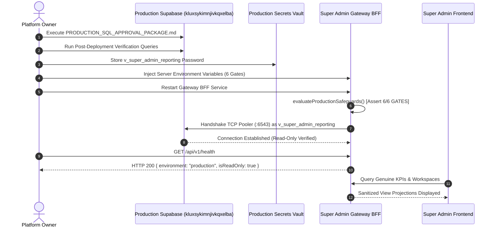

# VISTAAR SUPER ADMIN — PRODUCTION CONNECTOR ACTIVATION RUNBOOK
**Procedure Type:** Operational Runbook  
**Target Environment:** Production Supabase (`kluxsykimnjivkqxelba`) & Super Admin Gateway BFF  
**Target Role:** `v_super_admin_reporting`  
**Execution Authority:** Platform Owner & Lead Systems Architect  
**Air-Gap Status:** Strictly active until completion of Phase 3  

---

## 1. Overview & Architectural Prerequisites

This runbook guides the platform owner through the safe, sequential activation of the genuine read-only reporting connector.

### Activation Gate Invariants:
1. **Never Connect as Superuser:** Connection must use `v_super_admin_reporting` exclusively.
2. **Never Connect to Direct Database Port:** Always connect through Supabase Transaction Pooler (`:6543`).
3. **Never Expose Secrets to Frontend:** Credentials must exist solely in server-side process environment variables.
4. **Fail-Closed Gatekeeper:** All 6 activation gates must be satisfied simultaneously.

---

## 2. Activation Step-by-Step Procedure



### Phase 1: Database DDL Execution (Platform Owner)
1. Log in to the [Supabase Production Dashboard](https://supabase.com/dashboard/project/kluxsykimnjivkqxelba).
2. Open the **SQL Editor**.
3. Generate a cryptographically secure 64-character password:
   ```bash
   node -e "console.log(crypto.randomBytes(32).toString('hex'))"
   ```
4. Replace `<GENERATE_64_CHAR_RANDOM_SECRET>` in [`PRODUCTION_SQL_APPROVAL_PACKAGE.md`](file:///d:/Project/vistaar-main/super_admin/docs/PRODUCTION_SQL_APPROVAL_PACKAGE.md) with the generated password.
5. Paste and execute the script.
6. Verify output: `Query returned successfully with no errors`.

### Phase 2: Post-DDL Verification (Platform Owner)
Run the following verification query in the Supabase SQL Editor:
```sql
SELECT 
    (SELECT count(*) FROM information_schema.views WHERE table_schema = 'super_admin_reporting') AS view_count,
    (SELECT count(*) FROM information_schema.role_table_grants WHERE grantee = 'v_super_admin_reporting' AND table_schema = 'public') AS public_grants,
    (SELECT default_transaction_read_only FROM pg_roles WHERE rolname = 'v_super_admin_reporting') AS is_read_only;
```
**Expected Output:**
- `view_count`: `9`
- `public_grants`: `0`
- `is_read_only`: `true`

### Phase 3: Gateway BFF Configuration (Lead Architect & Owner)
Set the following environment variables in the production Gateway service host:

```bash
# ------------------------------------------------------------------------------
# VISTAAR SUPER ADMIN — PRODUCTION REPORTING CONNECTOR ENVIRONMENT CONFIGURATION
# ------------------------------------------------------------------------------

# 1. Audit & Review Attestation Flags
PROD_AUDIT_APPROVED="true"
PROD_SQL_REVIEWED="true"
PROD_ROLE_REVIEWED="true"
PROD_CONFIG_INDEPENDENTLY_CHECKED="true"

# 2. Production Read-Only Pooler Connection URL (Port 6543)
PROD_READONLY_DATABASE_URL="postgres://v_super_admin_reporting.kluxsykimnjivkqxelba:<SECURE_PASSWORD>@aws-0-eu-west-1.pooler.supabase.com:6543/postgres"

# 3. Explicit Owner Authorization & Cryptographic Token
PROD_OWNER_AUTHORIZED="true"
# Generate SHA-256 hash of owner confirmation signature
PROD_OWNER_AUTH_HASH="<64_CHARACTER_SHA256_AUTHORIZATION_HASH>"

# 4. Connector Active Mode
REPORTING_CONNECTOR_ENVIRONMENT="production"
```

### Phase 4: Service Startup & Verification
1. Restart the Gateway BFF service:
   ```bash
   node server/gateway.mjs
   ```
2. Verify startup logs:
   ```
   [REPORTING CONNECTOR] Evaluating Production Activation Safeguards...
   [REPORTING CONNECTOR] 6/6 mandatory security gates PASSED.
   [REPORTING CONNECTOR] ProductionReportingConnector activated for kluxsykimnjivkqxelba.
   [REPORTING CONNECTOR] Read-only transaction enforcement ACTIVE.
   ```
3. Issue health probe from authorized network host:
   ```bash
   curl -s http://localhost:3002/api/v1/health | jq .
   ```
   **Expected Response:**
   ```json
   {
     "status": "operational",
     "environment": "production",
     "projectRef": "kluxsykimnjivkqxelba",
     "isReadOnly": true,
     "healthy": true
   }
   ```

---

## 3. Post-Activation Monitoring & Alerting

Monitor the following operational metrics during the first 24 hours:
- **Pooler Connection Count:** Verify connections remain $\le 5$.
- **Query Execution Latency:** Target $\le 250\text{ ms}$; timeout occurs at $8000\text{ ms}$.
- **HTTP 403 Rate:** Ensure no legitimate client queries are rejected.
- **Supabase Disk I/O:** Verify reporting queries do not cause elevated read IOPS on the primary production replica.

