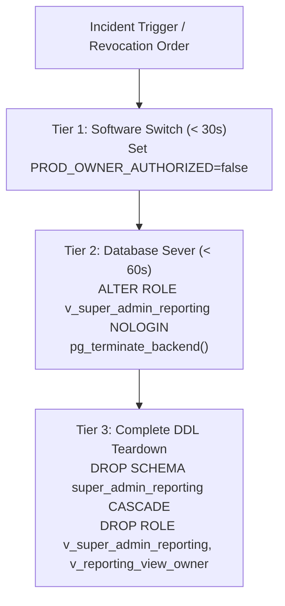

# VISTAAR SUPER ADMIN — PRODUCTION CONNECTOR ROLLBACK RUNBOOK
**Procedure Type:** Incident Response & Emergency Deactivation Runbook  
**Target Environment:** Production Supabase (`kluxsykimnjivkqxelba`) & Super Admin Gateway BFF  
**Target Roles:** `v_super_admin_reporting`, `v_reporting_view_owner`  
**Execution Authority:** Platform Owner & Incident Commander  
**Response Time Target:** Tier 1 Instant (< 30 Seconds), Tier 2 Pooler Sever (< 60 Seconds)  

---

## 1. Trigger Conditions for Rollback

Execute this runbook immediately upon encountering any of the following triggers:

1. **Suspected Credential Leak:** `v_super_admin_reporting` password found in unencrypted logs, public commits, or insecure terminals.
2. **Database Performance Degradation:** Production pooler latency spikes $> 2000\text{ ms}$ or connection pool exhaustion affects retail tenants.
3. **Unexpected Security Alert:** Database audit logs record unexpected queries or attempts to probe non-reporting schemas.
4. **Owner Direct Order:** Platform owner revokes authorization for production reporting monitoring.

---

## 2. Multi-Tiered Rollback Procedures



---

### Tier 1: Instant Software-Level Revocation (< 30 Seconds)
**Location:** Production Gateway BFF Host Environment  
**Action:** Disables the fail-closed safeguard gatekeeper without modifying database state.

1. Modify the production Gateway environment configuration:
   ```bash
   # Set authorization to false or clear the authorization hash
   PROD_OWNER_AUTHORIZED="false"
   REPORTING_CONNECTOR_ENVIRONMENT="staging"
   ```
2. Restart the Gateway process:
   ```bash
   node server/gateway.mjs
   ```
3. **Effect:**  
   The Gateway BFF's `evaluateProductionSafeguards()` immediately fails closed:
   ```
   [REPORTING CONNECTOR] Activation Blocked: missingGates = ['ownerAuthorized']
   ```
   All reporting queries return HTTP 403 `PRODUCTION_ACTIVATION_BLOCKED`. Zero outbound database queries are initiated toward production.

---

### Tier 2: Instant Database Credential Revocation (< 60 Seconds)
**Location:** [Supabase Production Dashboard SQL Editor](https://supabase.com/dashboard/project/kluxsykimnjivkqxelba)  
**Action:** Locks the reporting role and kills all active connections at the database engine level.

Execute the following SQL block in the Supabase SQL Editor:

```sql
-- 1. Immediately revoke login privileges
ALTER ROLE v_super_admin_reporting WITH NOLOGIN;

-- 2. Forcefully terminate all existing pooled or direct client sessions
SELECT pg_terminate_backend(pid) 
FROM pg_stat_activity 
WHERE usename = 'v_super_admin_reporting';
```

**Effect:**  
- All existing TCP connections from the pooler are severed immediately (`FATAL: terminating connection due to administrator command`).
- Any incoming connection attempt is rejected by PostgreSQL authentication with:
  ```
  FATAL: role "v_super_admin_reporting" is not permitted to log in
  ```
- The production database is completely isolated from Super Admin.

---

### Tier 3: Complete Database DDL Teardown (Full Removal)
**Location:** Supabase Production Dashboard SQL Editor  
**Action:** Permanently removes the reporting schema, views, and roles.

Execute the following atomic teardown block:

```sql
BEGIN;

-- 1. Drop the dedicated reporting schema and all 9 views
DROP SCHEMA IF EXISTS super_admin_reporting CASCADE;

-- 2. Revoke all permissions granted to dedicated roles
REVOKE ALL ON ALL TABLES IN SCHEMA public FROM v_reporting_view_owner;
REVOKE ALL ON SCHEMA public FROM v_reporting_view_owner;
REVOKE ALL ON SCHEMA public FROM v_super_admin_reporting;
REVOKE ALL ON ALL ROUTINES IN SCHEMA public FROM v_super_admin_reporting;

-- 3. Drop role memberships
REVOKE v_reporting_view_owner FROM postgres;

-- 4. Terminate any residual sessions
SELECT pg_terminate_backend(pid) 
FROM pg_stat_activity 
WHERE usename IN ('v_super_admin_reporting', 'v_reporting_view_owner');

-- 5. Drop the dedicated roles
DROP ROLE IF EXISTS v_super_admin_reporting;
DROP ROLE IF EXISTS v_reporting_view_owner;

COMMIT;
```

> [!NOTE]
> **Additive Columns Preserved:**  
> The idempotent columns added in Section 1 of the Approval Package (`is_test` on `workspaces`/`workspace_subscriptions`, and `discount_amount_inr` on `payment_transactions`) are safely left in place. Dropping columns on active production tables risks full-table locks and breaks potential application dependencies.

---

## 3. Post-Rollback Verification Queries

Execute this block to confirm total removal and zero lingering access:

```sql
-- 1. Verify schema removal
SELECT count(*) AS reporting_schemas 
FROM information_schema.schemata 
WHERE schema_name = 'super_admin_reporting';
-- EXPECTED: 0

-- 2. Verify role removal
SELECT rolname 
FROM pg_roles 
WHERE rolname IN ('v_super_admin_reporting', 'v_reporting_view_owner');
-- EXPECTED: 0 rows

-- 3. Verify no lingering grants
SELECT count(*) AS lingering_grants
FROM information_schema.role_table_grants
WHERE grantee IN ('v_super_admin_reporting', 'v_reporting_view_owner');
-- EXPECTED: 0
```
