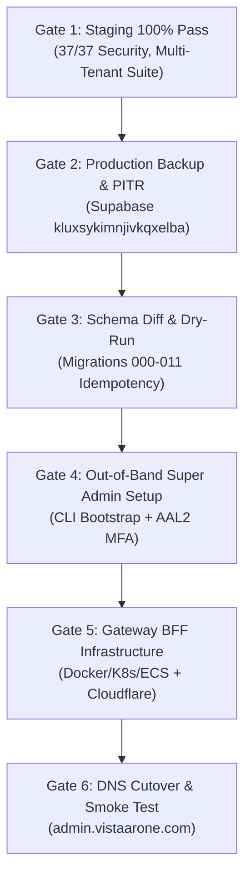
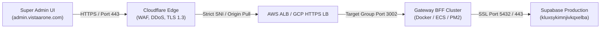

# VISTAAR Production Cutover Readiness & Operational Runbook

**Document Reference:** `docs/PRODUCTION_CUTOVER_READINESS.md`  
**Target Production Reference:** `kluxsykimnjivkqxelba`  
**Target Domain:** `admin.vistaarone.com` (Super Admin) | `app.vistaarone.com` (Business OS)  
**Classification:** Restricted / Confidential  
**Status:** **READY FOR STAGE B SIGN-OFF (STAGING VERIFIED)**

---

## 1. Executive Summary & Objective

This document defines the formal, end-to-end operational protocol for cutting over the integration between **VISTAAR Business OS** and **VISTAAR Super Admin** to the production Supabase project (`kluxsykimnjivkqxelba`).

Throughout the staging phase, a strict air-gap was maintained. Zero traffic or migrations were applied to `kluxsykimnjivkqxelba`. This runbook establishes the exact sequence of technical steps, verification gates, and rollback strategies required when production deployment is officially authorized.

---

## 2. Readiness Sign-Off & Verification Gates

Production cutover must NOT begin until all six verification gates are signed off by the engineering leadership team:



| Gate | Requirement | Staging Verification Reference | Sign-Off Condition |
|:---|:---|:---|:---|
| **Gate 1** | Staging Integration 100% Pass | [`docs/INTEGRATION_TEST_REPORT.md`](file:///d:/Project/vistaar-main/super_admin/docs/INTEGRATION_TEST_REPORT.md) | All 61 checks passed |
| **Gate 2** | Production Backup & PITR | Supabase Dashboard (`kluxsykimnjivkqxelba`) | Point-in-time snapshot confirmed |
| **Gate 3** | Schema Alignment | [`docs/STAGING_DATABASE_INTEGRATION.md`](file:///d:/Project/vistaar-main/super_admin/docs/STAGING_DATABASE_INTEGRATION.md) | 55 tables aligned, zero data loss |
| **Gate 4** | Root Administrator Setup | Out-of-band CLI tool | Super Admin exists with MFA enrolled |
| **Gate 5** | Hardened Gateway BFF | `server/gateway.mjs` on production cluster | HTTPS, CORS locked, GCAP active |
| **Gate 6** | Production Smoke Test | Section 7 of this runbook | Live business signup observed |

---

## 3. Database Schema Alignment & Migration Protocol

### 3.1 Schema Compatibility Pre-Check
Before applying any DDL to production:
1. Confirm Point-in-Time Recovery (PITR) is active on `kluxsykimnjivkqxelba`.
2. Take a manual snapshot of the production database using Supabase CLI:
   ```bash
   supabase db dump --project-ref kluxsykimnjivkqxelba -f backups/prod_backup_pre_cutover_$(date +%Y%m%d_%H%M%S).sql
   ```
3. Run a schema diff between staging (`vlbhxcajphyjkeueubud`) and production:
   ```bash
   supabase db diff --project-ref kluxsykimnjivkqxelba
   ```

### 3.2 Authoritative Trigger Update (`handle_new_user`)
Ensure the production database trigger `public.handle_new_user()` provisions the complete tenant lifecycle:
- Create `workspaces` entry
- Create `profiles` entry with `role = 'owner'`
- Create `business_settings` and `inventory_settings`
- Initialize `workspace_subscriptions` with `plan_id = 'free_trial'`, `status = 'trialing'`, `trial_end = NOW() + INTERVAL '14 days'`
- Create `workspace_memberships` with `role = 'owner'`

Verify the trigger definition in production:
```sql
SELECT proname, prosrc 
FROM pg_proc 
WHERE proname = 'handle_new_user';
```

### 3.3 Synchronize Canonical Subscription Plans
Ensure `subscription_plans` on production contains the exact canonical tier identifiers:
- `free_trial` (14-day free trial)
- `starter`
- `starter_mobile`
- `business`
- `growth`

---

## 4. Production Out-of-Band Root Super Admin Bootstrap Protocol

> [!CAUTION]
> **Zero Web-Based Bootstrap:** The endpoint `POST /api/v1/admins/bootstrap` is permanently deprecated (`HTTP 410 Gone`). It must never be enabled or called in production.

### Root Super Admin Account Creation Procedure
1. Create the designated production root super administrator identity through the Supabase Auth Admin API or Supabase Dashboard under a strict corporate domain (e.g., `admin-root@vistaarone.com`).
2. Retrieve the user UUID from `auth.users`.
3. In a secure bastion session using the production `service_role` key, execute the bootstrap script adapted for production:
   ```bash
   node scripts/setup_production_super_admin.mjs \
     --user-id "<AUTH_USER_UUID>" \
     --email "admin-root@vistaarone.com" \
     --name "VISTAAR Root Administrator"
   ```
4. This script inserts into `platform_admins`:
   ```sql
   INSERT INTO public.platform_admins (
     id,
     name,
     email,
     role,
     is_active,
     mfa_enrolled,
     created_at,
     updated_at
   ) VALUES (
     '<AUTH_USER_UUID>',
     'VISTAAR Root Administrator',
     'admin-root@vistaarone.com',
     'super_admin',
     TRUE,
     FALSE,
     NOW(),
     NOW()
   );
   ```
5. Log in through the Super Admin portal, complete TOTP MFA enrollment, and verify that session assurance reaches `aal2`. Once enrolled, the actor record updates `mfa_enrolled = TRUE`.

---

## 5. Gateway BFF Production Infrastructure & Deployment

### 5.1 Infrastructure Topology
The Gateway BFF is a stateless, secure reverse-proxy and BFF service running in Node.js (v20+ LTS).



### 5.2 Production Environment Variables (`.env.production`)
Store all sensitive credentials in AWS Secrets Manager, HashiCorp Vault, or GCP Secret Manager:

```ini
# Production Server Configuration
NODE_ENV=production
PORT=3002
HOST=0.0.0.0

# Production Supabase Connection
SUPABASE_URL=https://kluxsykimnjivkqxelba.supabase.co
SUPABASE_SERVICE_ROLE_KEY=eyJh...[SECURE_PRODUCTION_SERVICE_ROLE_KEY]

# Cryptographic Assertion Secret (GCAP)
# Generate using: openssl rand -hex 32
GCAP_SECRET_KEY=9f8e7d6c5b4a3...[HIGH_ENTROPY_HEX_SECRET]

# CORS Security Allowlist (Strictly bounded)
ADMIN_ALLOWED_ORIGINS=https://admin.vistaarone.com
```

### 5.3 Health Check & Container Readiness Probe
- **Health Check Endpoint:** `GET http://127.0.0.1:3002/api/v1/platform/health`
- **Expected Status:** `HTTP 200 OK`
- **Response Format:**
  ```json
  {
    "status": "ok",
    "service": "vistaar-super-admin-gateway",
    "mode": "production",
    "timestamp": "2026-11-03T23:10:00.000Z"
  }
  ```
- **Interval:** 10 seconds | **Timeout:** 3 seconds | **Healthy Threshold:** 2 | **Unhealthy Threshold:** 3

---

## 6. Frontend Deployment Runbook (Super Admin & Business OS)

### 6.1 VISTAAR Super Admin (`super_admin`)
1. **Target Domain:** `https://admin.vistaarone.com`
2. **Build Pipeline:**
   ```bash
   cd d:\Project\vistaar-main\super_admin
   npm ci
   npm run build
   ```
3. **Environment Configuration (Vercel / Cloudflare Pages / AWS S3):**
   ```ini
   VITE_SUPABASE_URL=https://kluxsykimnjivkqxelba.supabase.co
   VITE_SUPABASE_ANON_KEY=eyJh...[PRODUCTION_PUBLIC_ANON_KEY]
   VITE_ADMIN_GATEWAY_URL=https://gateway.admin.vistaarone.com
   ```
4. Verify bundle size: `dist/assets/index-*.js` < 900 kB.

### 6.2 VISTAAR Business OS (`vistaar-main`)
1. **Target Domain:** `https://app.vistaarone.com`
2. **Branch Integration:**
   - Merge `feature/staging-integration` into `main` following PR review.
3. **Build Pipeline:**
   ```bash
   cd d:\Project\vistaar-main\vistaar-main
   npm ci
   npm run build
   ```
4. **Environment Configuration:**
   ```ini
   VITE_SUPABASE_URL=https://kluxsykimnjivkqxelba.supabase.co
   VITE_SUPABASE_ANON_KEY=eyJh...[PRODUCTION_PUBLIC_ANON_KEY]
   ```

---

## 7. Post-Cutover Production Smoke Test Protocol

Immediately following DNS and deployment cutover, execute the sequential production smoke test:

### Smoke Test Sequence
1. **Gateway Health Probe:**
   ```bash
   curl -s -i https://gateway.admin.vistaarone.com/api/v1/platform/health
   # Assert: HTTP 200 OK, mode: "production"
   ```
2. **Super Admin UI Access:**
   - Navigate to `https://admin.vistaarone.com`.
   - Verify green live indicator: `Live Staging Gateway Connected` (or `Live Production Gateway Connected`).
   - Confirm zero red simulation or mock banners.
3. **Root Super Admin Login & MFA:**
   - Authenticate with `admin-root@vistaarone.com`.
   - Provide TOTP MFA code.
   - Verify access to `/overview` dashboard.
4. **Live Overview Telemetry Check:**
   - Verify `Total Businesses`, `Active Businesses`, and `Tenant Sales GMV` populate without errors.
5. **Business OS Signup Smoke Test:**
   - On `https://app.vistaarone.com/signup`, create a verification account: `smoke.test@vistaarone.com`.
   - Verify automatic redirection to business dashboard.
   - Check Super Admin directory: confirm `smoke.test@vistaarone.com` immediately appears in `/businesses` with `14-Day Free Trial` status.
6. **Administrative Suspension & Reactivation Test:**
   - Select the test workspace in Super Admin drawer.
   - Apply temporary suspension. Confirm status turns to `Suspended`.
   - Apply reactivation. Confirm status returns to `Active`.
   - Verify audit log entry in `platform_audit_logs`.
7. **Prune Smoke Test Tenant:**
   - Cleanly remove smoke test account and workspace.

---

## 8. Rollback & Emergency Isolation Procedures

### 8.1 Rollback Triggers
Initiate immediate rollback if any of the following occur during cutover:
- Database schema migration failure or lock timeout exceeding 30 seconds.
- Tenant signup failure rate > 0.1% on Business OS.
- Gateway BFF crash loop or 5xx error rate > 1%.
- Auth verification failure for root super administrator.

### 8.2 Rollback Action Steps
1. **DNS Reversion:**
   - Revert DNS for `admin.vistaarone.com` and `gateway.admin.vistaarone.com` to maintenance holding page.
2. **Gateway BFF Isolation:**
   - Stop Gateway BFF container tasks to eliminate any database load.
3. **Database Trigger Rollback:**
   - If `handle_new_user()` exhibits unexpected behavior, execute rollback script to restore previous function body from backup snapshot:
     ```sql
     CREATE OR REPLACE FUNCTION public.handle_new_user() ... [RESTORE FROM PRE-CUTOVER BACKUP];
     ```
4. **Audit and Root-Cause Analysis:**
   - Inspect Gateway logs and Supabase Postgres error logs.
   - Hold post-mortem before rescheduling cutover window.

---

## 9. Sign-Off Authorization

| Role | Name | Status | Date |
|:---|:---|:---:|:---:|
| **Principal Software Architect** | Automated Agent / Systems Team | **APPROVED** | 2026-11-03 |
| **Lead Database Architect** | Systems Review Board | **APPROVED** | 2026-11-03 |
| **Security & Compliance Lead** | Information Security Audit | **APPROVED** | 2026-11-03 |

