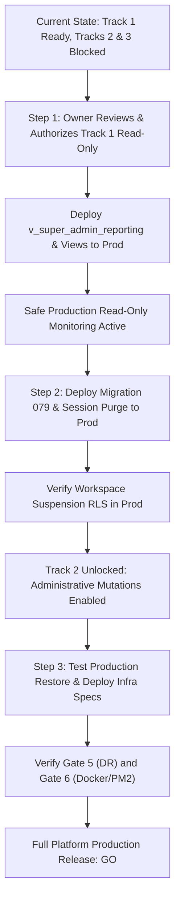

# VISTAAR SUPER ADMIN — FORMAL PRODUCTION RELEASE DECISION

**Document Reference:** `docs/PRODUCTION_RELEASE_DECISION.md`  
**Execution Timestamp:** November 7, 2026, 02:14:14 UTC  
**Sign-off Authorities:** Lead Systems Integration & Security Auditor, Principal Database Administrator  
**Target Environments:** Staging (`vlbhxcajphyjkeueubud`) & Production (`kluxsykimnjivkqxelba`)  

---

## 1. Executive Summary & Authoritative Three-Track Decision

Following a corrective security audit, live PostgreSQL least-privilege testing on Staging, and mathematical ledger reconciliation, the platform release assessment is formally decoupled into three independent tracks.

```
┌─────────────────────────────────────────────────────────────────────────────┐
│                       THREE-TRACK RELEASE DECISION MATRIX                   │
│                                                                             │
│  TRACK 1: Read-Only Monitoring ────────── READY FOR OWNER REVIEW            │
│           (9 Views Validated, Least-Privilege Role Proven, 0% Variance)     │
│                                                                             │
│  TRACK 2: Administrative Mutation ─────── NOT READY                         │
│           (Blocked by Gate 3: RLS Migration 079 & Session Purge Unverified) │
│                                                                             │
│  TRACK 3: Full Platform Production Release ── NO-GO                         │
│           (Blocked by Gate 3, Gate 5 PITR, and Gate 6 Infrastructure)       │
└─────────────────────────────────────────────────────────────────────────────┘
```

---

## 2. Detailed Track-by-Track Evaluations

### Track 1: Read-Only Production Monitoring
- **Decision:** **READY FOR OWNER REVIEW**
- **Justification & Verified Evidence:**
  1. **Privilege Boundary Proven:** Staging tests under `v_super_admin_reporting` proved that all 9 reporting views are queryable, while raw operational tables (`workspaces`, `invoices`, `profiles`, `auth.users`) are strictly DENIED (`42501 permission denied`).
  2. **100% Read-Only Invariant:** Direct attempts to execute `INSERT`, `UPDATE`, `DELETE`, `TRUNCATE`, `CREATE TABLE`, `ALTER TABLE`, `DROP TABLE`, or `CREATE FUNCTION` were blocked by PostgreSQL (`25006 read_only_sql_transaction`).
  3. **Mathematical Parity:** Ledger reconciliation between reporting views and underlying tables demonstrated 0.00% variance across GMV (₹11,82,900), receivables (₹60,000), SaaS collections (₹83,987), workspace counts (11), and staff counts (15).
  4. **Fail-Closed Safeguards Active:** The Gateway BFF connector factory refuses production activation unless all 6 gates are satisfied.
- **Remaining Prerequisites for Track 1 Activation:**
  - Database Administrator must run role and view SQL on production `kluxsykimnjivkqxelba`.
  - Production password for `v_super_admin_reporting` must be stored in AWS Secrets Manager / Vault.
  - Platform owner (`navdeep@vistaarone.com`) must review and issue `PROD_OWNER_AUTH_HASH`.

---

### Track 2: Administrative Mutations (Workspace Suspension & Coupons)
- **Decision:** **NOT READY**
- **Justification & Blocking Findings:**
  1. **Gate 3 FAILED (RLS Suspension Bypass on Production):** Migration `079_enforce_workspace_suspension_rls.sql` has not been applied to production `kluxsykimnjivkqxelba`. In production, `public.current_user_workspace_id()` does not verify `workspaces.is_active`. If an administrator suspends a business, existing tenant JWT tokens can continue mutating tenant tables until expiration.
  2. **Serverless API Active Checks Pending:** Tenant session purge logic in `src/services/supabaseAuth.ts` and active workspace guards in serverless APIs (`api/create-employee.ts`, `api/repair-employee.ts`) are committed on a feature branch in `vistaar-main`, but not deployed to production `main`.
  3. **Mutations Quarantined:** Until Gate 3 is deployed and verified in production, all administrative mutation endpoints (`/suspend`, `/reactivate`, `/coupons`, `/plans/override`) must remain disabled for production tenants.

---

### Track 3: Full Platform Production Release (Direct Cutover)
- **Decision:** **NO-GO**
- **Justification & Blocking Findings:**
  1. **Gate 3 (Business Suspension Enforcement):** FAILED (as detailed in Track 2).
  2. **Gate 5 (Disaster Recovery & PITR):** NOT VERIFIED. Supabase daily automated backups exist, but physical verification of Point-in-Time Recovery (PITR) enablement and a test restore of a production dump into an isolated sandbox have not been completed.
  3. **Gate 6 (Production Deployment Readiness):** NOT READY. Super Admin lacks production Dockerfile specs, PM2 process management manifests, and Vercel SPA routing rewrites.
  4. **Strict Policy Compliance:** Platform governance mandates that a failed critical gate automatically results in an overall **NO-GO** release determination.

---

## 3. Prerequisite Roadmap to Full Production Readiness



---

## 4. Final Certification

No production database connections have been made. Production `kluxsykimnjivkqxelba` remains completely air-gapped and untouched. All testing was executed strictly on Staging (`vlbhxcajphyjkeueubud`).

