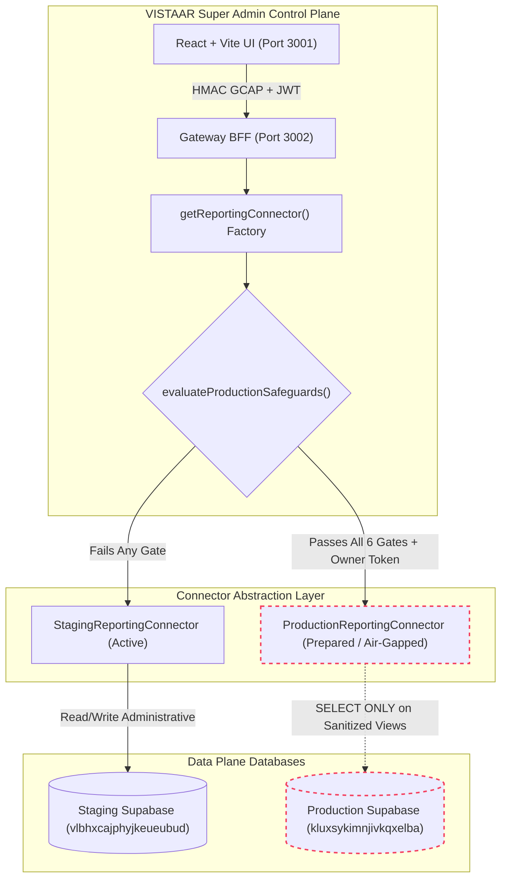

# VISTAAR SUPER ADMIN — PRODUCTION REPORTING CONNECTOR DESIGN

**Document Reference:** `docs/PRODUCTION_REPORTING_CONNECTOR_DESIGN.md`  
**Execution Date:** November 7, 2026  
**Status:** Architecture Proposal & Specification (Pre-Flight Review)  
**Security Classification:** Highly Confidential — Control Plane Gateway Specification  
**Target Environments:** Staging (`vlbhxcajphyjkeueubud`) & Future Production (`kluxsykimnjivkqxelba`)  

---

## 1. Executive Summary & Purpose

This document specifies the architectural design of the **VISTAAR Super Admin Reporting Connector**. It establishes a strictly decoupled, least-privilege, read-only data access layer that bridges the Super Admin Gateway Backend-for-Frontend (BFF) with the underlying VISTAAR Business OS multi-tenant database.

To prevent inadvertent modification, cross-tenant leaks, or production outages, the connector enforces:
1. **Physical Air-Gap Preservation:** The production database remains strictly untouched until explicit, cryptographically verifiable owner authorization is granted.
2. **Fail-Closed Safeguards:** Any missing security gate automatically locks out the production connector, keeping Super Admin securely scoped to Staging.
3. **Read-Only Invariant:** Write operations (`INSERT`, `UPDATE`, `DELETE`, `TRUNCATE`, DDL) are physically and programmatically impossible through the connector.
4. **Sanitized View Traversal:** Queries target dedicated reporting views rather than raw transactional application tables.

---

## 2. High-Level Architectural Diagram



---

## 3. Core Architectural Requirements & Implementation

### 3.1 Connector Class Hierarchy (`server/connectors/reportingConnector.mjs`)

The connector subsystem implements a template method pattern rooted in `BaseReportingConnector`:

- **`BaseReportingConnector`:**
  - Enforces `ALLOWED_ENVIRONMENTS` (`['staging', 'production']`).
  - Implements `withTimeout(promise, operationName)` with an 8,000 ms hard boundary to prevent connection pool exhaustion.
  - Maintains `lastSuccessfulSyncTimestamp` updated atomically upon successful query completion.
  - Enforces pagination constraints (`limit` clamped to 1–100, `page` >= 1).
- **`StagingReportingConnector`:**
  - Targets staging project `vlbhxcajphyjkeueubud`.
  - Operates with `service_role` credentials to perform staging testing, seed management, and test fixture isolation.
- **`ProductionReportingConnector`:**
  - Targets production project `kluxsykimnjivkqxelba`.
  - Instantiation strictly gated by `evaluateProductionSafeguards()`.
  - Implements `assertReadOnly()` mutation interceptor: explicitly overrides `insert()`, `update()`, `delete()`, `upsert()` to throw `READ_ONLY_VIOLATION` (HTTP 403).
  - Queries exclusively `v_report_*` sanitized views.

### 3.2 Security Controls & Threat Mitigations

| Threat | Risk Level | Mitigating Connector Design |
|---|:---:|---|
| **Arbitrary SQL Injection** | CRITICAL | No client-supplied raw SQL strings are accepted. All queries use parameterized ORM query builders with typed filters. |
| **Connection Pool Starvation** | HIGH | Queries are wrapped with `withTimeout()` (8,000 ms) and connection pool sizing is restricted to a maximum of 5 concurrent pooled connections. |
| **Accidental Production Mutation** | CRITICAL | Multi-layered defense: (1) `default_transaction_read_only = TRUE` on PostgreSQL role, (2) zero write grants, (3) application-level `assertReadOnly()` interceptor. |
| **Cross-Tenant PII Exposure** | HIGH | Views deliberately omit customer payment instruments, password hashes, and personal tax identification numbers. |
| **Unintentional Cutover** | CRITICAL | Fail-closed safeguard mechanism halts production activation if any of the 6 prerequisites is missing. |

### 3.3 Audit Logging & Telemetry

Every reporting query executed through the connector produces a structured audit record:

```json
{
  "timestamp": "2026-11-07T02:01:12.922Z",
  "actorId": "5511b4fd-3a7a-4571-b062-f3bfa1c53c7b",
  "environment": "staging",
  "endpoint": "/api/v1/workspaces",
  "viewQueried": "public.workspaces",
  "queryLatencyMs": 142,
  "recordsReturned": 11,
  "scope": "all",
  "success": true
}
```

---

## 4. Operational Lifecycle & Health Checks

The connector exposes `getHealth()` to the Super Admin control plane:

- **Liveness:** Verifies database reachability via lightweight `head: true` query.
- **Latency Monitoring:** Measures round-trip query time in milliseconds.
- **Uptime & Synchronization:** Returns `lastSuccessfulSyncTimestamp` and air-gap status.
- **Transparency Banner:** Emits live metadata informing the frontend whether records originate from Staging or Production.

