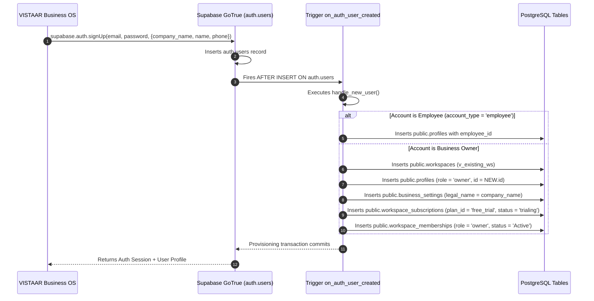

# STAGING DATABASE INTEGRATION SPECIFICATION
## Unified Staging Supabase Architecture for VISTAAR Multi-Tenant SaaS
**Document Reference:** `docs/STAGING_DATABASE_INTEGRATION.md`  
**Revision:** 1.0.0-FINAL  
**Date:** November 3, 2026  
**Target Environment:** Staging Supabase Database (`vlbhxcajphyjkeueubud`, AWS `eu-west-1`)  
**Production Air-Gap Status:** STRICT AIR-GAP CONFIRMED (Zero traffic to `kluxsykimnjivkqxelba`)

---

## 1. Overview & Unified Data Model

The VISTAAR ecosystem operates on a shared PostgreSQL architecture where **VISTAAR Business OS** (tenant execution plane) and **VISTAAR Super Admin** (platform management plane) access a unified database schema under strict principle-of-least-privilege boundaries.

```
+---------------------------------------------------------------------------------------------------+
|                                      POSTGRESQL 17.11 (STAGING)                                    |
|                                     Project: vlbhxcajphyjkeueubud                                 |
+---------------------------------------------------------------------------------------------------+
|  auth.users (Supabase GoTrue Identities)                                                          |
|       |                                                                                           |
|       | (Trigger: on_auth_user_created -> handle_new_user())                                      |
|       v                                                                                           |
|  +-----------------------------+     +-------------------------------+                            |
|  | public.workspaces           | <---+ public.profiles               |                            |
|  | - id (UUID PK)              |     | - id (UUID PK -> auth.users)  |                            |
|  | - company_name (VARCHAR)    |     | - workspace_id (UUID FK)      |                            |
|  | - owner_name, owner_email   |     | - employee_id (VARCHAR)       |                            |
|  | - organization_id (UUID FK) |     | - role ('owner'|'employee')   |                            |
|  | - is_active, is_main_branch |     | - status ('Active'|'Inactive')|                            |
|  +-----------------------------+     +-------------------------------+                            |
|       |                 |                            |                                            |
|       |                 | (1:1)                      | (M:N)                                      |
|       |                 v                            v                                            |
|       |          +-----------------------------------------+                                      |
|       |          | public.workspace_subscriptions          |                                      |
|       |          | - workspace_id (UUID FK)                |                                      |
|       |          | - plan_id ('free_trial'|'starter'|...)   |                                      |
|       |          | - status ('trialing'|'active'|'expired')|                                      |
|       |          | - trial_end, current_period_end         |                                      |
|       |          +-----------------------------------------+                                      |
|       |                 |                                                                         |
|       v                 v (Audit)                                                                 |
|  +-----------------------------+     +--------------------------------+                           |
|  | Tenant Retail Activity      |     | Platform Control & Governance  |                           |
|  | - public.invoices           |     | - public.platform_admins       |                           |
|  | - public.payments           |     | - public.platform_audit_logs   |                           |
|  | - public.products           |     | - public.platform_gcap_nonces |                           |
|  | - public.customers          |     | - public.platform_suspensions  |                           |
|  | - public.counter_sales      |     | - public.coupons & redemptions |                           |
|  +-----------------------------+     +--------------------------------+                           |
+---------------------------------------------------------------------------------------------------+
```

---

## 2. Table Inventory & Domain Responsibilities

The staging database hosts 55 verified tables partitioned cleanly by domain:

### 2.1 Multi-Tenant Core & Workspace Identity
- **`public.workspaces`**: Authoritative root tenant entity. Represents a distinct business or branch location. Contains `company_name`, `owner_name`, `owner_email`, `owner_phone`, `organization_id`, `branch_code`, `is_main_branch`, and `is_active`.
- **`public.profiles`**: User account details linked directly to `auth.users(id)` and `public.workspaces(id)`. Stores `employee_id`, `name`, `email`, `role`, and `status`.
- **`public.business_settings`**: Legal company information, GSTIN, registered address, and locale preferences for receipt and invoice rendering.
- **`public.organizations`**: High-level organizational boundary for multi-branch retail chains.
- **`public.workspace_memberships`**: Explicit multi-tenant access control mappings between users and workspaces.

### 2.2 Retail Operations & POS Engine (Repo A Primary Domain)
- **`public.products`**: SKU master catalog with barcode, category, prices, and stock units.
- **`public.customers`**: Tenant customer records and credit balances.
- **`public.suppliers`**: Inventory vendor roster and payable balances.
- **`public.invoices` & `public.invoice_items`**: Formal GST/non-GST tax invoices. Sum of invoice totals reflects Tenant GMV.
- **`public.payments`**: Payment collection receipts against invoices.
- **`public.counter_sales` & `public.counter_sale_items`**: Fast-checkout retail point-of-sale register.
- **`public.quotations` & `public.quotation_items`**: Sales estimates convertible to formal invoices.
- **`public.stock_receipts` & `public.stock_movements`**: Authoritative inventory ledger and audit trail.
- **`public.udhari_records` & `public.udhari_payments`**: Retail ledger for deferred customer credit accounts.
- **`public.expenses` & `public.daybook_transactions`**: Cashbook accounting and daily business expenditure.

### 2.3 SaaS Subscription & Entitlements Engine (Shared Domain)
- **`public.subscription_plans`**: Master plan catalog (`free_trial`, `starter`, `starter_mobile`, `business`, `growth`).
- **`public.workspace_subscriptions`**: Live entitlement state per workspace (`trialing`, `active`, `past_due`, `cancelled`, `expired`).
- **`public.subscription_addons`**: Add-on seat and device permissions.
- **`public.payment_transactions`**: SaaS revenue payments collected from businesses.

### 2.4 Super Admin Control Plane & Governance (Repo B Primary Domain)
- **`public.platform_admins`**: Authorized platform administrators (`super_admin`, `billing_admin`, `support_agent`) with MFA enrollment flags.
- **`public.platform_gcap_nonces`**: Single-use cryptographic nonces for GCAP assertion verification.
- **`public.platform_workspace_suspensions`**: Authoritative suspension log tracking administrative blocks and reactivation history.
- **`public.platform_audit_logs`**: Append-only security audit log recording every privileged administrative action.
- **`public.platform_bootstrap_registry`**: Hardware/out-of-band bootstrap lock preventing unauthorized re-initialization.
- **`public.platform_admin_invitations`**: Expiring cryptographically hashed tokens for administrative team onboarding.
- **`public.coupons` & `public.coupon_redemptions`**: Promotional discount codes and tracking ledger.

---

## 3. Authoritative Registration Trigger Lifecycle

When a business signs up via VISTAAR Business OS, the database executes an atomic provisioning workflow:



---

## 4. Privilege Hardening & Row Level Security (RLS)

### 4.1 SQL Privilege Matrix
| Schema / Role | `anon` | `authenticated` | `service_role` (Gateway BFF) | `postgres` (Migration Owner) |
| :--- | :--- | :--- | :--- | :--- |
| **`public` Schema** | `USAGE` only (NO `CREATE`) | `USAGE` only (NO `CREATE`) | `USAGE` + `SELECT/INSERT/UPDATE/DELETE` | `ALL PRIVILEGES` |
| **`extensions` Schema** | `USAGE` only (NO `CREATE`) | `USAGE` only (NO `CREATE`) | `USAGE` (NO `CREATE`) | `ALL PRIVILEGES` |
| **`platform_admins`** | NONE | NONE | `SELECT, INSERT, UPDATE` | `ALL PRIVILEGES` |
| **`platform_audit_logs`** | NONE | NONE | `SELECT, INSERT` (NO `UPDATE/DELETE`) | `ALL PRIVILEGES` |
| **`platform_gcap_nonces`** | NONE | NONE | `SELECT, INSERT, DELETE` | `ALL PRIVILEGES` |
| **`subscription_plans`** | `SELECT` | `SELECT` | `ALL PRIVILEGES` | `ALL PRIVILEGES` |
| **`workspaces`** | NONE | RLS filtered (`workspace_id`) | `ALL PRIVILEGES` | `ALL PRIVILEGES` |
| **`workspace_subscriptions`**| NONE | RLS filtered (`workspace_id`) | `ALL PRIVILEGES` | `ALL PRIVILEGES` |

### 4.2 Security Definer Functions
All administrative functions run under `SECURITY DEFINER` with fixed, explicit `SET search_path = public, pg_temp` to prevent search path hijacking:
- `super_admin_bootstrap_system`
- `super_admin_enroll_mfa`
- `super_admin_revoke_mfa`
- `super_admin_create_invitation`
- `super_admin_provision_admin`
- `super_admin_suspend_workspace`
- `super_admin_reactivate_workspace`
- `super_admin_log_audit`
- `super_admin_create_coupon`
- `super_admin_toggle_coupon`

