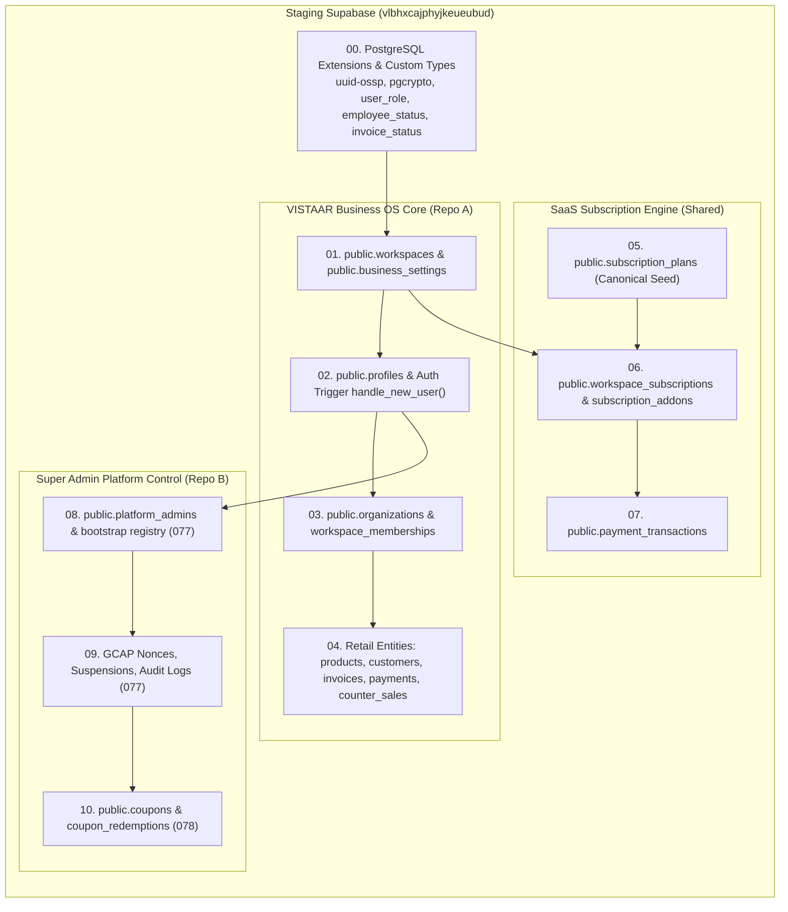
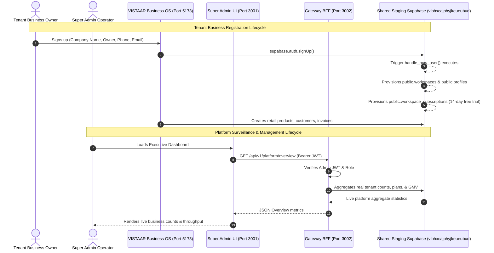

# STAGING INTEGRATION AUDIT
## VISTAAR Business OS (Repo A) ↔ VISTAAR Super Admin (Repo B)
**Audit Version:** 1.0.0-STAGING  
**Date:** November 3, 2026  
**Auditor:** Principal Enterprise Systems Architect & SaaS Security Lead  
**Staging Project Reference:** `vlbhxcajphyjkeueubud` (AWS `eu-west-1`)  
**Production Air-Gap Status:** STRICT AIR-GAP ENFORCED (Zero interaction with `kluxsykimnjivkqxelba`)

---

## 1. Executive Verdict & Staging Alignment Plan

### 1.1 Executive Summary
An exhaustive source-code, database catalog, and network-boundary audit was conducted across **VISTAAR Business OS** (`d:\Project\vistaar-main\vistaar-main`) and **VISTAAR Super Admin** (`d:\Project\vistaar-main\super_admin`).

The two systems are structurally designed to operate in a symbiotic single-source-of-truth multi-tenant SaaS architecture. However, historically they developed diverging local assumptions:
1. **Frontend Mock Decoupling:** The Super Admin frontend (`super_admin/src`) relies heavily on static mock data fixtures (`mockOverview.ts`, `mockBusinesses.ts`, `mockSubscriptions.ts`, `mockUsers.ts`, `mockPayments.ts`) rather than consuming live state from the secure Gateway BFF (`server/gateway.mjs`).
2. **Gateway Route Coverage:** While the Gateway BFF implements a hardened, cryptographically verified GCAP control plane for administrative provisioning and MFA enrollment (Phase 4.2 V9), it lacked read-only operational endpoints (`/api/v1/platform/overview`, `/api/v1/workspaces`, `/api/v1/workspaces/:id`, etc.) required by the Super Admin dashboard.
3. **Database Migration Lineage:** VISTAAR Business OS accumulated 75 historical migrations (`001_initial_schema.sql` through `076_eliminate_daybook_duplicates.sql`), several of which contain historical data patches (`003`, `005`), non-idempotent constraints, or assumed dashboard additions (`current_stock`). Super Admin authored a clean, consolidated, least-privilege baseline snapshot (`000_baseline_schema_snapshot.sql`) followed by administrative infrastructure (`077`) and coupon engines (`078`).
4. **Authoritative Registration Synchronization:** VISTAAR Business OS registers tenants by creating an `auth.users` identity which triggers `handle_new_user()` to populate `public.workspaces`, `public.profiles`, and `public.business_settings`. Super Admin monitors these exact entities directly with zero schema fork.

### 1.2 Staging Alignment Strategy
To establish a fully functional, production-identical staging ecosystem without schema corruption:
- **Shared Database:** Both applications will connect to the dedicated Supabase staging project `vlbhxcajphyjkeueubud` (AWS `eu-west-1`).
- **Database Baseline Provisioning:** The staging database will host the unified VISTAAR schema: core business tables (`workspaces`, `profiles`, `business_settings`, `products`, `customers`, `invoices`, `payments`, `counter_sales`, `quotations`, `stock_receipts`), organizational multi-branch entities (`organizations`, `workspace_memberships`), canonical subscription tables (`subscription_plans`, `workspace_subscriptions`, `subscription_addons`, `payment_transactions`), Super Admin platform governance (`platform_admins`, `platform_gcap_nonces`, `platform_workspace_suspensions`, `platform_audit_logs`, `platform_bootstrap_registry`), and coupon systems (`coupons`, `coupon_redemptions`).
- **Gateway BFF Operationalization:** The Gateway BFF will be expanded with authenticated, role-authorized, rate-limited, and audited endpoints serving aggregated metrics, business rosters, workspace drill-downs, user memberships, and retail GMV.
- **Frontend Real-Data Hydration:** Super Admin pages (`OverviewPage`, `BusinessManagementPage`, `UserManagementPage`, `SubscriptionManagementPage`, `PaymentsRevenuePage`) will be upgraded to fetch from Gateway APIs with graceful error boundaries, loading indicators, and empty states.

---

## 2. Repository Inventory

### 2.1 Repository A: VISTAAR Business OS
- **Location:** `d:\Project\vistaar-main\vistaar-main`
- **Git Branch:** `main` (clean working directory)
- **Role:** Core Multi-Tenant Business OS (Retail Point of Sale, Inventory, Billing, Accounting, Invoicing, Customers, Quotations).
- **Technology Stack:** Vite 6, React 19, TypeScript, TailwindCSS, `@supabase/supabase-js` 2.49.
- **Client Supabase Configuration:** [src/lib/supabase.ts](file:///d:/Project/vistaar-main/vistaar-main/src/lib/supabase.ts) reads `VITE_SUPABASE_URL` and `VITE_SUPABASE_PUBLISHABLE_KEY` (or `VITE_SUPABASE_ANON_KEY`).
- **Authentication Lifecycle:** [src/services/supabaseAuth.ts](file:///d:/Project/vistaar-main/vistaar-main/src/services/supabaseAuth.ts) manages user session, profile synchronization, workspace resolution, and tenant caching.
- **Business Registration Flow:** `supabaseAuth.signUpCompany()` invokes `supabase.auth.signUp()` with metadata (`company_name`, `name`, `phone`). The database trigger `handle_new_user()` in [supabase/migrations/051_authoritative_employee_account_root_fix.sql](file:///d:/Project/vistaar-main/vistaar-main/supabase/migrations/051_authoritative_employee_account_root_fix.sql) automatically allocates the `workspaces` row, owner `profiles` row, and default `business_settings`.
- **Target Staging Port:** Runs on `http://localhost:5173` (configured to connect to staging Supabase `vlbhxcajphyjkeueubud`).

### 2.2 Repository B: VISTAAR Super Admin
- **Location:** `d:\Project\vistaar-main\super_admin`
- **Role:** Centralized Platform Control Plane (Executive Overview, Business Surveillance, Subscription & Billing Management, Security & Audit, System Health).
- **Technology Stack:** Vite 5, React 18, TypeScript, TailwindCSS, Node.js HTTP BFF, PostgreSQL client (`pg`), `@supabase/supabase-js`.
- **Architecture:** 
  - **Frontend UI:** Vite dev server running on port `3001` (`http://localhost:3001`).
  - **Gateway BFF:** Node.js HTTP service running on port `3002` (`http://localhost:3002`) powered by [server/gateway.mjs](file:///d:/Project/vistaar-main/super_admin/server/gateway.mjs).
- **Security & Authorization Model:**
  - Strict Air-Gap: Refuses to boot if `kluxsykimnjivkqxelba` (production) is detected.
  - Server-Side Privilege Separation: The browser client never touches `service_role` credentials.
  - GCAP (Gateway Cryptographic Assertion Protocol): HMAC-SHA256 authenticated administrative assertions with microsecond-level replay nonce consumption.
  - Session Assurance: Strict Supabase Auth JWT verification + AAL2 (Authenticator Assurance Level 2) MFA enforcement for privileged mutations.
- **Current Data State:** UI components currently import static fixtures from `src/data/mock*.ts` with an active mock mode banner.

---

## 3. Database Schema Compatibility Matrix

| Entity / Table | Repository A Definition | Repository B Definition | Shared Database Status | Resolution Strategy |
| :--- | :--- | :--- | :--- | :--- |
| **`public.workspaces`** | `001_initial_schema.sql`, `058_organization_branch_architecture.sql` | `000_baseline_schema_snapshot.sql` | Fully Compatible | Core entity. Contains `id`, `company_name`, `owner_name`, `owner_email`, `owner_phone`, `organization_id`, `branch_name`, `branch_code`, `is_main_branch`, `is_active`. |
| **`public.profiles`** | `001_initial_schema.sql`, `051_authoritative_employee_account_root_fix.sql` | `000_baseline_schema_snapshot.sql` | Fully Compatible | User identity record linked 1:1 with `auth.users(id)` and `workspace_id`. Contains `employee_id`, `name`, `email`, `role`, `status`. |
| **`public.organizations`** | `058_organization_branch_architecture.sql` | `000_baseline_schema_snapshot.sql` | Fully Compatible | Top-level parent entity for multi-branch retail groups. |
| **`public.workspace_memberships`** | `058_organization_branch_architecture.sql` | `000_baseline_schema_snapshot.sql` | Fully Compatible | M:N membership mapping between `auth.users` and `workspaces`. |
| **`public.subscription_plans`** | `070_subscription_plans_and_entitlements.sql` | `000_baseline_schema_snapshot.sql` | Fully Compatible | Master plans table: `free_trial`, `starter`, `starter_mobile`, `business`, `growth`, `enterprise`. |
| **`public.workspace_subscriptions`** | `070_subscription_plans_and_entitlements.sql` | `000_baseline_schema_snapshot.sql` | Fully Compatible | Authoritative subscription state per workspace: `status`, `plan_id`, `trial_start`, `trial_end`, `current_period_end`. |
| **`public.subscription_addons`** | `070_subscription_plans_and_entitlements.sql` | `000_baseline_schema_snapshot.sql` | Fully Compatible | Add-on modules (e.g. mobile license addons). |
| **`public.payment_transactions`** | `070_subscription_plans_and_entitlements.sql` | `000_baseline_schema_snapshot.sql` | Fully Compatible | Platform SaaS subscription payments (Razorpay/Stripe audit trail). |
| **`public.invoices`** | `001_initial_schema.sql`, `061_fix_invoice_finalization_schema_and_atomic_rpc.sql` | `000_baseline_schema_snapshot.sql` | Fully Compatible | Retail customer invoices generated by tenant businesses. Sum of amounts represents tenant GMV. |
| **`public.platform_admins`** | Not present in Repo A | `077_super_admin_infrastructure.sql` | Repo B Dedicated | Administrative operator identities, roles (`super_admin`, `billing_admin`, `support_agent`), MFA status. |
| **`public.platform_gcap_nonces`** | Not present in Repo A | `077_super_admin_infrastructure.sql` | Repo B Dedicated | Cryptographic single-use nonce registry preventing replay attacks. |
| **`public.platform_workspace_suspensions`** | Not present in Repo A | `077_super_admin_infrastructure.sql` | Repo B Dedicated | Audit ledger of suspended workspaces, reasons, and active flags. |
| **`public.platform_audit_logs`** | Not present in Repo A | `077_super_admin_infrastructure.sql` | Repo B Dedicated | Immutable append-only platform audit logging table. |
| **`public.platform_bootstrap_registry`** | Not present in Repo A | `077_super_admin_infrastructure.sql` | Repo B Dedicated | Root bootstrap lock guaranteeing single-execution out-of-band admin initialization. |
| **`public.platform_admin_invitations`** | Not present in Repo A | `077_super_admin_infrastructure.sql` | Repo B Dedicated | Time-limited cryptographically hashed invitations for platform staff. |
| **`public.coupons` & `coupon_redemptions`** | Not present in Repo A | `078_coupon_and_promotional_campaign_system.sql` | Repo B Dedicated | Platform discount coupon engine and redemption ledger. |

---

## 4. Migration Dependency Graph & Staging Execution Sequence

### 4.1 Dependency Hierarchy

### 4.2 Migration Execution Protocol for Staging
1. **Pristine State Verified:** The staging database currently contains 26 core tables cleanly applied from `001_initial_schema.sql`.
2. **Sequential Application Plan:**
   - Run `super_admin/migrations/000_baseline_schema_snapshot.sql`: Idempotently ensures all missing organizational (`organizations`, `workspace_memberships`) and subscription entities (`subscription_plans`, `workspace_subscriptions`, `subscription_addons`, `payment_transactions`) are provisioned and hardened with least-privilege SQL grants.
   - Run `super_admin/migrations/077_super_admin_infrastructure.sql`: Provisions platform administrator registry, GCAP assertion nonces, suspension ledgers, and audit procedures.
   - Run `super_admin/migrations/078_coupon_and_promotional_campaign_system.sql`: Provisions platform promotional campaign engine and redemption tracking.
   - Run `vistaar-main/supabase/migrations/051_authoritative_employee_account_root_fix.sql`: Ensures `handle_new_user()` trigger on `auth.users` seamlessly provisions newly registered business owners.

---

## 5. Existing Endpoint Inventory & Gateway API Design

### 5.1 Existing Gateway BFF Endpoints (Phase 4.2 V9 Hardened)
- `GET /health` or `GET /api/v1/health` (BFF uptime & status)
- `POST /api/v1/admins/bootstrap` (Initial root administrator setup)
- `POST /api/v1/admins/mfa/enroll` (Administrator MFA enrollment)
- `POST /api/v1/admins/mfa/revoke` (Administrator MFA revocation)
- `POST /api/v1/admins/invite` (Issue administrator invitation token)
- `POST /api/v1/admins/provision` (Claim invitation and complete onboarding)

### 5.2 Required Operational Monitoring & Control Endpoints
To power the live Super Admin dashboard and replace all mock data fixtures, the Gateway BFF must implement the following secure, read-only operational endpoints:

1. **`GET /api/v1/platform/overview`**
   - **Purpose:** Supplies high-level platform KPIs for the `OverviewPage`.
   - **Data Sources:** Aggregates `workspaces`, `profiles`, `workspace_subscriptions`, `payment_transactions`, and `invoices`.
   - **Metrics Returned:** Total businesses, active businesses, suspended businesses, total users, active/trial/expired subscriptions, platform SaaS collected revenue (INR), net platform revenue, failed payments, and total tenant GMV (INR).
2. **`GET /api/v1/workspaces`**
   - **Purpose:** Searchable, paginated roster of registered businesses for `BusinessManagementPage`.
   - **Query Parameters:** `page`, `limit`, `search`, `status`, `plan`, `sortBy`, `sortOrder`.
   - **Data Sources:** `public.workspaces` left-joined with `public.workspace_subscriptions`, `public.subscription_plans`, and `public.platform_workspace_suspensions`.
3. **`GET /api/v1/workspaces/:id`**
   - **Purpose:** Deep-dive details for the Business Detail Drawer.
   - **Data Sources:** Workspace metadata, business settings, current subscription, branch count, owner details, suspension history.
4. **`GET /api/v1/workspaces/:id/members`**
   - **Purpose:** Workspace member roster for Business Detail and User Management.
   - **Data Sources:** `public.profiles` filtered by `workspace_id`.
5. **`GET /api/v1/workspaces/:id/activity`**
   - **Purpose:** Activity summary (recent invoices, payments, and customers).
   - **Data Sources:** `public.invoices`, `public.payments`, `public.customers`.
6. **`GET /api/v1/platform/health`**
   - **Purpose:** Detailed platform infrastructure status for `SystemHealthPage`.
   - **Data Sources:** Gateway latency, Supabase API ping, PostgreSQL database ping, active connections.

---

## 6. Identified Blockers & Recommended Staging Architecture

### 6.1 Identified Blockers
1. **CORS Configuration Mismatch:** In [server/gateway.mjs](file:///d:/Project/vistaar-main/super_admin/server/gateway.mjs#L77), `ALLOWED_ORIGINS` defaults to ports `5173` and `3000`. Super Admin Vite runs on port `3001`! Requests from the Super Admin frontend are blocked by CORS in browser mode.
   - *Resolution:* Add `http://localhost:3001` and `http://127.0.0.1:3001` to `ALLOWED_ORIGINS`.
2. **Missing Operational Gateway Routes:** Frontend calls to `/api/v1/platform/overview` or `/api/v1/workspaces` currently 404 because they are not yet implemented in `server/gateway.mjs`.
   - *Resolution:* Implement all required endpoints in `server/gateway.mjs` using `supabase` service_role client with query sanitization.
3. **Mock Data Coupling:** Super Admin pages hardcode imports from `src/data/mock*.ts`.
   - *Resolution:* Create an API client service in `super_admin/src/services/adminGatewayClient.ts` that fetches live data from the Gateway BFF when available and falls back gracefully with clear UI status indicators.

### 6.2 Target Integrated Architecture Diagram

